# Patton — Next Steps

<!-- MAP:BEGIN -->
## 🗺 THE MAP — S62: one install and a walk-through

**Goal:** (S62) Everything built since v1.33.0 reaches /Applications and is seen working by him: one install of the latest release with Patton quit, then a walk-through of each change live (S61 decision: "anything he will see or hear is tried by him before it ships"); with S62's two asks from his screenshots, a shell tab reading "Terminal" and Pause all leaving quiet sessions alone.
**Done when:** the latest release is installed from its tag, proven by the asar's mtime, `codesign --verify --deep --strict` and Info.plist; every change in `v138_walkthrough` has been shown to him live with his word on it; the open `*_ship` checks are closed from main.log or his eyes, or carried with a reason.
_Previous goals: S46 → v1.17 (Interface Text Size, ⌘W/⌘Q confirm, board actions in the board's tab), S45 → v1.16/v1.17 (real font, Claude button, ⌘W twice, Forge 8), S44 → v1.15 (project board), S43 → v1.14 (find, checkpoint, Claude's own state) and S40 (signals, image paste, bookmarks, look) reached except their live checks, which stay below._
**Last verified:** 2026-11-23 (Session 62 reality check: done 17 → 16, `okay_button` done → superseded because its button was removed in v1.33.0; the 16 other done nodes re-checked against code, shas and checks, the full suite 54/54; every open check re-read against main.log of the installed v1.33.0, none newly provable; the four sub-maps re-audited in the same pass, `compose_box`'s `bar_ship` done and `review_tab`'s evidence paths fixed) (earlier: 2026-11-20, Session 56 reality check: done 25 → 30 on five live checks the logs now proved, 13 finished nodes retired, `compose_box` pointer added; 2026-11-12 00:10, `okay_button`, `ckpt_finished` and `s49_ship`'s Pause all press 2026-11-18, S54; `tabs_fill` 2026-11-14, S53; `worktree_own_name`, `worktree_short` 2026-11-13, S52)

**Retired:** 70 finished nodes, in `docs/map-archive.md`

```mermaid
flowchart TD
  subgraph PL["Live checks of releases v1.11–v1.29: own map in docs/live-checks.md"]
    live_checks[live checks of v1.11–v1.29 still waiting on his use: own map in docs/live-checks.md]:::live
  end
  subgraph P15["Phase 15 — S55: tab groups"]
    tab_groups[tab groups: own map in docs/tab-groups.md]:::live
  end
  subgraph P16["Phase 16 — S56: the always-open compose box"]
    compose_box[compose box steps aside when Claude asks: own map in docs/compose-box.md]:::live
  end
  subgraph P17["Phase 17 — S60: the session bar"]
    session_bar[session bar on the right of Claude tabs: own map in docs/session-bar.md]:::live
  end
  subgraph P18["Phase 18 — S61: Word documents in a Patton tab"]
    review_tab[review tab: own map in docs/review-tab.md]:::live
  end
  subgraph P19["Phase 19 — S62: Terminal tab names, a quiet Pause all, the install"]
    s63_install[release and install the S63 changes, Patton quit]:::done
  end
  subgraph P20["Phase 20 — S65–S66: usage panel, group edge drops, the dot's log, Close and Reload, one install"]
    usage_panel[usage panel: every login's week, reset and tokens]:::done
    group_edge_drop[a tab dropped at a group's edge joins it]:::done
    dot_log[green dot raise, skip, clear and tab switches logged]:::done
    green_selected[green on the selected tab when Patton isn't in front]:::done
    chip_left_drop[a chip's left half drops a tab just before its group, outside it]:::done
    close_reload[tab menu: Close and Reload, a fresh Claude in the same tab]:::done
    rename_one_off[Rename Tab… on project tabs: a one-off name beside the project default]:::done
    s65_install[install the latest release, Patton quit; live checks]:::live
    s67_batch[S67: icon K1, usage used-of-allowance, volume to 400%, install refreshes the Dock]:::live
  end
  subgraph P21["Phase 21 — S68: long paste, sidebar density, group line"]
    long_paste[a long paste into the compose box goes in as one edit: no freeze]:::done
    sidebar_density[sidebar rows tighten only as needed, then scroll]:::done
    group_line[tab group top line 6 px]:::done
    s68_install[install v1.49.1, Patton quit; live checks]:::live
  end
  s63_install --> s65_install
  usage_panel --> s65_install
  group_edge_drop --> s65_install
  dot_log --> s65_install
  dot_log --> green_selected
  green_selected --> s65_install
  group_edge_drop --> chip_left_drop
  chip_left_drop --> s65_install
  close_reload --> s65_install
  rename_one_off --> s65_install
  s65_install --> s67_batch
  long_paste --> s68_install
  sidebar_density --> s68_install
  group_line --> s68_install
  classDef done fill:#1a7f37,color:#fff
  classDef live fill:#0969da,color:#fff
  classDef todo fill:#8c959f,color:#fff
  classDef blocked fill:#cf222e,color:#fff
  classDef dropped fill:#eaeef2,color:#57606a
  classDef superseded fill:#eaeef2,color:#57606a
```

| ID | Task | Status | Depends on | Evidence |
|----|------|--------|------------|----------|
| `live_checks` | Live checks of releases v1.11–v1.29 still waiting on his use: own map in docs/live-checks.md | live | — | moved word for word 2026-11-27 (S68); pointer node so this map shows it |
| `tab_groups` | Chrome-style tab groups, named and folded, in ink (Michael 2026-11-19, approved sketch). Its own map in `docs/tab-groups.md` (split S55: its five nodes would pass this map's 40-node hard cap) | live | — | — **S56 audit:** v1.30.0 released, not installed; `[GROUP]` 0 lines in main.log **S57:** installed with v1.31.0 (20 Nov 11:55); `groups_ship` live **S62:** `docs/tab-groups.md` re-audited, 4 done nodes hold; `groups_ship` now has 13 `[GROUP]` lines (22 Nov 19:38 on: created, named, folded, unfolded by click), the relaunch restore and the light shades (v1.37.0) unseen; still live |
| `compose_box` | Always-open compose box that steps aside when Claude asks (Michael 2026-11-20, approved with "ok"). Its own map in `docs/compose-box.md` (S56); pointer node so this map shows it | live | — | Released as v1.31.0: pushed `eef0399`, run 44728983899 green, tag `v1.31.0` (`gh run list`, `git tag`); not installed, /Applications 1.26.1. Its open step is `box_ship` in `docs/compose-box.md` (install on his word, live check; no `[COMPOSE] aside` lines in main.log yet) **S57 (20 Nov 11:55):** installed from the tag with Patton quit, /Applications reports 1.31.0, codesign ok; `box_ship` live **S58 (20 Nov 14:55):** part 2, one typing bar (the box over Claude Code's own bar, Okay? and pasted images inside it, `composeOverBar`), released as v1.32.0: pushed `18de10e`, run 44757794817 green, cask `906e8a04…` matches the DMG; not installed (/Applications 1.31.0); its open step is `bar_ship`, with `box_ship` **S60 (22 Nov):** part 3, long drafts grow down and the terminal gives up rows instead of the box covering Claude's output (Michael's /compact screenshot; he chose "Room made below"), Ctrl-U deletes the line, and a Font Size change now resizes the pty: released as v1.34.0 (run 45015717603, cask `9e948576…` matches the DMG); not installed; open step `room_ship` **S62:** `bar_ship` is done (462 `[COMPOSE] place`, 3 blocked-question asides each followed by `back`, on the installed v1.33.0); open: `box_ship` (a dropped file adding its path unseen) and `room_ship` (v1.34.0 not installed); `docs/compose-box.md` has no node yet for D18, the Esc restore |
| `session_bar` | A permanent bar on the right of Claude tabs: running work, loops, failures, links, the checkpoint clock; ⇥ minimizes (Michael 2026-11-22, sketch v3 https://claude.ai/code/artifact/08d6e409-4c7d-4f4e-8fe1-ceb84b75c586: "do it"). Its own map in `docs/session-bar.md`; pointer node so this map shows it | live | — | Released as v1.35.0 (`ce48413`) and v1.36.0 (`613f9a8`), casks match; not installed; its open step is `bar_ship` in `docs/session-bar.md` **S62:** `docs/session-bar.md` re-audited, 10 done nodes hold (every check passes); `bar_ship` live: /Applications is v1.33.0, 0 `[BAR]` lines |
| `review_tab` | Word documents open in a Patton tab, laid out as they print, with comments into the .docx and to Claude, Print and Send to Drive (Michael 2026-11-22: "Capability to open docs in new tab within patton like its a word doc"; his four needs; "4 ok"). Its own map in `docs/review-tab.md`; pointer node so this map shows it | live | — | Released as v1.38.0 (main `1e270d6`, cask `218b4a84…` matches); not installed; its open step is `rt_ship` in `docs/review-tab.md` **S62:** `docs/review-tab.md` evidence rewritten to resolvable repo paths (the validator now passes); 10 done nodes hold; `rt_ship` moved todo → live (released, never installed, 0 `[REVIEW]` lines) |
| `s63_install` | Release the four above and the two below (main fast-forwarded to `integrate/s63`), then install from the tag with Patton quit, proven by the asar's mtime, codesign and Info.plist; live: `[TAB] wake compact`, `[CKPT] finished {…own…}`, the P1 icon in the Dock | done | `wake_compact`, `bar_rows_wrap`, `cpd_own_tasks`, `icon_p1`, `working_mark`, `tab_multiselect` | Full verifier on `integrate/s63` 24 Nov 10:22: lint, tsc, probe, 55/55 checks, no-install build **Done 24 Nov 16:10:11 (S63):** with Patton quit and v1.42.1's release run still queued for a runner, built from `37344b6` (also the dismiss-all × in the bar's Failures header, his 15:30 ask, `[BAR] failures dismissed`) and installed: Info.plist 1.42.0+1, codesign ok, asar byte-identical to the build, `electron.icns` = P1, the asar holds "Dismiss all failures", `wake-compact`, "Add Tab to Selection", "Claude working". The release then tagged v1.42.1 at that same `37344b6` (cask `0af658f6…` equals the DMG's digest), so the next install reads 1.42.1. Live checks: `[TAB] wake compact`, `[TAB] working`, `[TAB] selection`, `[CKPT] finished {…own…}`, `[BAR] failures dismissed`. Dismiss-all review: approve; open minors: a same-id replay assertion in the model check, D11 missing the new log line, the `bar_ui` row's count. no check: an install, proven by the asar's mtime, codesign, Info.plist and the icon file. |
| `usage_panel` | At the foot of the bookmarks sidebar, every Claude login he has used: name, weekly percent with a meter, reset, a 5-hour line where reported, the tokens Claude Code recorded on it this week (raw, "≥ N since" until a whole week is on the timeline); the hidden sidebar's rail shows small bars. Data: the status line's `~/.claude/plan-usage/accounts.json` (central-claude-md `c3cf681`) and the transcripts, scanned in a worker | done | — | His ask 24 Nov 20:13; U1 picked on https://mjy-pages.vercel.app/p/patton-usage-panel/ ("2 u1"). `src/renderer/components/usage-panel.ts`, `src/main/plan-usage-ipc.ts`, `src/main/token-scan.ts`, `src/shared/token-credit.ts` · `2d1576d`, `f027aa6`, `84f6518`, `7e17f50`, `e6e83b7` · `scripts/check-usage-panel.mjs` (191), `scripts/check-usage-tokens.mjs` (102); three reviews, mutations caught; v1.43.0 and run 45505198756. no check: built to the design he picked on its try-out page, and his own use after the install is the check he chose ("happy to just ship and then feedback", 24 Nov 21:42); `s65_install` carries it |
| `group_edge_drop` | A dragged tab drops into a slot (half of the tab under the pointer); the slot after an open group's last tab joins it; left of a chip is outside; a blue line when it joins, ink when not, the chip marked | done | — | His words 24 Nov 21:33 ("drag a tab to the edge of the tab group, and it will include it"). `src/renderer/services/tab-groups.ts::dropPlacement`, `TabManager.dropTabs` · `bf69980`, `c300e3c`, `1b1c1c9` · `scripts/check-tab-groups.mjs` (240), `check-tab-groups-strip.mjs` (160), `check-ui-text-scale.cjs` (249); review: one major (a mid-drag rebuild read every drop as the right half) fixed; v1.44.0. no check: the behaviour he named (Chrome's), and his own use after the install is the check he chose ("happy to just ship and then feedback"); `s65_install` carries it |
| `dot_log` | `[DOT] green raised`, `green skipped` (selected tab or already up, with window focus), `green cleared` (why) and `[TAB] switched` in main.log | done | — | His screenshot 24 Nov 21:45 ("it didn't flash green"). `src/renderer/components/tab.ts::raiseAwaitingInput`, `src/renderer/services/tab-manager.ts` · `632220b`; `check-tab-working-mark.mjs` 45, `check-turn-end.mjs` 156; v1.43.0. no check: log lines for diagnosis, nothing he reads or acts on |
| `green_selected` | The selected tab gets the green dot and the red checkpoint circle when its window isn't in front (another app, another Patton window, minimised); they clear when that window comes back (250 ms settle, the tab selected then), or on a key or click in it; a tab selected while its window is behind keeps its marks until then | done | `dot_log` | His "ok i think fine then", 25 Nov 08:22, to that heading. `src/renderer/components/tab.ts` (`raiseAwaitingInput`, `windowFocused`, `dropSeenMarks`), `src/renderer/services/tab-manager.ts` (`WINDOW_FOCUS_SETTLE_MS`) · `26e215a`, `b171976`, `9ff3568`, `5bc99aa` · `scripts/check-green-selected.mjs` (82); two reviews, every finding fixed, mutations caught. no check: the real window focus event is Electron's; `[DOT] green cleared {why:'window focused'}` in main.log after the install proves it (`s65_install`) |
| `chip_left_drop` | A group chip has halves: the left half drops the dragged tabs just before that group, outside every group (open or folded); the right half joins as before; so a group at the strip's start and two adjacent groups have an ungrouped slot; ink line on the chip's left edge, the joining chip marked by a bottom bar | done | `group_edge_drop` | His words 25 Nov 08:39 ("Wake is currently inside the low group. I'm trying to drag it to the left of the low group so that it's outside it but on the far left ... It just won't move it"). `src/renderer/services/tab-groups.ts::dropPlacement`, `components/tab-bar.ts` (chip halves, cue), `styles/tabs.css` · `4b30ed4`, `982a30e` · `scripts/check-tab-groups.mjs` (288), `check-tab-groups-strip.mjs` (185), `check-tab-select.mjs` (156), `check-ui-text-scale.cjs` (261); review: a 341,753-case oracle probe, no wrong order; findings fixed. no check: the behaviour he named, and his own drag after the install is the check (`s65_install`) |
| `close_reload` | The single-tab menu of a project tab ends with "Close and Reload": the Claude pane's shell (in a split, only that pane) is replaced in place by a fresh one in the project folder (a worktree tab's own folder) with PATTON_PROJECT_DIR exported, and the Settings startup command is typed into it; the tab keeps its place, group and flag, and drops a one-off name; it asks first only when work runs, Claude waits on him, text is unsent or stashed, or a plain shell's command runs | done | — | His words 25 Nov 08:37 ("I just want it to close that tab and reload the same project with a fresh Claude thing"). `src/renderer/services/tab-manager.ts::closeAndReload`, `components/tab-bar.ts`, `components/tab.ts` (`respawnShell` `allowSplit`/`keepFlag`), `components/pane.ts` (`shellAtPrompt`), `services/startup-command.ts` (pane-bound send) · `0966130`, `3ccbe1e`, `68b5eef`, `f401377`, `afcf415` · `scripts/check-close-reload.mjs` (157); two reviews; found and fixed an older defect: an old shell exiting mid-respawn closed the tab (board too). no check: his use after the install, `[TAB] close and reload` in main.log (`s65_install`) |
| `rename_one_off` | Every tab's menu offers "Rename Tab…" (a one-off name for this tab), on a project tab directly above "Set Default Tab Name for Project…"; the one-off wins on the strip and palette, survives restart and a new Claude session, is cleared by an empty box and by Close and Reload (the flag stays); a later default rename leaves it alone | done | `close_reload` | His words and screenshot, 25 Nov 10:25 ("if something is a live project with a default name, you can't rename it as a one-off ... sometimes I just want to know what I'm working on in that project right now rather than renaming the whole thing"). `src/renderer/components/tab-bar.ts` (menu), `components/tab.ts` (`respawnShell` `keepFlag`) · `7c361c7`, `6206595` · `scripts/check-tab-rename-menu.mjs` (56), `check-close-reload.mjs` (157); a review, findings fixed, mutations caught. no check: his own use after the install (`s65_install`) |
| `s65_install` | Install the latest release with Patton quit, proven by the asar's mtime, codesign, Info.plist and `electron.icns` = `build/icon.icns`; live: `[USAGE] read`/`tokens`, `[GROUP] drop` (with `half` on a chip), `[DOT] green …` incl. `why:'window focused'`, `[TAB] switched`, `[TAB] close and reload`; his feedback on the panel, the drag and Close and Reload | live | `s63_install`, `usage_panel`, `group_edge_drop`, `dot_log`, `green_selected`, `chip_left_drop`, `close_reload`, `rename_one_off` | **Installed 26 Nov 00:29:04 (S67)**, his "1 yes install", Patton quit and this session in iTerm: the orphaned `chrome_crashpad_handler` from the 24 Nov 16:14 launch (parent PID 1) stopped first; built with `npm run package` (audit: 0 vulnerabilities) from tag `v1.46.1` (`e5d3720`) in a detached worktree, since removed; Info.plist 1.46.1, `codesign --verify --deep --strict` ok, asar byte-identical to the build, `electron.icns` = `build/icon.icns`, file list identical to `out/`; the asar holds "Close and Reload", "Rename Tab", "green raised", "window focused", `[USAGE]`, `[GROUP] drop`, "Dismiss all failures". Live checks and his feedback pending → live **S67 (26 Nov 18:02):** v1.48.0 installed from its tag with Patton quit (brings everything to v1.48.0; see `s67_batch`) **S68 (main.log 26 Nov 18:06 → 27 Nov 14:02, v1.48.0):** `[USAGE] read` 77 and `tokens` 200; `[GROUP] drop` 1 (a tab's left half, joined at the group's edge; a chip half not yet seen); `[DOT] green raised` 47, `green cleared` 43, 7 of them `window focused`; `[TAB] switched` 122; `[TAB] close and reload` 0 → stays live |
| `s67_batch` | The S67 changes, shipped together as v1.48.0: the K1 icon; each login's usage line as "<used> of <allowance> bn"; notification volume 0–400% with a limiter only above 100%; installs bump the bundle's mtime and run `lsregister -f`. Live: K1 in the Dock, the panel's three lines, the slider past 100% with a video playing, `[USAGE] estimate` and `[SOUND] played {volume, limiter}` in main.log | live | `s65_install` | His words 26 Nov: "is this really the icon we agreed on", "it just looks black", "make the green in the background just bigger", "k1"; "it should just be 1.2 out of 5 ... really simple"; "cant hear marimba if watching a video". Icon studies rounds 7–8 (`docs/mocks/icon-studies/portrait_rain.py` `FACE_VARIANTS_R7`, `ROUND8`, `render_round.py`), K1 `e060364`; install refresh `e2bd1f9`…`d8801f4` (`check-install-bundle` 81, `check-install-gate` 8); usage `496d001`…`a2216ba` (`check-usage-tokens` 157, `check-usage-panel` 193; two reviews, all findings fixed, mutation-tested); volume `cf6d2bb`…`b5003e6` (`check-notification-sound` 235; a review, findings fixed). Full suite 62/62 on the usage branch. Released v1.47.0 (G3, superseded), v1.47.1 (K1; first run cancelled with no runner, rerun green), v1.48.0 (run 45839821429; cask `9a57b7d1…` equals the DMG's digest); installed 26 Nov 18:02:45, Info.plist 1.48.0, codesign ok, `electron.icns` = `build/icon.icns`, bundle folder mtime bumped by the install (18:02:48), macOS serves K1; `killall Dock` after **S68 (same window):** `[USAGE] estimate` 40; `[SOUND] played` 51, all `volume:100, limiter:false`; K1 in the Dock and the slider past 100% unseen → stays live |
| `long_paste` | A paste into the compose box over 200 line breaks or 50,000 characters goes in as one edit (`setRangeText`, then one `input` event the box's own handler skips); smaller pastes keep `execCommand` and ⌘Z; the box's handler runs once per insertion, not per line; the caret at the end of the text is kept in view without the hidden mirror; an open IME composition keeps the edit route; a lone CR counts as a line break. A one-edit paste clears the box's undo history (pinned in real Chromium) | done | — | His report 27 Nov 14:03 ("pasted a 20,000-word article ... froze the Patton app for like 5 minutes"): main.log 13:57:36–13:59:47, renderer unresponsive 2 min 11 s; the article 413,762 characters, 3,397 lines (AIBL tab). Cause reproduced in a hidden Electron with a real Pane: 5,111 `input` events from execCommand's per-line insert, each laying out a mirror of the whole draft (112.7 of 119 s). `src/renderer/components/editor-input.ts` (`insertAtCaret`), `src/renderer/services/textarea-caret.ts` · `d4a8d72`, `0bf94bc`, `5c2f9f6`, `762b495`, `72605c4` · `scripts/check-compose-long-paste.cjs` (56), `check-compose-box.mjs` (302); D19 in `docs/compose-box.md`; probe: the article 119 s → 37 ms, 425 lines 1,479 → 8 ms, a key at the end 37 → 2 ms; a review, all findings fixed, mutation-tested; released v1.49.0 (run 46027646837; cask `fec0f992…` equals the DMG's digest). no check: his own long paste after the install (`s68_install`) |
| `sidebar_density` | The bookmarks sidebar's rows start at today's height, tighten to A (one-line rows `var(--row)`) and then B (22 px × scale) only when the list would scroll, and scroll only once B doesn't fit; rows with a second line keep both; decided on render, list resize (debounced 100 ms), UI scale change and show; fit read from the scroll range Chromium gives; an empty list stays roomy; the rename box fits a compact row; `[BOOKMARK] density` logged on change | done | — | His screenshot and words 27 Nov 14:28 ("can we compress these more so dont need to scroll"); three densities rendered from the real component on https://mjy-pages.vercel.app/p/patton-sidebar-rows/; his 14:35 "it starts as today, then becomes A, then becomes B, and then, once it hits B, it just becomes scroll". `src/renderer/components/bookmarks-panel.ts`, `src/renderer/styles/main.css` · `4b62f49`, `af0d90b`, `5d7817b`, `7fcc7ca` · `scripts/check-bookmarks-density.cjs` (151), `check-ui-text-scale.cjs`; a review (approve after the fit fix), all findings fixed, 15 mutations caught; released v1.49.0. no check: his sidebar after the install (`s68_install`) |
| `group_line` | A tab group's top line is 6 px (`--group-line-w` in `main.css`) in the group's own colour on the chip and every tab, selected and multi-selected included; the drop-slot cue keeps 3:1 over the line by a 1 px edge; an open name box sits below the line; the selection outline shows over it | done | — | His screenshot and words 27 Nov 15:30 ("can we make colour bar at top thicker of group, its v hard to distinguish groups"); four strengths rendered with the real CSS on https://mjy-pages.vercel.app/p/patton-group-lines/; his "1 ok" to B, 6 px. `src/renderer/styles/tabs.css`, `main.css`, `docs/tab-groups.md` · `7b7ef68`, `942aea2`, `42c77a7` · `check-ui-text-scale.cjs` (375), `check-tab-groups-strip.mjs` (192); a review, findings fixed (two left by design: the chip's drop mark, the dot's glow), mutation-tested; full suite 64/64; released v1.49.1 (cask `fe485a40…` equals the DMG's digest). no check: his strip after the install (`s68_install`) |
| `s68_install` | Install the latest release (v1.49.1 or later) at the next Patton install, with Patton quit, proven by the asar's mtime, codesign, Info.plist and the icon file; live: a long paste lands at once (`[COMPOSE] insert {route:'replace'}`), `[BOOKMARK] density` on a resize, the 6 px group line | live | `long_paste`, `sidebar_density`, `group_line` | His words 27 Nov 14:35: "don't install it now. Just have it ready to install next time we install Patton". Installing ends every Claude session in Patton (the AIBL tab was live). **Installed 28 Nov 10:05:22 (S69)**, his "patton shut so pls install and update etc", no Patton process or orphaned crash reporter running, this session outside Patton: built with `npm run package` (audit: 0 vulnerabilities) from tag `v1.49.1` (`42c77a7`) in a detached worktree, since removed; Info.plist 1.49.1, `codesign --verify --deep --strict` ok, asar byte-identical to the build, file list identical to `out/`, `electron.icns` = `build/icon.icns` (unchanged since v1.48.0, so no Dock refresh needed); the asar holds `setRangeText`, `[COMPOSE] insert`, `[BOOKMARK] density`, `group-line-w`; the tap's cask reads 1.49.1, sha `fe485a40…` = the DMG's digest. Live checks pending → live |
<!-- MAP:END -->

Last updated: 2026-11-28 (Session 69: v1.49.1 installed from its tag with Patton quit, proven by Info.plist, codesign, the asar and the icon; `s68_install` todo → live). Earlier 2026-11-27 (Session 68: long-paste freeze fixed, sidebar density, 6 px group line; v1.49.0 and v1.49.1 released, not installed; `s68_install` todo at his next install). Earlier 2026-11-26 (Session 67, later: v1.48.0 installed — icon K1, usage used-of-allowance, volume to 400%, the install refreshes the Dock; `s67_batch` added). Earlier 2026-11-26 (Session 67: v1.46.1 installed from its tag with Patton quit, proven by Info.plist, codesign, the asar and the icon; `s65_install` todo → live). Before that, 2026-11-25 (Session 66: Close and Reload, a chip's left half drops a tab outside its group, green on the selected tab when Patton is behind; built, reviewed twice each, released as v1.46.0; then a one-off Rename Tab… on project tabs, released as v1.46.1; CLAUDE.md slimmed into a router; not installed). Before that, 2026-11-25 (Session 65: the usage panel with token counts, Chrome-like group edge drops and the green dot's log lines released, not installed; map nodes added, `f3_install` superseded by `s65_install`; green on the selected tab next). Before that, 2026-11-24 (Session 64: Pages links in the session bar, released and not installed; the two tab marks kept at his word). Before that, 2026-11-24 (Session 63: v1.39.0 and v1.40.0 installed and walked through; v1.41.0 to v1.42.1 released and `37344b6` installed: the wake tab always compact, wrapped session bar rows with dismiss-all, the checkpoint circle held only by its own work, a busy-tab dot, multi-select tabs; the F3 icon pushed, not installed). Before that, 2026-11-24 (Session 62, v1.39.0 released, not installed: a tab with no Claude reads "Terminal", Pause all types only where work runs; a reality check of all five maps; the map's goal now the install and walk-through; the S62 hand-off below). Before that, 2026-11-23 (Session 61, v1.36.1, v1.37.0 and v1.38.0 released, not installed: his sound and fill picks, page titles, the Word-document review tab with its own map in `docs/review-tab.md`, group shades, clean copy, the Esc restore, the turn-end ring while a subagent runs, long-draft fixes). Before that, 2026-11-22 (Session 60, v1.34.0 to v1.36.0 released, not installed: long drafts make room below and Ctrl-U, the Stop hook's ambient fix, the session bar with its own map in `docs/session-bar.md`, a calmer sound, a cleaner bookmarks bar; the review tab designed in `docs/review-tab.md`). Before that, 2026-11-20 (Session 59, v1.33.0 installed from its tag with Patton quit; release, cask and the installed Stop hook checked; `bar_ship` live, waiting on his sessions in it). Before that, 2026-11-20 (Session 58, v1.32.0 released: the compose box lies over Claude Code's own input bar, found on screen, with Okay? and pasted images inside it; not installed). Before that, 2026-11-20 (Session 57, v1.31.0 installed from its tag with Patton quit; the Homebrew cask, the release and the installed Stop hook checked; every ship check now live, waiting on his sessions in it). Before that, 2026-11-20 (Session 56, v1.31.0 released: an always-open compose box under Claude tabs that steps aside while Claude asks, with its own map in `docs/compose-box.md`; the build tools' asar bump; a reality check of this map; not installed). Before that, 2026-11-19 (Session 55, v1.30.0 released: Chrome-style tab groups, named and folded, in ink, with their own map in `docs/tab-groups.md`; not installed). Before that, 2026-11-18 (Session 54, v1.28.0 and v1.29.0 released: an Okay? row under each Claude pane asks "Is everything going okay?", and the red checkpoint circle rises when a checkpoint finishes, not when it starts; not installed). Before that, 2026-11-14 (Session 53, v1.27.2 released: a few tabs grow to fill the strip with their names centred, then compress as before; not installed). Before that, 2026-11-13 (Session 52, v1.27.0 and v1.27.1 released: a name set on a worktree tab names that worktree, an unnamed one shows its short folder name; not installed). Before that, 2026-11-13 (Session 51, v1.26.1 installed from its tag: /Applications reports 1.26.1, codesign ok; every `s49_ship` live check pending). Before that, 2026-11-12 (Session 49, later: v1.24.0, v1.24.1, v1.25.0, v1.26.0 and v1.26.1 released: the drag space, the checkpoint-finished red circle, short tab names and Rename Tab, the slimmer strip, the clock showing total context; not installed; CLAUDE.md slimmed). Before that, 2026-11-12 (Session 50, v1.23.0 released: a registered sub-project is its own project; not installed). Before that, 2026-11-12 (Session 49, v1.22.0 released: no Resume all, thumbnails clear on send; not installed). Before that, 2026-11-10 (Session 48, v1.21.0 released and installed: Pause all, the selected tab, `wake` moving left; live checks pending). Before that, 2026-11-10 (Session 47, the Pause all button on local main)

CLAUDE.md's `## Next Steps` section points here; this is the canonical list. Items leave only via `[x] DONE — Session N`, `[~] SUPERSEDED — <pointer>`, or `[-] DROPPED: <reason>`. Marked items linger 10 checkpoints, then sweep to `docs/session-archive.md`.

### 2026-11-27 — S68: long-paste freeze fixed, sidebar density, 6 px group line; v1.49.0 and v1.49.1 released, not installed

- His report: a 20,000-word article pasted into the compose box froze Patton (main.log: 2 min 11 s). Cause reproduced and fixed (node `long_paste`); released v1.49.0 with the sidebar density (node `sidebar_density`, his "today, then A, then B, then scroll"), then v1.49.1 with the 6 px group line (node `group_line`, his "1 ok" to B). Each built in a worktree, reviewed fresh, every finding fixed, full suite 64/64 before each push.
- [ ] **Install at the next Patton install** (node `s68_install`): his "don't install it now. Just have it ready to install next time we install Patton". Not offered before then.

### 2026-11-26 — S67: v1.48.0 installed (icon K1, usage "used of allowance", volume to 400%, installs refresh the Dock)

- v1.46.1 installed at his "1 yes install" (00:29). His screenshot "usage only has 2 of 3 accounts": michaeljryoung@ (`17f8b6e1`, inferred: the one of his three logins not listed) was last live 24 Nov 17:46, before the recorder began at 20:22; its last reading (100%, resets Sat 28 Nov 08:00) seeded into `~/.claude/plan-usage/accounts.json` from seven-day.log.
- Icon: his "is this really the icon we agreed on?" — F3 was his pick ("f3", 24 Nov 16:27), but the Dock kept P1 from its own cache (NSWorkspace already served F3); `touch`, `lsregister -f` and `killall Dock` showed F3, which "just looks black" (mean luminance 28/255 at 64 px). Round 7 (G1–G4: brighter rain with a glow) and round 8 (K1–K4: bigger digits) on https://mjy-pages.vercel.app/p/patton-icon-studies/; his "k1". The install now bumps the bundle's mtime and runs `lsregister -f` (two reviews, findings fixed; `check-install-bundle` 81, `check-install-gate` 8).
- Usage: his "it should just be 1.2 out of 5 ... really simple": "<used> of <allowance> bn · resets …" per login; the allowance from a complete week's count, or from the tokens counted since the timeline began over the percent risen since then (seven-day.log keyed by reset time, at least a 10-point rise); estimates drawn at scan time. Two reviews, every finding fixed, mutation-tested; real data: "2.1 of 6.1 bn", "5.6 of 5.7 bn", and "back Sat 08:00" for the login not used on this Mac.
- Volume: his "cant hear marimba if watching a video": the slider to 400% with "Above 100% is a boost, for when a video or music is playing", a soft limiter only above 100% (the marimba peaks 0.14 at 100%, 0.57 at 400%). A review, findings fixed.
- His "Let's get all of our updates ready first": released v1.47.0 (G3), v1.47.1 (K1; first run cancelled with no runner, rerun green) and v1.48.0, then one install at his "its shut" (18:02), the Dock restarted after.
- [ ] **S67 live checks** (node `s67_batch`): K1 in the Dock; the three usage lines and their hovers; the volume slider past 100% with a video playing; `[USAGE] estimate` and `[SOUND] played {volume, limiter}` in main.log; his feedback on each. *(S68, 2026-11-27: main.log from the v1.48.0 launch, 26 Nov 18:06, to 27 Nov 14:02: 40 `[USAGE] estimate` lines (the live login's last "2.9 of 4.8 bn", method complete); 51 `[SOUND] played`, every one at volume 100 with no limiter, so the slider past 100% is unseen; K1 in the Dock and his feedback are not log events)*

### 2026-11-25 — S66: Close and Reload, a chip's left half drops outside the group, green on the selected tab when Patton is behind

- His ask, 08:37: "In any project tab, when you right-click the dropdown menu, can we add 'Close and Reload'? ... I just want it to close that tab and reload the same project with a fresh Claude thing." Built in place on the project board's respawn path (node `close_reload`): same tab, place, group and flag (a one-off name is cleared); asks only when something would be lost. Two reviews; the second round's probes found an older defect (an old shell exiting mid-respawn closed the tab, the board's respawn too), fixed.
- His bug, 08:39: "Wake is currently inside the low group. I'm trying to drag it to the left of the low group so that it's outside it but on the far left ... It just won't move it." Cause, in the installed build and in v1.44.0's rule alike: no ungrouped slot before a group at the strip's start (the pointer is over the chip, and a chip drop of a tab already in that group did nothing). A chip now has halves (node `chip_left_drop`); workaround until the install: right-click → Move Left.
- `green_selected` built at his "ok" of 25 Nov 08:22, the red checkpoint circle under the same rule ("never on the tab being looked at"). Two reviews; the second found a pointerdown clear that could swallow the first click after returning to the window (moved after the click).
- His screenshot of a project tab's menu, 10:25 ("if something is a live project with a default name, you can't rename it as a one-off ... sometimes I just want to know what I'm working on in that project right now"): "Rename Tab…" on every tab, above "Set Default Tab Name for Project…" (node `rename_one_off`); Close and Reload now clears a one-off name, keeping the flag. A network drop (DNS) killed one builder mid-edit; a fresh one finished from its uncommitted diff.
- Each built in its own worktree by a builder, reviewed fresh twice, every finding (minors and nits) fixed with mutation-tested checks; merged in `integrate/s66`; the full verifier once (60 of 61: `check-worktree-name` caught a copy of the worktree rule in tab-manager, fixed through `projectFolder`, `2222b89`). Released as v1.46.0 (run 45584563531, cask `94bfa338…` equals the DMG's digest); not installed.

### 2026-11-24 — S65: usage panel, group-edge drops, green-dot log lines; v1.43.0, v1.44.0, tokens released, none installed

- Released (each built in its own worktree, reviewed fresh, every finding fixed with a probe, full suite and a no-install build): v1.43.0 = usage panel U1 (his "2 u1") + green-dot log lines; v1.44.0 = Chrome-like group edge drops (his "drag a tab to the edge of the tab group, and it will include it"; rule in `dropPlacement`, docs/tab-groups.md); then the token count (`e6e83b7`, run 45505198756 in progress at 23:55). He chose to ship without a test copy ("happy to just ship and then feedback").
- Token figure: his "3 no" turned down price-weighting; the raw count was built on the default after he passed over the follow-up. Counts start at the switch timeline (24 Nov 20:22), so a login reads "≥ N since Tue 20:22" until a whole week is covered; credited to the login live at each request's time, approximate around switches.
- His screenshot "When this finished working, it didn't flash green": Defence (tab-3) ended at 20:42:21Z, needs-you and marimba at 20:42:23Z; main.log could not say whether Defence was the selected tab (no green by design) or the dot was lost. Every raise/skip/clear and tab switch is now logged (`[DOT] green …`, `[TAB] switched`).
- [x] DONE — Session 65 **Which tab was he on?** His answer, 25 Nov 08:20: "yes i think i was unless the green happened late" (on Defence, most likely). Not late: the signal came 2 s after the stop, as designed. A next miss is traced from the new lines.
- [x] DONE — Session 66 **Green on the selected tab when Patton isn't the window in front** (node `green_selected`). His "ok i think fine then" (25 Nov 08:22) to the heading "Build green on the selected tab when Patton isn't in front", read as yes; drop it if he meant leave as is. Today `Tab.raiseAwaitingInput` skips the selected tab, so in another app or another Patton window only the marimba tells him; raise it there too when `document.hasFocus()` is false, clear it when the window comes back to the front; a worktree, a fresh review, released with the next install.
- [x] DONE — Session 67 (v1.46.1 installed 26 Nov 00:29, then v1.48.0 at 18:02 from its tag with Patton quit; Info.plist, codesign, asar and icon checked; live checks carried by `s65_install` and `s67_batch`) **Install the latest release with Patton quit** (node `s65_install`; F3 icon, Pages links, usage panel, edge drops, tokens, the dot's log lines): on his word; "we can't do it now because we're in Patton" (24 Nov 21:31). Proven by the asar's mtime, codesign, Info.plist and `electron.icns` equal to `build/icon.icns`; then live: `[USAGE] read`, `[USAGE] tokens`, `[GROUP] drop`, `[DOT] green raised`, `[TAB] switched`, and his feedback on the panel and the drag ("happy to just ship and then feedback"). *(S66, 2026-11-25: Close and Reload, the chip's left half and green on the selected tab join this install, once released; live: `[TAB] close and reload`, `[GROUP] drop` with a chip `half`, `[DOT] green cleared {why:'window focused'}`; released in v1.46.0; v1.46.1 adds the one-off Rename Tab… (`[TAB]`/rename lines) and now carries everything since the install)*
- `check-close-guard.mjs` was flaky on main between v1.43.0 and the token commit (it read the live accounts.json); the token commit points it at missing paths.

- His ask (20:13): he cycles three Ultra logins and each chat shows only the live one's usage; save the latest of each, with resets, and show the names, percent and a token count in Patton's bottom left ("not all of them have the same usage, or they might not in the future").
- Capture, live from 20:23: the status line (central-claude-md `scripts/statusline.sh` + `scripts/plan_usage_snapshot.py`, `c3cf681`, 19 test cases) keeps each login's latest 5-hour and weekly reading, email and plan in `~/.claude/plan-usage/accounts.json`, plus `switches`, the timeline of which login was live when (for crediting tokens). A reading goes to the login whose weekly reset it carries, else to the live login only from a session that answered after the switch.
- Claude Code reports percent and reset only, no tokens; the live login reports no 5-hour window today. This week's transcripts (since Sat 21 Nov 12:00, all logins): 7.5 bn tokens, 96% cache re-reads; 0.87 bn weighted by price; 0.27 bn without re-reads.
- Try-out page: https://mjy-pages.vercel.app/p/patton-usage-panel/ (source `docs/mocks/usage-panel.html`): U1 meters, U2 lines, U3 strip; token figure weighted / all / none. Build after his picks: main reads `accounts.json` and counts each login's tokens per window from the transcripts (incremental), the panel at the bookmarks sidebar's foot, the rail's stacked bars when hidden.

### 2026-11-24 — Pages links in the session bar

- Shipped at his "1 yes": links to his Pages site (`https://mjy-pages.vercel.app/p/<slug>/`, where his pages go since 24 Nov) show in the session bar as Page rows, labelled with the markdown text or the slug in words (`src/shared/pages-url.ts`, D6). Installs with the next install, on his word with Patton quit.
- His tab-marks question answered from main.log: the dot is Claude mid-turn, the ring a turn ended over its own background work; both kept at his "1 ok" (S64). D6's click line corrected (`95ad1bd`).

### 2026-11-24 — S63: installs, his asks, what is left

- Installed: v1.39.0 (06:41:59) and v1.40.0 (07:06:48) from their tags; then `37344b6` at 16:10:11 with v1.42.1's run queued (Info.plist 1.42.0+1). Map nodes `wake_compact`, `bar_rows_wrap`, `cpd_own_tasks`, `icon_p1`, `working_mark`, `tab_multiselect`, `s63_install` done with their evidence.
- [~] SUPERSEDED — Session 65 — CLAUDE.md Decisions 2026-11-25 (`f3_install`): **Install the F3 icon release** (node `f3_install`; `84564e7`, run 45426020744 queued at the checkpoint) with Patton quit: from its tag, or from `84564e7` if the run is still queued; proven by the asar's mtime, codesign, Info.plist and `electron.icns` equal to `build/icon.icns`.
- [ ] **The S63 live checks from main.log** as he works: `[TAB] wake compact`, `[TAB] working`, `[TAB] selection` and `moved together`, `[CKPT] finished` / `finish held` with `own` and `und`, `[BAR] failures dismissed`. *(S65, 2026-11-24: main.log on 1.42.0+1 from 16:14: `wake compact` 1, `working` 355, `selection` up to count 4, `[CKPT] finished` 20 with `own`/`und` null, `failures dismissed` 1 (5 rows); `moved together` and `finish held` still unseen)*
- Open from the reviews, left as they are: `~/.claude/scripts/checkpoint-commit.py` exits 0 on FAIL, so a failed `--message` run still counts as a rescue (the estate's script, not Patton's); an agent launched in the main transcript and resumed by a subagent is dated by the main transcript only; "Add Tab to Selection" can't be reached from the keyboard on other tabs (D2 in `docs/tab-select.md`).

### 2026-11-24 — the app icon (S63)

His ask: "i dont really like the patton icon logo, can you suggest 10 alrtnative that look sleeker and more modern without losing reference". Today's icon is a fine-line pen portrait on a plain white square (`build/icon.icns`, from `0529d00`), with no rounded tile and thin lines at 16–64 px. Ten candidates drawn as SVG on the 824-in-1024 macOS tile, shown at full size, 64, 32 and 16 px and in a light and dark Dock: https://claude.ai/code/artifact/c144ceae-d458-4332-b7aa-8e765227fd4f (source `docs/mocks/icon-studies.html`, rebuilt by `docs/mocks/icon-studies/page.py`; drawings in `icons.py` there). Letters on the page: A Helmet, B Silhouette, C Under the brim, D Star cursor, E Window stars, F Three stars, G Stencil star, H Stencil P, I Dog tag, J Patton tank.
- His pick, 06:52: "a but cat shouldnt be too curved" (read as the helmet). Round 2 on the same page: A1 as first drawn, A2 flatter brim, A3 flatter crown, A4 both flatter, A5 a flat-topped crown on a straight brim (`a2`–`a5` in `icons.py`).
- His pick, 06:58: "a2". Built from `icon.py`'s `a2` by `docs/mocks/icon-studies/export_icon.py` into `build/icon.svg`, rendered at 1024 by headless Chrome on a transparent ground, every size by Lanczos into `build/icon.iconset` (now with the 1024 `icon_512x512@2x.png` the old set lacked), `iconutil` to `build/icon.icns` (read back: all ten standard sizes). A no-install build carries it as `Contents/Resources/electron.icns` (`cmp` equal); macOS 26.6.2's own icon drawing (`NSWorkspace.icon(forFile:)`) shows it in the system's rounded shape with no grey frame. Released as v1.40.0 (tag `0a3a80e`, run 45344936036 green, cask 1.40.0 `c79a3980…` equals the DMG's digest; a minor bump because the icon studies page and scripts took the lines since v1.39.0 to 751). Seen in the Dock only after the next install.
- Then A2 in the Dock "still looks like a bowler hat" (07:32); round 3 drew it in falling digits, round 4 the original portrait in falling digits (`portrait_rain.py`; his ask "take the original image we had of patton then do matrix style, like n1 but more subtle so see more backgroun nos"). His word on the preview page https://claude.ai/code/artifact/6a5834b9-2f6b-4b9a-b129-7c8e15c22bca, 08:00: "yes this all looks great": **P1**, the portrait in green digits. `build/icon.svg` is P1's SVG (digits in Menlo, rendered by headless Chrome at 1024 on a transparent ground); every iconset size from that render; `iconutil` read-back gives all ten sizes.
- Then P1 in his Dock: "background green isnt clear enough, just looks like the icon, needs to be more subtle"; round 5 first went the wrong way (Q1–Q3, quieter rain), then R1–R3 past his favourite P2; his "isnt the point that the face is part of the falling numbers, and is made up of falling numbers" gave round 6 (`face_in_rain`): F1–F3, the falling streams draw the face. His pick 16:27: **F3**, `84564e7`. The page now lives on his Pages site, https://mjy-pages.vercel.app/p/patton-icon-studies/ (the claude.ai copies sit on his other login).
- [x] DONE — Session 63 **His pick from round 2**, then the chosen drawing rendered to every size in `build/icon.iconset` and `build/icon.icns`, shipped with the walk-through's fixes in one install (his 24 Nov question was how to avoid another reinstall).

### 2026-11-24 — hand-off (S62): install v1.39.0 with Patton quit, then the walk-through

For the session that runs the install, started in iTerm or Terminal.app with Patton quit, on his "install" (23 Nov: "ok make sure all done and ready for me to install tomorrow"). v1.39.0's tag is `276e1b0`, where the full verifier passed (lint, tsc, 54/54 checks, a no-install build); run 45275722462 green; cask 1.39.0 `dc2b68a9…` equals the DMG's digest. Every step below was run through the live off-limits guard on 24 Nov and is allowed.
1. `pgrep -f Patton.app` prints nothing (stop any crash reporter a quit Patton left); `git -C /Users/sparelaptop/Projects/betterterm status` is clean.
2. `git worktree add .worktrees/install-1.39.0 v1.39.0`, `cp -cR node_modules .worktrees/install-1.39.0/`, then `npm run package` in the worktree (prod audit, build, install over /Applications).
3. Prove it: the installed asar's mtime, `codesign --verify --deep --strict /Applications/Patton.app`, and `defaults read /Applications/Patton.app/Contents/Info.plist CFBundleShortVersionString` reading 1.39.0; never run the binary to read its version. Remove the worktree.
4. Launch Patton (its first launch refreshes the installed Stop hook), then the walk-through below with him, then the open `*_ship` checks from main.log.
- [x] DONE — Session 63 (24 Nov 06:41:59, proof in node `v138_install`) **Install v1.39.0** (S62: v1.38.1 plus the "Terminal" tab names and the quiet Pause all; node `v138_install`; was v1.38.1, the same code as v1.38.0, which the S61 checkpoint commit released without the no-release marker) by the steps above (from the tag, in a worktree, Patton quit, the session in iTerm), proven by the asar's mtime, codesign and Info.plist.
- [x] DONE — Session 63 (his "all looks good", 24 Nov 07:12, on v1.40.0) **Walk through each change with him live** (node `v138_walkthrough`), in this order: the yellow box and Send on the first line; Esc right after a send (the message back in the box); ⌘C on part of a reply pasted into Mail; the session bar (agents, links with page titles, the clock); group shades; the bookmarks panel (no blue dot); a .docx link from Claude opening in the review tab (a comment, Print, Send to Drive, Send comments to Claude); the marimba; a shell tab reading "Terminal" and taking its project's name once `cc` starts; Pause all leaving a quiet chat alone and naming none. The new icon (A2) in the Dock (installed with v1.40.0). Then the live checks from main.log (`bar_ship`, `room_ship`, `box_ship`, `groups_ship`, `rt_ship`, `[TITLE] backfill`, `[COPY] original`, `[PAUSE-ALL] press`).

### 2026-11-23 — reality check (S62)

Done counts before and after: this map 17 → 16 (plus 59 retired); `docs/tab-groups.md` 4 → 4; `docs/compose-box.md` 6 → 7; `docs/session-bar.md` 10 → 10; `docs/review-tab.md` 10 → 10. Of 47 done rows opened across the five maps, one was wrong (`okay_button`), so the done claims were right on about 98%; the damage was in the open nodes and the evidence paths. Checked against the artifact itself: every sha and tag resolves, every named symbol and file exists, the full suite ran 54/54 on this branch, and the build in use is v1.33.0 (Info.plist 1.33.0, asar 20 Nov 16:24:11, one main.log launch since 20 Nov 16:32).

Moves. `okay_button` done → superseded: the button was removed in `07dd5f5` on 20 Nov and replaced by the `/ok` command, yet the node stayed done for three days; its `s54_ship` Task no longer asks for the Okay? checks. `bar_ship` in the compose map live → done: main.log since the v1.33.0 launch holds 462 `[COMPOSE] place` lines and 3 blocked-question asides, each followed by `back` (22 Nov 07:11, 09:26, 11:55), which is the whole of its check. `rt_ship` in the review-tab map todo → live, to match every other released-not-installed ship node. The review-tab map's 10 done rows failed the validator on unresolvable relative paths; they now name repo paths and it passes. Evidence-only edits: `groups_ship` now cites its 13 `[GROUP]` lines (it said 0), `box_ship` cites the three question asides and the one click hand-off, `s54_ship` cites two held finishes that ended in `[CKPT] finished`. An edge `bar_release --> draft_room` was added to the compose diagram.

Unmapped work, proposed as nodes and not added: the turn-end ring over a still-working root (`fa53ccb`, `dfa4216`, `8fa5fe6`); the Esc restore, D18, in `docs/compose-box.md` with six commits and no node; the notification sound choice and the yellow box fill (`223ec33`, `173d0df`, `6315591`); the bookmarks bar changes (`fec994a`, `613f9a8`, `fd59078`); page titles (`1996a08` to `a4495f2`); clean copy (`7460fe6`, `60407ba`); group shades (`af1b3fc`, `0514b16`, only in the tab-groups journal); the History log fix and the Stop hook's ambient-task label (`8ee8270`, `c98cc2f`); on this branch, "Terminal" for a tab with no Claude (`f9dc19d`) and Pause all typing only where something runs (`6303cce`, `cbc33ae`, `fc440ba`, `6b272aa`); and the open defect that the Stop hook sends `cpd` only when no task of any kind runs, not the checkpoint's own (line 337).

Stale blockers: no node is `blocked`. Every `*_ship` node's "install on his word" half is stale, since v1.33.0 went in on 20 Nov; what blocks the post-v1.33 work is the install of v1.38.1 and the walk-through. Several live or todo checks (`s52_ship`, `s53_ship`, the Pause all button's label, the window drag, the selected tab's look, the palette entry, bookmark-row counts, a worktree tab's label) leave no log line and can only be closed by his eyes.

Header note: this map's Goal and Done-when still describe S46's Interface Text Size and a v1.17.0 install; they no longer say what the map is for and need his-scope rewriting, not a status edit.

### 2026-11-23 — hand-off (S61): install v1.38.0 with Patton quit, then a walk-through

v1.38.0 released 23 Nov (main `1e270d6`, run 45134218680 green, cask `218b4a84…` equals the DMG's digest), on his "nice" to the preview page https://claude.ai/code/artifact/ee7b5553-4a3f-4f2a-ac33-189f8f22c6b7. It holds everything since v1.33.0. /Applications is still the 20 Nov v1.33.0 build.
- _Its two open items (the install and the walk-through) moved to the S62 hand-off above, 24 Nov, with the S62 changes added._
- Known trade-off: an Esc while a background subagent keeps Claude busy leaves the message in Claude's bar with the box's note, rather than risk a Ctrl+C on a working Claude (D18).

### 2026-11-22 — before the install (S61): his picks are in, v1.36.1 released

He asked to try things before they ship ("you didn't even test the notification charm with me"). On the try-out page https://claude.ai/code/artifact/f74647ea-0491-4524-b765-4046100061bf (the sounds from `notification-sound.ts`, the fill shades) he picked "low marimba" and "typing: B". Released as v1.36.1 (`173d0df`, run 45048755479 green, cask `4ab997c4…` equals the DMG's digest): the marimba is the default (`DEFAULTS.NOTIFICATION_SOUND_NAME`), Settings names it Low marimba, the typing box has `--compose-fill` (#fefbea light, #1f1d14 dark). Full suite 45/45 before release.
- Install v1.37.0 (tag `8ee8270`, run 45061634034 green, cask `63340427…` equals the DMG's digest), not v1.36.0, by the hand-off below. v1.37.0 adds page titles: artifact bookmarks and session-bar page links show the page's `<title>` (`src/main/page-title*.ts`, `publish-order.ts`; checks `check-page-titles.mjs`, `check-page-title-labels.mjs`); live, look for `[TITLE] learned` and, a minute after launch, `[TITLE] backfill` in main.log (the real search took 20–29 s over 502 transcripts; the Nevis Road bookmark should read "Nevis Road walk-round"). Also `[HISTORY] not kept: too long` replaces the old `[SECURITY] HISTORY_ADD` warning for drafts over 10,000 characters.
- After the install, go through each change since v1.33.0 with him in the app (session bar, room below, Ctrl-U, the sound in Settings, the bookmarks bar, the yellow box); none has been seen live. His saved settings are encrypted, so whether he hears the marimba depends on whether he ever chose Bugle, Bullet or Off.
- Artifact bookmarks: Chrome's history (profile "Personal") shows each of his four clicks on 20–21 Nov opened the page within a second; on 21 Nov he then signed out of claude.ai and in again through Google's account picker before opening it. Patton's hand-off works; why the page needed a sign-in again although `~/.claude/page-follow/registry.json` records it shared to both logins is open, and outside Patton.

### 2026-11-22 — hand-off (S60): install v1.36.0 with Patton quit

For the session that runs the install, in iTerm or Terminal.app with Patton quit, on his word: the S56 steps below with `v1.36.0` (cask `31e8b956…` matches its DMG). Stop any crash reporter a quit Patton left, build in `.worktrees/install-1.36.0` from the tag, prove it by the asar's mtime, codesign and Info.plist, remove the worktree. The launch refreshes the installed Stop hook (it now sends `tl`, `cl`, `tp`). Then from main.log: `[BAR] attach`, `[SOUND] played`, `[LINK] web open` (an artifact bookmark click, for his "don't really work"), `[COMPOSE] room` and `settled`.

### 2026-11-20 — hand-off (S58): install v1.33.0 with Patton quit

**Done S59 (20 Nov 16:24):** installed from the tag in `.worktrees/install-1.33.0` (removed after) with Patton quit and its crash reporter already gone, at his "do the update": prod audit 0, asar 16:24:11 and byte-identical to `out/`, Info.plist 1.33.0, codesign ok; the installed Stop hook already matches the shipped one; cask 1.33.0 `516e7a08…` matches the release DMG. The live checks below remain, from main.log as he works.

For the session that runs the install, in iTerm or Terminal.app with Patton quit, on his word (as S57's "Install v1.31.0 now"): the S56 steps below with `v1.33.0` in place of `v1.31.0` (v1.33.0 is v1.32.0's one typing bar with the Okay? button removed; cask `516e7a08…` matches its DMG; stop any crash reporter a quit Patton left running, build in `.worktrees/install-1.33.0` from the tag, prove it by the asar's mtime, codesign and Info.plist, never by running the binary, remove the worktree). Then the live checks from main.log as he works: `bar_ship` (`docs/compose-box.md`: one bar under a Claude tab, `[COMPOSE] place` lines and few `bar not found`, a question hiding the box and it coming back, an image paste keeping it over), then `box_ship`, `groups_ship`, `s54_ship`, `s53_ship`, `s52_ship`.

### 2026-11-20 — hand-off (S56): install v1.31.0 from Terminal.app with Patton quit

Michael: "do 2 and 3 now Before I exit Patton and we install this from the terminal". For the session that runs the install, in Terminal.app with Patton quit:
1. `pgrep -f Patton.app` prints nothing; `git -C /Users/sparelaptop/Projects/betterterm status` is clean and `git describe --tags` on main's release commit reads `v1.31.0`.
2. Build and install from the tag in a worktree (`git worktree add .worktrees/install-1.31.0 v1.31.0`, `cp -cR node_modules` into it, then `npm run package` there, which audits, builds and installs over /Applications). Prove it by the installed asar's mtime, `codesign --verify --deep --strict /Applications/Patton.app` and `defaults read /Applications/Patton.app/Contents/Info.plist CFBundleShortVersionString` reading 1.31.0. Never run the Patton binary itself to read its version (`docs/reference/build-and-install.md`, S56). Remove the worktree after.
3. Launch Patton. Its first launch refreshes the installed Stop hook (v1.29's `cpd`). Live checks, all from main.log as he works: `box_ship` (`docs/compose-box.md`: the box open under a Claude tab, `[COMPOSE] aside` / `back` around a permission prompt, a click in the terminal leaving typing in the box, a dropped file's path), `groups_ship` (`docs/tab-groups.md`), then THE MAP's `s54_ship`, `s53_ship`, `s52_ship`.

*(S57, 2026-11-20, his word "Install v1.31.0 now", from iTerm: steps 1 and 2 done. Patton's window closed 11:53:22; its 13 Nov crash reporter (pid 96466, running out of /Applications) outlived it and was stopped so the prune step saw Patton quit. Built in `.worktrees/install-1.31.0` at `eef0399`: prod audit 0, installed 11:55:30, `codesign --verify --deep --strict` ok, Info.plist 1.31.0, file list identical to `out/`, the bundle carries `[COMPOSE] aside`, `[GROUP]`, `[OKAY]`, `cpd`; worktree removed. On his "You sure everything's updated, Homebrew, etc.?": the tap's cask reads 1.31.0 with sha `65ad2b08…`, the release DMG's digest; every step of run 44728983899 succeeded; brew doesn't manage this Mac's copy (no tap, no cask installed); main past the tag holds notes and a dev-only lockfile change. The Stop hook in Patton's userData (the copy shipped v1.14–v1.28) was refreshed to v1.31.0's by hand at 12:03, which the launch-time refresh in `ipc-handlers.ts` would also have done. Step 3: he relaunches; a later session reads the live checks from main.log.)*

### 2026-11-20 — reality check (S56)

- **Done count 25 before, 30 after (17 on the map once 13 retired); five live nodes moved up, none down.** Every `done` node's artifact was re-opened: all 25 tags and commits resolve, the named files and symbols exist, and the jsdom and Node checks behind them pass on main `eef0399` (`check-pause-all` 108, `check-paste-chips` 37, `check-worktree-name` 76, `check-okay-button` 65, `check-checkpoint-done` 67, `check-project-board-wire` 193, `check-close-confirm` 147, `check-close-guard` 154, `check-pty-respawn` 35, `check-tab-strip-dblclick` 32, `check-tab-rename-menu` 29, `check-checkpoint-clock` 22, `check-title-bar-action` 40, `check-project-board` 119). Not re-run: the hidden-Electron `check-ui-text-scale`, `check-close-electron`, `check-fonts`.
- **Moved to `done`, from `main.log` (UTC, 10 Nov 22:39 → 20 Nov 11:40) and `main.log.1`:** `paste_verify` (152 `[PASTE] image`; 7 transcript messages with an image block, six within 27 s of a paste line; 79 `chips cleared` with a chip present); `bookmarks_verify` (artifact added 8 Nov 06:00:48 and opened, again 12 Nov 17:44; re-click `activated existing tab`); `s45_verify` (last-tab ⌘W 10 Nov 22:36:26–27, one in-app question, then the log ends; font ×5, Claude button ×38); `s47_ship` (the same ⌘W, the in-app quit 10 Nov 22:39, 43 in-place tile opens, 747 parks since 13 Nov); `v115_verify` (two drags saved, `project-board.json` unchanged since 8 Nov 07:30:47, `Loaded {themes:6}` at four launches).
- **Stay open, with what is shown and what is missing in each Evidence cell:** `signals_verify` (parks and green-at-end shown, 148 transitions; a `wake` tab turning yellow logs nothing), `pause_ship` (Pause all pressed twice, no draft and no skipped prompt either time; `[WAKE] tab moved first` 0 lines), `s49_ship` (79 chips cleared, 81 finished/cleared marks, 2 zooms; the button label, window drag and Personal Finances beside Stocks and Shares unseen), `s41_verify` (97 multi-line pastes with `confirm:false`; drag reorder and ⌃⌘B unseen, and its Stop-hook clause is overtaken: `Hook verdict applied` and source `claude` no longer exist), `s43_verify`, `v114_verify`, and `s52_ship`, `s53_ship`, `s54_ship`, `tab_groups` (the installed app is still 1.26.1, so none can have been seen).
- **Retired 13 finished nodes** to `docs/map-archive.md`: `paste_thumbnail`, `bookmark_open`, `bookmarks_verify`, `board_seed`, `v115_release`, `s45_install`, `close_via_main`, `quit_dialog`, `board_in_place`, `s47_ship`, then `paste_verify`, `v115_verify`, `s45_verify` once their dependents had gone. Added the missing edge `worktree_own_name --> worktree_short`.
- **Unmapped work found:** the compose box (S56, `8a1a8bb`…`eef0399`, v1.31.0) had no node: added the pointer `compose_box` in its own phase (map 27 → 28 nodes, under the hard cap of 40). Everything since 12 Nov otherwise maps to a node (retired `drag_space`, `ckpt_done`, `tab_names`, `slim_strip`, `clock_total`, `subproject_root`; open `worktree_*`, `tabs_fill`, `okay_button`, `ckpt_finished`, `tab_groups`); the remaining commits are notes and checkpoints. `0a7af2f` (broadcast input skips a pane whose Claude is asking) sits in the compose box's work.
- **Stale blockers:** none recorded. `s54_ship` and the S47 hand-off steps wait only on his install word. main.log holds a start of v1.26.1 at 20 Nov 11:35:20 that ends in an EPIPE fatal: not a session, most likely the stray `--version` launch S56's note forbids.

### 2026-11-10 — hand-off (S47): pick up in Terminal.app with Patton quit

Michael: "lets just get this ready to pick up in a new session in terminal once ive closed these tabs". THE MAP's `pause_ship`, in order:
1. `git -C /Users/sparelaptop/Projects/betterterm log --oneline -1` shows `6adaf6c` and `git status` is clean; `pgrep -f Patton.app` prints nothing.
2. Install from main with `npm run package` (audit, build, install over /Applications; the prune step runs because Patton is closed). Prove it by the asar mtime and `codesign --verify --deep --strict /Applications/Patton.app`. With Patton quit, S45's "Patton Test first" guard (it protects running sessions) doesn't bite, so the real app can launch; that reading is the S47 session's call, not his words.
3. Launch Patton and check live: in a throwaway Claude tab type a draft without sending and press Pause all (the tab gets `pause`, the draft comes back with "Draft restored"); a tab at a permission prompt and one with `/model` open are skipped and named; Resume all sends `resume` only to the paused; ⌥-click gives Pause remaining. Read the button's lines in `main.log`.
4. Push main (first `git log --format=%B origin/main..` must not carry the no-release marker), watch CI release it and verify the cask; S46's `s47_ship` checks ride on the same install.

*(S48, 2026-11-10 22:39: steps 1, 2 and 4 done, in the order Michael asked ("push all live, update local"): v1.21.0 released, cask verified, installed from the tag and launched. Step 3's live checks wait for his next Patton session → THE MAP `pause_ship`.)*

---

### 2026-11-07 — reality check (S44)

- **Done count 20 before, 20 after; no status moved.** Every `done` node's artifact was opened and does what its Task says; the 12 failing Evidence cells (prose such as "in v1.14.0: …", bare names, tags) now name repo paths, symbols and commit shas, with the original counts and run ids kept. Tags resolve through their commits (`v1.11.0` `fe6df9c`, `v1.12.0` `520db90`, `v1.13.0` `4ff78cc`, `v1.13.1` `3f1923e`, `v1.14.0` `33f76c2`). The "nav suite 53/53", "72 replay cases" and "65 cases" counts have no committed test file behind them (only `scripts/check-*.mjs` for links and the board), so they are noted as claims.
- **Open nodes stay open.** `main.log` shows the v1.15 tile click starting Claude (twice), ⌘T, Esc / Terminal and a layout save, but not that a dragged tile survives a relaunch or the Wake button, so `v115_verify` stays live. The S41, S43 and v1.14 checks gained what the log shows (panel hide / show, 7501 reports, a hover card) and stay open; `v114_verify` points at a "Done when" that now lists v1.15, flagged in its Evidence.
- **Retired 9 finished nodes** to `docs/map-archive.md`; added the missing edge `parked_state --> ckpt_clock`.
- **Work no node covers:** the v1.13.3 release and its accessibility / contrast pass (`b409dea`, `e4f8f70`, `abe0a38`, `2b4cf92`, `5fe7f8f`, `ad6353d`, `eea070e`, `cf8ac2e`, `a5652b1`, 13:13 to 13:34 on 7 Nov), the `fast-uri` pin to ^3.1.9 (`3f1923e`), and the Settings number-input save fix (`33f76c2`).

## Live

- _One item (`[x]` DONE — Session 43) swept 2026-11-18 S54 → `docs/session-archive.md`._
- [ ] **S40 live checks** (first launch of the installed 1.12.0 build is the test; add: (e) compose-first engages in a Claude tab, arrows/Enter pass through from an empty box, Esc with a draft hands over and ◐ reclaims, a multi-line draft arrives as one block, Settings toggle off collapses every tab; (f) the new look in light and dark, especially dark hairlines; (g) a split pane gets the same font/renderer as its sibling) → `live_checks` `paste_verify` `bookmarks_verify`. (a) A Claude tab whose turn ends while a background agent runs shows the hollow ring, no sound, and goes green when the session truly stops; `grep '\[DOT\]' ~/Library/Application\ Support/Patton/logs/main.log` shows `stored`/`applied` with source `hook`. Settings → Claude Code should read "Hook installed". (b) Type `wake` in a tab: yellow flag; Ctrl+C: gone. (c) ⌘V a screenshot into a Claude tab: `[Image #1]` in Claude, a thumbnail chip above the compose bar; in a plain shell the PNG's path is typed. (d) ⌃⌘B: bookmark two projects and an artifact; re-clicking an open project activates its tab; the artifact opens in the browser. If any fails, `main.log` has `[DOT]`, `[PASTE]`, `[BOOKMARK]`, `[HOOK]` lines. *(S41, 2026-11-06: field evidence from the 1.12.0 run is in THE MAP's evidence cells: (a) seen, the hook parked pane-4 twice and raised needs-you 3×; (c) four image pastes logged, the chip and `[Image #1]` not visible in the log; (d) four projects bookmarked, none opened; (b), (e)–(g) not yet observed.)* *(S42, 2026-11-07: (d) re-clicking an open project's bookmark activated its tab; a closed project's bookmark typed `cc` and showed the picker, fixed in `5be6a3b` + claude-launcher `238974c`, not yet installed. (a) 6 Nov evening: 12 hook parks and 2 false greens from expired verdicts, fixed by the 40 s TTL. Dictated pastes raised the paste dialog every time, now off by default, `8266f90`.)* *(S43, 2026-11-07: v1.14.0 changes (a)'s source: a Claude pane's dot and ring now follow its OSC 7501 reports, and the hook/title path runs only with Settings → "Use Claude Code's own status reports" off; the v1.14 checks are THE MAP's `v114_verify`. Compose-first (e) is left off by Michael.)* *(S56, 2026-11-20: (e) is superseded: compose-first was replaced by the always-open compose box, whose live check is `box_ship` in `docs/compose-box.md`.)*
- _One item (`[x]` DONE — Session 43) swept 2026-11-18 S54 → `docs/session-archive.md`._
- _Two items (`[x]` DONE — Session 40, DONE — Session 40) swept 2026-11-13 S51 → `docs/session-archive.md`._
- _One item (`[x]` DONE — Session 45) swept 2026-11-20 S56 → `docs/session-archive.md`._
- [ ] **Re-check the glob and minimatch advisories after 10 Nov** (S45). Both moderate (GHSA-3g3m-2fjr-6pw4, GHSA-g3hv-75wg-m249); the fixing majors (glob 14.0.2, minimatch 11.0.1) clear Michael's `min-release-age` on 10 Nov, but `@electron/asar` and typescript-eslint must accept them first, so check whether new releases of those do. image-size (high, under appdmg, build-time only) waits for appdmg. *(S48, 2026-11-10: the prod audit at the v1.21.0 release found 0 vulnerabilities; the dev advisories were not re-checked.)* *(S56, 2026-11-20: re-checked. `@electron/asar` 4.3.1 → 4.3.2 by `npm update` (`2f83e1d`, lockfile only) clears both on the packager path: full audit 12 → 10, prod 0. The typescript-eslint half waits: 8.73.0 fixes minimatch but was published 16 Nov, so `min-release-age=7` refuses it until **23 Nov**; then bump `@typescript-eslint/eslint-plugin` and `@typescript-eslint/parser` 8.72.0 → 8.73.0. image-size still has no fix.)* *(S63, 2026-11-24: done on branch `chore/typescript-eslint-8.73`, not merged: both packages pinned 8.72.0 → 8.73.0 (8.74.0, published 23 Nov, is under `min-release-age=7`); npm also moved minimatch 10.2.6 → 11.0.9 and brace-expansion 5.0.12 → 5.0.13 under typescript-estree. Full audit 10 (6 moderate, 4 high) → 4 high, no minimatch or glob advisory left; all four are the image-size chain under appdmg (build-time only), still unfixed. Prod audit 0, lint and tsc clean. This item stays open only for image-size.)*
- [-] DROPPED (2026-11-03, evening): "i dont think we need any of that test, i can just login to other account"; "we know the setup works fine from this switch". Switching accounts is `/login` in Claude Code. Was: **An account per tab, with a switch key** (queued 2026-11-03, not started). Each tab runs Claude Code on a chosen account, a key moves a session to the other account, and both accounts' usage is in view. Switching stays a keypress, never automatic. Test first that a session resumes on the other account (`CLAUDE_CONFIG_DIR` per account sharing setup and history, then `claude --resume`). Today's startup command is one global setting (`src/renderer/components/app.ts:196`), and `~/.claude/launcher.sh` hard-codes `claude` at three launches. Why and when: the private AI Brain exit map, node `patton_account_switch`. *(S38, 2026-11-03: the resume test is planned for the next couple of weeks.)*
- [ ] **Validate project tab names in real use** (S37). Tabs now default to their project's one-word name (project = nearest git repo, else the top-level `~/Projects` folder; name = last word of the folder, `fantasy-football` → "football"). Double-click still renames one tab, and an **emptied** box now clears that tab's own name; right-click → **Set Default Tab Name for Project…** (labelled "Rename Project…" in v1.10.0) names every tab in the project, in every window, and persists (electron-store `projectNames`). Verified by lint + types + a green build + asar literals + a 29-check script run against real folders — **not driven through a live UI**. Worth exercising: `cd` between projects (the name should follow at once — the cwd is re-read at every shell prompt since `0253530`), split panes in different projects, the empty-box reset on both rename paths, a second window picking up a rename, and that Claude Code's "·" title still raises the attention dot on a project-named tab. *(S43, 2026-11-07: a linked worktree now names its tab "<project> ⎇ <worktree>" and belongs to the main project's bookmark, v1.14.0.)* *(S52, 2026-11-13: Set Default Tab Name for Project… was driven live from the tab menu (main.log 16:59:06) and showed a worktree tab filing its name under the parent repo; fixed in v1.27.0 (a worktree's name is its own) and v1.27.1 (an unnamed worktree reads its short folder name, "lifesci"), released, not installed → THE MAP `worktree_own_name`, `worktree_short`, `s52_ship`.)*
- [ ] **Validate the S37 green-dot rework in real use** (S37). The dot (plus its sound and "Waiting for you in …" notification) should now light only when a session needs you: a Claude Code tab when Claude stops (finished, or asking something), never while it works; other tabs when a shell command finishes, on a bell, or on a free-text OSC 9. Signal source: Claude Code 2.1.296 titles start ◐/◑ while working, ✳ when stopped (read from its bundled source). If a dot appears while Claude is still working, `grep '\[DOT\]' ~/Library/Application\ Support/Patton/logs/main.log` names the source that fired. Also watch: a Claude update changing those glyphs would silently stop Claude dots (bell/OSC 9 would still work); Claude under tmux keeps a static ✳ title, so no Claude dots there. *(S40, 2026-11-06: the one failure Michael reported — green while a background agent still ran — is addressed by the Stop hook; the title path stays the fallback. Still unobserved live.)* *(S41, 2026-11-06: in the 1.12.0 run, 11:39–13:04, `[DOT]` shows two hook parks, three hook needs-you and two title-path needs-you, and no green while a pane was working; 26 of 31 hook verdicts expired unapplied because the title never settled at ✳ within 10 s, which raised nothing.)* *(S42, 2026-11-07: two false greens on 6 Nov evening, both a hook verdict that expired before ✳; TTL raised to 40 s, `c6d1af8`.)* *(S43, 2026-11-07: from v1.14.0 the glyphs are the fallback only; Claude drops them once Patton answers its OSC 7501 probe. The 1.12.0 run's log (6 Nov 11:39 to 7 Nov 12:01): 307 hook verdicts stored, 223 expired, 93 needs-you.)* *(S46, 2026-11-08: Michael saw a green on a CK3 tab whose agents and shells still ran; 9 of 60 7501 greens since 7 Nov came after a hook verdict with tasks > 0, now the ring (v1.18.0, THE MAP `parked_hook_tasks`); not yet seen live.)*
- _One item (`[x]` DONE — Session 41) swept 2026-11-13 S52 → `docs/session-archive.md`._
- [ ] **Validate the v1.9.0 UI features in real use** (S36). Tab colour flags (right-click → Green/Yellow/Red/Clear) and the keyboard-drivable confirm dialog (←/→ then Enter) are verified by lint + types + a green build + asar literal inspection, but were **never driven through a live UI** — three verification routes failed (signed build refuses the Node inspector; dev mode raced Vite; isolated-profile launch popped a keychain prompt). The event wiring most worth exercising: right-click on a tab, which shares that element with drag, middle-click-close and click-to-select handlers. First real use is the test. **S37: right-click on a tab confirmed live** (the user's screenshot of the flag menu); applying a flag and the confirm dialog's ←/→ still unobserved. *(S45, 2026-11-07: Michael's screenshot showed the tab close dialog live, Cancel focused; it now opens on Close and a second ⌘W confirms (v1.16.0), other confirms unchanged.)* *(S48, 2026-11-10: his screenshot showed green squares on three tabs, the selected one included; only a flag draws a square on the selected tab, so applying a flag has been used live. The confirm dialog's ←/→ is still unobserved.)*
- _One item (`[x]` Confirm the `ditto` install fix holds) swept 2026-11-13 S52 → `docs/session-archive.md`._
- _One item (`[x]` DONE — Session 37) swept 2026-11-10 S48 → `docs/session-archive.md`._
- _One item (`[x]` DONE — Session 45) swept 2026-11-20 S56 → `docs/session-archive.md`._
- _One item (`[-]` Revoke the burned `github_pat_` PAT) swept 2026-11-13 S51 → `docs/session-archive.md`._
- _One item (`[x]` DONE — Session 37) swept 2026-11-10 S48 → `docs/session-archive.md`._
- [ ] **`/mcp`-auth Enter unresponsiveness — watching brief** (S23). On next recurrence of any Claude Code blocking prompt where Enter appears dead: (1) press Ctrl+C — if it aborts, stdin is flowing, it's a Claude Code bug, stop here. (2) press any letter key — if nothing happens, it's Patton keystroke-delivery; add a dev-toggleable keystroke tracer to `terminal-view.ts` that file-logs every `onKey` event and repro. Notes in `~/.claude/plans/enchanted-sauteeing-moonbeam.md`.
- [ ] **Validate session 22 changes in real use** — Path A (command-done) verified live. Path B (Claude Code "·" title prefix) **removed S37** — current Claude Code never uses it; the ◐/◑ → ✳ title transition replaced it, and Path A's 3-second-quiet heuristic is gone too (see the S37 dot item above). Path C (OSC 9) still needs observation in everyday Claude Code workflow, now limited to free-text OSC 9. Quit-confirmation dialog still needs a real-world trigger to confirm UX.
- [ ] **Validate session 20+21 changes in real use** — `patton-health` alias + file logger ready. Watch for: duplicate notifications firing (K3 regression), `safeStorage` migration failures, crash counter false-tripping, unexpected WebGL context-loss rate.
- _One item (`[x]` DONE — Session 36) swept 2026-11-10 S47 → `docs/session-archive.md`._

## Distribution / packaging

- [ ] Test CI-built DMG install on a clean machine (right-click → Open for Gatekeeper).
- [ ] End-to-end test all features in packaged app.
- [ ] Consider Apple Developer ID ($99/yr) for notarization if distributing widely.

## Considered / low-priority

- _Four items (`[x]` DONE — Session 43, DONE — Session 43, DONE — Session 43; `[-]` Why compose-first went off) swept 2026-11-18 S54 → `docs/session-archive.md`._
- [ ] **Paste warning that asks only where pasted lines would run** (offered S42). With bracketed paste on (zsh, bash 5.1+, Claude Code) never ask; without it (macOS's bash 3.2) ask. Would let the default return to on for everyone.
- [ ] **Make renderer-only bindings registry-driven too** (S36 follow-up, optional). `keybinding-manager.ts` still matches raw `KeyboardEvent` fields by hand (⌘E compose, ⌘⇧K reset renderer, ⌃R history search, ⌘⌥arrows pane nav), so those four keys are written down twice: once as a matcher there, once as a `rendererOnly` accelerator in `src/shared/shortcuts.ts` for display. A small accelerator→event matcher would close the last drift seam. Deliberately out of scope in S36 — key-matching edge cases (layout, `e.key` case, Option-composed characters) carry real regression risk for a purely cosmetic gain, and a comment on the class flags the coupling.
- [ ] **Consider Apple's canonical modifier order** (S36, cosmetic). `acceleratorToDisplay()` renders ⌃⌘⌥⇧ — the order Patton's UI has always used (⌘⇧D, ⌃⌘N). Apple's HIG order is ⌃⌥⇧⌘ (so ⇧⌘D). Deliberately preserved so existing strings didn't shuffle; now a one-line change in `MODIFIER_ORDER` if the native look is ever wanted.
- [ ] **Harden CI's DMG maker against the flaky `hdiutil detach` race** (S31, optional). electron-forge's `maker-dmg` intermittently fails `hdiutil detach … No such file or directory`, blocking the release until a `gh run rerun`. A retry wrapper / newer `appdmg` / `maker-dmg` option would remove the manual re-run. Low priority — re-run works and it's rare. (The S28→S30 "install the actual DMG for a correct version string" item is now moot — the post-commit hook reverts the version string on every commit; see Recent transitions + the `app.getVersion` Gotcha.)
- [ ] **Install VS Code for `:line:col` jump** — without it, file-path double-clicks fall through to `shell.openPath` (macOS default app). Opens but loses line/column. Most useful when Claude Code output has `path.ts:42` references. *(S43, 2026-11-07: from v1.14.0, without an editor, code files are revealed in Finder rather than opened, since their default handler can run them; an editor makes code links open again.)*
- [ ] **Failed-command indicator variant** — OSC 133 `;D` carries an exit code; show a red dot variant on inactive tabs whose last command exited non-zero. Would need to plumb the exit code through `onPromptState` (currently emits state enum only) — more invasive than the green-dot impl.
- [ ] **Blind-spot passes** flagged by S20 reasoning synthesis (separate sessions): CVE scan of dep tree (Electron 44, xterm.js 6, node-pty, electron-store, codemirror) — **prod `fast-uri` patched S29; dev-tree scan still owed (see "Dev-dependency CVE pass" in Live)**; audit auto-release CI workflow + signing-key handling (highest-severity blind spot for self-signed distribution); empirical validation of K3/K5/S7 timing under real slow commands.

## Deferred from S20 punch list (`analysis/reasoning-modes/REPORT.md`)

- [ ] S9: remove CSP `style-src 'unsafe-inline'` (needs empirical test that xterm + CodeMirror still render).
- [ ] H1: test IME phantom composition with CJK input (requires CJK keyboard).
- [ ] H3: document cross-tab PTY access as an architectural choice.
- _One item (`[~]` SUPERSEDED — S37 Decisions ("Folder tracking via OSC 133 D,…) swept 2026-11-10 S48 → `docs/session-archive.md`._
- [ ] H6: refactor `swapPanes` to immutable (no confirmed aliasing bug — investigate first).
- [ ] H7: PTY ID counter overflow guard (purely theoretical at 9e15 creations).
- [ ] H10: per-window rate limiters keyed by `window.id` (substantial refactor).
- [ ] UX F5: shell setting as a dropdown from `ALLOWED_SHELLS` instead of text input.
- [ ] UX F6: stale-settings indicator ("applies to new tabs" badge).
- [ ] UX F7: diff-and-patch `tab-bar.ts` / `history-search.ts` instead of `innerHTML = ''` rebuilds.

## Deferred from S24 (`~/.claude/plans/see-the-screenshot-saved-glowing-kahn-findings-links.md`)

- _One item (`[x]` DONE — Session 43) swept 2026-11-18 S54 → `docs/session-archive.md`._
- [ ] Context-menu integration for links (right-click → "Open link" / "Copy path").
- [ ] `editorCommand` setting in AppSettings for vim/emacs/Sublime users.
- [ ] Hybrid UX: keep single-click for URLs, double-click for files (user picked unified double-click for now; revisit if muscle-memory friction surfaces).

---

## Recent transitions (visible 10 checkpoints, then archived)

- _One item (`[x]` DONE — Session 41) swept 2026-11-13 S52 → `docs/session-archive.md`._
- _Seven items (`[x]` DONE — Session 37 (after v1.10.1), DONE — Session 37 (after v1.10.0), DONE — Session 37, DONE — Session 37, DONE — Session 37, DONE — Session 37, DONE — Session 37) swept 2026-11-10 S48 → `docs/session-archive.md`._
- _Six items (`[x]` DONE — Session 36, DONE — Session 36, DONE — Session 36, DONE — Session 36, DONE — Session 36, DONE — Session 36) swept 2026-11-10 S47 → `docs/session-archive.md`._
- _Three items (`[x]` DONE — Session 33, DONE — Session 33, DONE — Session 33) swept 2026-11-07 S44 → `docs/session-archive.md`._
- _Three items (`[x]` DONE — Session 31, DONE — Session 31; `[-]` DROPPED (S31): Install the actual DMG for a correct version…) swept 2026-11-07 S42 → `docs/session-archive.md`._
- _Six items (`[x]` DONE — Session 30, DONE — Session 30, DONE — Session 29, DONE — Session 29, DONE — Session 29, DONE — Session 29) swept 2026-11-06 S41 → `docs/session-archive.md`._
- _Four items (`[x]` DONE — Session 28, DONE — Session 28; `[-]` DROPPED (S28): System-level font-cache reset, DROPPED (S28): Phase 2 Canvas-renderer fallback) swept 2026-11-04 S39 → `docs/session-archive.md`._

_S22–S27 completed/superseded items (8) swept 2026-10-11 S37 → `docs/session-archive.md`._
