# Patton — Next Steps

<!-- MAP:BEGIN -->
## 🗺 THE MAP — S40: signals, image paste, bookmarks, look

**Goal:** (S44 → v1.15) A tile board of every project in Michael's project list, shown in each new empty tab: themes he names as tinted areas, tiles that snap to a grid and drag between themes, worktrees inside their project's tile, + Project and + Theme, and a click that opens the project with Claude started. Michael chose it from three sketches made in the Claude Launcher session (spec `~/Projects/claude-launcher/docs/project-board-spec.md`, outside this repo).
**Done when:** v1.15.x is released (cask sha matches the DMG) and installed from its tag, after lint, `tsc`, the package build, a node suite on the main-process module (parse, nesting, validation, and a project-list append that `cc`'s own parser reads back) and a jsdom suite on the real board (tiles from a fixture list, drag between themes and theme reorder saved, a new tab shows it while restored and bookmark tabs don't) all pass and a fresh review leaves no open major finding; then live: ⌘T shows the board with his themes and a tile click starts Claude in its project.
_Previous goals: S43 → v1.14 (find, checkpoint, Claude's own state) and S40 (signals, image paste, bookmarks, look) reached except their live checks, which stay below._
**Last verified:** 2026-11-07 16:40 (Session 44, run from the Claude Launcher session: P7 shipped as v1.15.0, cask checked, installed from its tag; live checks open)

**Retired:** 17 finished nodes, in `docs/map-archive.md`

```mermaid
flowchart TD
  subgraph P1["Phase 1 — Attention signals"]
    parked_state[parked vs needs-you state]:::done
    wake_yellow[WAKE title → yellow flag]:::done
    hook_install[install hook from Settings]:::done
    signals_verify[probe + live run]:::live
  end
  subgraph P2["Phase 2 — Image paste"]
    paste_thumbnail[thumbnail chip]:::done
    paste_verify[live paste check]:::live
  end
  subgraph P3["Phase 3 — Bookmarks"]
    bookmark_open[open or activate project; open artifact]:::done
    bookmarks_verify[live sidebar check]:::live
    s41_install[S41: install into /Applications]:::done
    s41_verify[S41: live drag + hide check]:::todo
    s43_fixes[S43: review fixes, v1.13.2]:::done
    s43_verify[S43: fixes seen live]:::todo
  end
  subgraph P6["Phase 6 — S43 → v1.14: find, checkpoint, Claude's own state"]
    ckpt_clock[checkpoint clock]:::done
    worktree_names[worktree-aware names + bookmarks]:::done
    bookmark_state[bookmark rows show live state]:::done
    palette_sessions[Go to session in palette]:::done
    osc8_links[OSC 8 links]:::done
    osc7501[Claude Code OSC 7501 status]:::done
    hover_card[tab hover card]:::done
    v114_release[review, release, install v1.14]:::done
    v114_verify[live checks v1.14]:::todo
  end
  subgraph P7["Phase 7 — S44 → v1.15: project board"]
    board_seed[seed Michael's themes]:::done
    v115_release[release + install v1.15]:::done
    v115_verify[live checks v1.15]:::live
  end
  subgraph P4["Phase 4 — Look"]
    look_pick[Michael picks a combination]:::done
  end
  subgraph P5["Phase 5 — Typing and release"]
    merge_release[merge, review, release v1.11.0]:::done
    release_v1_12[release v1.12.0: look + compose-first]:::done
  end
  parked_state --> signals_verify
  wake_yellow --> signals_verify
  hook_install --> signals_verify
  paste_thumbnail --> paste_verify
  bookmark_open --> bookmarks_verify
  s41_install --> s41_verify
  s41_install --> s43_fixes
  s43_fixes --> s43_verify
  parked_state --> merge_release
  wake_yellow --> merge_release
  hook_install --> merge_release
  paste_thumbnail --> merge_release
  bookmark_open --> merge_release
  merge_release --> signals_verify
  merge_release --> paste_verify
  merge_release --> bookmarks_verify
  merge_release --> release_v1_12
  worktree_names --> bookmark_state
  ckpt_clock --> osc7501
  osc7501 --> hover_card
  ckpt_clock --> hover_card
  ckpt_clock --> v114_release
  bookmark_state --> v114_release
  palette_sessions --> v114_release
  osc8_links --> v114_release
  hover_card --> v114_release
  v114_release --> v114_verify
  v115_release --> v115_verify
  board_seed --> v115_verify
  classDef done fill:#1a7f37,color:#fff
  classDef live fill:#0969da,color:#fff
  classDef todo fill:#8c959f,color:#fff
  classDef blocked fill:#cf222e,color:#fff
  classDef dropped fill:#eaeef2,color:#57606a
  classDef superseded fill:#eaeef2,color:#57606a
```

| ID | Task | Status | Depends on | Evidence |
|----|------|--------|------------|----------|
| `parked_state` | Hook verdict parks (tasks/crons > 0: hollow marker, tooltip) or fires needs-you (= 0); parked clears when the title goes ◐; title path stays the fallback; `[DOT]` log names source `hook` | done | `hook_script`, `osc777_parse` | `src/renderer/components/pane.ts::handleHookStop` · `41eb69d` (verdict applied after a settled ✳) |
| `wake_yellow` | Pane title exactly `WAKE` → automatic yellow flag on the tab (manual flag wins), cleared when the title changes | done | — | `src/renderer/components/pane.ts` WAKE title → `tab.ts` autoFlag · `0d1450c` · ordering `41eb69d` |
| `hook_install` | Settings → "Install Claude Code hook": merges the Stop entry into `~/.claude/settings.json` (never overwrites); on this Mac wired per the estate guide | done | `hook_script` | `src/main/claude-hook.ts` · `5854a10` · `f703483`; installed on this Mac 2026-11-06 10:25 (backup `~/.claude/settings.json.patton-bak-2026-11-06T10-25-30-362Z`) |
| `signals_verify` | Real hook fed synthetic Stop JSON (tasks>0, crons>0, both 0); OSC replay into a pane; then live: Claude tab with a background agent parks, goes green at the end; `wake` tab turns yellow | live | `parked_state`, `wake_yellow`, `hook_install`, `merge_release` | probe green (14 + ambient + quoted-path cases); installed script run with synthetic stdin; **field (S41 log read, 1.12.0 run from 11:39):** `Parked` from the hook twice (pane-4, 12:18 and 12:50, tasks=1), needs-you from the hook 3×; 26 of 31 stored verdicts expired unapplied (title never settled at ✳ within 10 s), with no false green logged. `wake` → yellow not yet seen. **S42 (log 6 Nov 13:05–22:33):** 12 hook parks, 24 hook needs-you, 21 title-path needs-you; 146 of 189 verdicts expired, and 2 title-path greens followed a verdict that reported tasks → TTL 10 → 40 s (`c6d1af8`, `b192930`) |
| `paste_thumbnail` | Chip strip above the compose area: thumbnail, size, ×; clears when Claude starts working or on Esc; Ctrl+V shows it too | done | `image_paste` | `.paste-strip` in `pane.ts` · `src/renderer/styles/editor.css` · `f7bb954` · `e778394` |
| `paste_verify` | Live: paste a screenshot into a Claude tab, Claude sees `[Image #1]`, the chip shows it | live | `paste_thumbnail`, `merge_release` | asar literals present in the 10:25 build; **field:** four ⌘V image pastes into a Claude pane (pane-5, 12:31–12:32, route `ctrl-v`); whether Claude showed `[Image #1]` and the chip is not in the log |
| `bookmark_open` | Click project: activate the tab already in that project, else new tab at the folder running the startup command; click artifact: open in the browser (https only) | done | `bookmarks_panel` | `bookmarks-panel.ts::open` · `src/renderer/services/startup-command.ts` · `ce7526b` · `43cb3c7` |
| `bookmarks_verify` | Live: bookmark two projects and an artifact; open, re-click (no second tab), artifact opens | live | `bookmark_open`, `merge_release` | asar literals present; **field:** four projects bookmarked 12:13–13:03; no bookmark opened yet (`[BOOKMARK] open` absent). **S42 (7 Nov):** re-clicking an open project activated its tab (15:23 on 6 Nov); clicking a closed one (Foot) opened the tab but typed `cc`, which showed the picker; fixed in `5be6a3b` + claude-launcher `238974c` |
| `look_pick` | Michael picks a combination from the mixer | done | `look_mixer` | Michael 2026-11-06 11:13: `tabs=c&glyphs=a&rows=c&scale=b&compose=a&tone=light&lines=ink` (ledger-strip tabs, coloured glyphs, dense rows, compact scale, boxed compose + Send, light, ink hairlines) |
| `release_v1_12` | Push the afternoon's commits, CI release v1.12.0 on macos-15, cask green, checksum verified | done | `compose_default`, `look_implement`, `merge_release` | tag `v1.12.0` (run 42209891435; cask 1.12.0, sha `5495ad3f…` matches the DMG) |
| `s41_install` | The S41 build, plus S42's three fixes (multi-line paste confirmation off by default, `8266f90`; Stop-hook verdicts kept 40 s, `c6d1af8`; a bookmark for a closed project launches Claude there instead of the `cc` picker, `5be6a3b` with claude-launcher `238974c`), reaches /Applications/Patton.app. Michael asked that nothing touch the running app during the session ("don't activate anything while we're in here") and chose to install in a later session run from a plain terminal ("we'll update in a later session in terminal so this doesnt all break"): from Terminal.app, `npm run install-app` in the repo, then quit and relaunch Patton | done | `bookmark_reorder`, `bookmark_hide` | `PATTON_NO_INSTALL=1` build verified 13:11 and 13:25 with /Applications untouched (asar mtime 11:40:58 throughout); released as `v1.13.0` (run 42225415151; cask 1.13.0, sha `2d0fe426…` matches the DMG); **S43 (7 Nov):** installed from iTerm with Patton closed, then pushed and released as `v1.13.1` (run 42371043455; cask 1.13.1, sha `39e75b04…` matches the DMG); /Applications rebuilt at the tag reports `1.13.1`, asar 12:10, `PATTON_PROJECT_DIR`, "Confirm multi-line pastes" and `afterMs` literals present |
| `s41_verify` | Live: click the bookmark of a project with no open tab: Claude Code starts there with "let's work on <name> project", no picker, and `main.log` has `[PTY] PATTON_PROJECT_DIR exported`. Dictate or paste 3+ lines into a Claude tab: no dialog, `[PASTE] multi-line text` with `confirm:false` in `main.log`; `[DOT] Hook verdict applied` lines carry `afterMs`, and no `Needs-you` with source `claude` follows a verdict that reported tasks. Drag a project row to a new place (blue line, order persists across relaunch), drag onto the other group (refused); chevron hides to the strip, the strip's "+" brings it back, ⌃⌘B the same | todo | `s41_install` | bookmark launch seen 2026-11-07: `main.log` 13:12:48.993 export for a project with no tab, its Claude session began 0.8 s later with the launch prompt; the rest open |
| `s43_fixes` | Eight bugs a post-restyle review found (two agents; claims checked against code and `main.log`) plus four from a fresh code review, released as v1.13.2: autosave saved `''` for panes past the tenth (cwd IPC capped 10/s), now spaced refresh + per-pane cache; notifications latch off only on macOS's "not allowed"; terminal frame takes the theme background (`--term-bg`); closed overlays `visibility: hidden` and focus returns on close; tab tooltip/aria carries status; larger hit areas, tab min-width 76 px, active tab kept in view; Color Theme no longer writes 18 old-look properties; opacity/font-size saves no longer refused | done | `s41_install` | `a68f871`…`a025b79`; lint + tsc + jsdom checks (13 stale panes all save real folders, ≤9 calls/s) + no-install build; tag `v1.13.2` (run 42374027568; cask 1.13.2, sha `049e5339…` matches the DMG) |
| `s43_verify` | Live, after install: a split tab where one pane runs `cc` reopens both panes in their own folders after a relaunch; with 11+ panes open `grep -c 'pty:get-cwd' main.log` stops growing; a dark terminal theme on a light Mac has no white frame; Tab never lands in a closed dialog and closing search/settings returns focus to the terminal; hovering a tab shows its state; tab close and grip are easy to hit; with many tabs the active one stays visible | todo | `s43_fixes` | — |
| `ckpt_clock` | Right end of the tab strip, active tab's Claude pane: "✓ +NN%" = share of the 1M window used since this session's last `/checkpoint` (Stop hook reads the transcript: ctx, since, cpt on OSC 777), amber + bold from 20% (setting); click or palette types `/checkpoint` + Enter when Claude is stopped | done | `parked_state` | in v1.14.0: hook ctx/since/cpt (probe 40 ok; oracle 0 mismatches over 56–834 transcripts; 75 MB transcript 109–118 ms); review + fix pass |
| `worktree_names` | A linked worktree (`.git` file with `gitdir:` into another repo's `.git/worktrees/`) belongs to its main repo: tab reads "<project> ⎇ <worktree>", the main project's bookmark matches it; submodules (`gitdir` under `/modules/`) untouched | done | — | in v1.14.0: `projects.ts` backlink check; 10/10 resolution cases; review + fix pass |
| `bookmark_state` | Each project bookmark row shows its open tabs' state (dot / ring) and a count ("2 open · 1 waiting"); a click goes to the waiting tab first; renders still held mid-drag | done | `worktree_names` | in v1.14.0: rows fed from the hover card's activity ranking; nav suite 53/53 |
| `palette_sessions` | Typing in the command palette also matches open tabs and panes by project, Claude title and state, waiting first, splits included; Enter activates that tab and pane | done | — | in v1.14.0: `session-palette.ts`; nav suite 53/53 |
| `osc8_links` | xterm `linkHandler` accepts OSC 8 hyperlinks through `file-link-provider.ts`'s safety rules (https, file paths in allowed roots); Patton advertises support so Claude Code emits them | done | — | in v1.14.0: `link-open-policy.ts` (116/116 via the real handler), security review + re-review; `FORCE_HYPERLINK` only in startup-command panes |
| `osc7501` | Patton answers Claude Code's `OSC 7501;?` probe and applies its reports (working / blocked + kind + msg / done / idle / error, child task records) as the pane's state: dot on root done/blocked, ring while children work; title glyph + Stop hook stay the fallback for terminals' sessions that never report; compose-first, image-paste routing, chip clearing and the checkpoint clock read the new state | done | `ckpt_clock` | in v1.14.0: `program-status.ts`; 72 replay cases; double-alert on late `msg` fixed; setting `programStatus` turns it off |
| `hover_card` | Hovering a tab shows Claude's own title, its state and for how long, the blocked question or parked task names, and the checkpoint reading | done | `osc7501`, `ckpt_clock` | in v1.14.0: `tab-hover-card.ts`; 65 cases; pointer-through, Esc only when keyboard-shown |
| `v114_release` | Each wave reviewed fresh (no open major), merged, pushed; CI release; cask checksum verified; installed from the tag | done | `ckpt_clock`, `bookmark_state`, `palette_sessions`, `osc8_links`, `hover_card` | tag `v1.14.0` (run 42383125028; cask 1.14.0, sha `b7cfa349…` matches the DMG); installed from the tag 14:48, reports 1.14.0 |
| `v114_verify` | The live checks listed under Done when | todo | `v114_release` | — |
| `merge_release` | Merge `feat/image-paste` and `feat/bookmarks` into main, code review, `npm run lint && npm run package`, release v1.11.0, Homebrew step green | done | `parked_state`, `wake_yellow`, `hook_install`, `paste_thumbnail`, `bookmark_open` | tag `v1.11.0` (release run 42203278111, macos-15; cask 1.11.0 pushed by CI) |
| `board_seed` | Michael's layout file seeded from the sketch's grouping (seven themes with tints), checked by a fresh-eyes agent; lives in userData, never in the repo | done | `board_main` | userData `project-board.json` written 2026-11-07 16:34 (6 themes, 39 tiles, 7 sub-projects nested), passed the real `validateLayout` + `loadBoard`; grouping checked by a fresh-eyes agent · `src/main/project-board.ts::validateLayout` |
| `v115_release` | ff-merge, push, CI release v1.15.x, cask sha matches the DMG, installed from the tag | done | `board_review` | tag `v1.15.0` → `9d91bdd` (run 42391977593 success); cask 1.15.0 sha `9b37f9ad…` matches the DMG; installed from the tag 16:37 (asar, CFBundleShortVersionString 1.15.0, codesign ok); v1.15.1 (launch tab on the board, one Esc, "Terminal") tag → `0571119`, run 42394762317, cask `015a4d8a…` matches, installed 17:11; v1.15.2 (Wake button) tag → `bb5c063`, run 42398761505, cask `f5ee0fcf…` matches, installed 17:59 |
| `v115_verify` | Live: ⌘T shows the board with his themes; a tile dragged to another theme stays there after a relaunch; a tile click starts Claude in its project; Plain terminal leaves a plain shell | live | `v115_release`, `board_seed` | main.log 2026-11-07: ⌘T board shown 17:01:43 ("that looks great"), `tile moved` via drag + `Layout saved` 17:01:47; after a relaunch `Loaded` that layout and `shown at launch` 17:42:17, `Esc pressed` → `removed` (terminal) 17:42:20; a tile click and the Wake button (v1.15.2) still open |
<!-- MAP:END -->

Last updated: 2026-11-07 (Session 44, v1.15.2)

CLAUDE.md's `## Next Steps` section points here; this is the canonical list. Items leave only via `[x] DONE — Session N`, `[~] SUPERSEDED — <pointer>`, or `[-] DROPPED: <reason>`. Marked items linger 10 checkpoints, then sweep to `docs/session-archive.md`.

---

## Live

- [x] **DONE — Session 43**: **Checkpoint button and clock** (Michael, S43: "a button for checkpointing and something to say, with a countdown, how long since the project was last checkpointed… I don't want it to be too obtrusive"). Sketch published (three placements, two clock styles); waiting on his pick. Proposed: a small reading at the right end of the tab strip for the active tab's project, time since the newest `^Checkpoint` commit in its git root, amber after 2 h (median same-day gap between checkpoints across his projects over 30 days: 2 h 18 m; p25 25 min, p75 6 h 11 m); click types `/checkpoint` + Enter into the active tab's Claude session, greyed out where there is none; palette entry too. *(Michael chose placement A and "Context since checkpoint"; shipped in v1.14.0 → THE MAP `ckpt_clock`.)*
- [ ] **S40 live checks** (first launch of the installed 1.12.0 build is the test; add: (e) compose-first engages in a Claude tab, arrows/Enter pass through from an empty box, Esc with a draft hands over and ◐ reclaims, a multi-line draft arrives as one block, Settings toggle off collapses every tab; (f) the new look in light and dark, especially dark hairlines; (g) a split pane gets the same font/renderer as its sibling) → `signals_verify` `paste_verify` `bookmarks_verify`. (a) A Claude tab whose turn ends while a background agent runs shows the hollow ring, no sound, and goes green when the session truly stops; `grep '\[DOT\]' ~/Library/Application\ Support/Patton/logs/main.log` shows `stored`/`applied` with source `hook`. Settings → Claude Code should read "Hook installed". (b) Type `wake` in a tab: yellow flag; Ctrl+C: gone. (c) ⌘V a screenshot into a Claude tab: `[Image #1]` in Claude, a thumbnail chip above the compose bar; in a plain shell the PNG's path is typed. (d) ⌃⌘B: bookmark two projects and an artifact; re-clicking an open project activates its tab; the artifact opens in the browser. If any fails, `main.log` has `[DOT]`, `[PASTE]`, `[BOOKMARK]`, `[HOOK]` lines. *(S41, 2026-11-06: field evidence from the 1.12.0 run is in THE MAP's evidence cells: (a) seen, the hook parked pane-4 twice and raised needs-you 3×; (c) four image pastes logged, the chip and `[Image #1]` not visible in the log; (d) four projects bookmarked, none opened; (b), (e)–(g) not yet observed.)* *(S42, 2026-11-07: (d) re-clicking an open project's bookmark activated its tab; a closed project's bookmark typed `cc` and showed the picker, fixed in `5be6a3b` + claude-launcher `238974c`, not yet installed. (a) 6 Nov evening: 12 hook parks and 2 false greens from expired verdicts, fixed by the 40 s TTL. Dictated pastes raised the paste dialog every time, now off by default, `8266f90`.)* *(S43, 2026-11-07: v1.14.0 changes (a)'s source: a Claude pane's dot and ring now follow its OSC 7501 reports, and the hook/title path runs only with Settings → "Use Claude Code's own status reports" off; the v1.14 checks are THE MAP's `v114_verify`. Compose-first (e) is left off by Michael.)*
- [x] **DONE — Session 43**: **Push S42 to GitHub on Michael's word** (held S42: "again dont push live yet"). Local main carries `8266f90`, `c6d1af8`, `b192930`, `5be6a3b` and their notes; a push to main cuts v1.13.1 and updates the cask. Keep the head commit free of the no-release marker, or the whole push skips the release. *(S43, 2026-11-07: Michael closed Patton and said to push; pushed with a `fast-uri` 3.1.9 pin on top (`3f1923e`), released as v1.13.1, cask green and checksum verified.)*
- [x] **DONE — Session 40**: **Pick a look combination from the mixer** → `look_pick` (`tabs=c&glyphs=a&rows=c&scale=b&compose=a&tone=light&lines=ink`). The five static directions were rejected; the aesthetic is Trial Stack AI's table page (Helvetica Neue, ink on white, hairlines, square corners, uppercase tracked labels, glyph status).
- [x] **DONE — Session 40**: **Compose-first mode** (Michael's go 2026-11-06: "a setting where you can choose to toggle it default on or off") → `compose_default`. Reason it isn't the default: `98a216e` (2026-03-09). The hook channel can now hand focus to Claude's dialogs (Notification hook `permission_prompt`), so an always-open compose box for Claude tabs with Esc/arrow hand-off is feasible.
- [ ] **Forge 8 upgrade** (offered). Would remove the need for `scripts/forge-package.sh` under Node 26; CI pins Node 20 either way. *(S40, 2026-11-06: Michael asked "why not now?"; answer: Node 22.17+, ESM-only, Vite 5→8 and CI Node 20→22 for a wrapper that already works; deferred until after the 1.12.0 live run, then its own small release.)*
- [-] DROPPED (2026-11-03, evening): "i dont think we need any of that test, i can just login to other account"; "we know the setup works fine from this switch". Switching accounts is `/login` in Claude Code. Was: **An account per tab, with a switch key** (queued 2026-11-03, not started). Each tab runs Claude Code on a chosen account, a key moves a session to the other account, and both accounts' usage is in view. Switching stays a keypress, never automatic. Test first that a session resumes on the other account (`CLAUDE_CONFIG_DIR` per account sharing setup and history, then `claude --resume`). Today's startup command is one global setting (`src/renderer/components/app.ts:196`), and `~/.claude/launcher.sh` hard-codes `claude` at three launches. Why and when: the private AI Brain exit map, node `patton_account_switch`. *(S38, 2026-11-03: the resume test is planned for the next couple of weeks.)*
- [ ] **Validate project tab names in real use** (S37). Tabs now default to their project's one-word name (project = nearest git repo, else the top-level `~/Projects` folder; name = last word of the folder, `fantasy-football` → "football"). Double-click still renames one tab, and an **emptied** box now clears that tab's own name; right-click → **Set Default Tab Name for Project…** (labelled "Rename Project…" in v1.10.0) names every tab in the project, in every window, and persists (electron-store `projectNames`). Verified by lint + types + a green build + asar literals + a 29-check script run against real folders — **not driven through a live UI**. Worth exercising: `cd` between projects (the name should follow at once — the cwd is re-read at every shell prompt since `0253530`), split panes in different projects, the empty-box reset on both rename paths, a second window picking up a rename, and that Claude Code's "·" title still raises the attention dot on a project-named tab. *(S43, 2026-11-07: a linked worktree now names its tab "<project> ⎇ <worktree>" and belongs to the main project's bookmark, v1.14.0.)*
- [ ] **Validate the S37 green-dot rework in real use** (S37). The dot (plus its sound and "Waiting for you in …" notification) should now light only when a session needs you: a Claude Code tab when Claude stops (finished, or asking something), never while it works; other tabs when a shell command finishes, on a bell, or on a free-text OSC 9. Signal source: Claude Code 2.1.296 titles start ◐/◑ while working, ✳ when stopped (read from its bundled source). If a dot appears while Claude is still working, `grep '\[DOT\]' ~/Library/Application\ Support/Patton/logs/main.log` names the source that fired. Also watch: a Claude update changing those glyphs would silently stop Claude dots (bell/OSC 9 would still work); Claude under tmux keeps a static ✳ title, so no Claude dots there. *(S40, 2026-11-06: the one failure Michael reported — green while a background agent still ran — is addressed by the Stop hook; the title path stays the fallback. Still unobserved live.)* *(S41, 2026-11-06: in the 1.12.0 run, 11:39–13:04, `[DOT]` shows two hook parks, three hook needs-you and two title-path needs-you, and no green while a pane was working; 26 of 31 hook verdicts expired unapplied because the title never settled at ✳ within 10 s, which raised nothing.)* *(S42, 2026-11-07: two false greens on 6 Nov evening, both a hook verdict that expired before ✳; TTL raised to 40 s, `c6d1af8`.)* *(S43, 2026-11-07: from v1.14.0 the glyphs are the fallback only; Claude drops them once Patton answers its OSC 7501 probe. The 1.12.0 run's log (6 Nov 11:39 to 7 Nov 12:01): 307 hook verdicts stored, 223 expired, 93 needs-you.)*
- [x] **DONE — Session 41**: **Validate Electron 44 in real use** (S37). Upgraded 40.8.0 → 44.7.0 (`519ec4e`). Verified headlessly: build, Electron 44 typings, installed bundle reports 44.7.0, and the shipped node-pty spawns a real zsh under Electron 44 (`ELECTRON_RUN_AS_NODE` with the dev binary; load it through `app.asar/…`, not `app.asar.unpacked/…` — node-pty rewrites `app.asar`→`app.asar.unpacked` in its helper path, so loading from the unpacked dir doubles it and fails with `posix_spawnp failed`). **Launched and used by the user on v1.10.0 (S37)** — shells, the tab menu and ⌘W all exercised (⌘W surfaced the close-guard race, fixed in v1.10.1). Still unverified — the real risk — whether macOS notifications still appear: since Electron 42 they need a code-signed app and Patton is self-signed; a refusal logs `[NOTIFY] Notification not shown` in `main.log`. If refused, the fix is a real signing identity (the Apple Developer ID item below). Also new: macOS 13+ required (the Homebrew cask declares it from the release after v1.10.1), and Save Terminal Output's dialog opens in ~/Downloads. *(S40, 2026-11-06: `main.log` has no `[NOTIFY]` lines at all, so no refusal has been logged; whether notifications appear is still unobserved.)* *(S41, 2026-11-06: answered — refused. The 1.12.0 run logged `[NOTIFY] Notification not shown {"error":"Notifications are not allowed for this application"}` six times, 11:42–13:03: Patton has no entry in Notification Centre's preferences (`~/Library/Preferences/com.apple.ncprefs.plist`, 97 apps listed), so it was never registered rather than switched off — consistent with the code-signing requirement above (Patton is self-signed), not proven. The fix, if Patton's notifications are wanted, is the Apple Developer ID item below; the dot and sound carry the signal meanwhile. Electron 44 has otherwise run all day in real use.)*
- [ ] **Validate the v1.9.0 UI features in real use** (S36). Tab colour flags (right-click → Green/Yellow/Red/Clear) and the keyboard-drivable confirm dialog (←/→ then Enter) are verified by lint + types + a green build + asar literal inspection, but were **never driven through a live UI** — three verification routes failed (signed build refuses the Node inspector; dev mode raced Vite; isolated-profile launch popped a keychain prompt). The event wiring most worth exercising: right-click on a tab, which shares that element with drag, middle-click-close and click-to-select handlers. First real use is the test. **S37: right-click on a tab confirmed live** (the user's screenshot of the flag menu); applying a flag and the confirm dialog's ←/→ still unobserved.
- [x] DONE — Session 41: **Confirm the `ditto` install fix holds** (S36). `forge.config.ts` no longer `rm -rf`s `/Applications/Patton.app` before copying, which is what killed a running Patton mid-session. The property that matters — a live app surviving a commit — is **not yet proven**; it needs a running Patton when the post-commit hook fires, and the app was already down when the fix landed. Validates itself on the next mid-session commit. If Patton dies again right after a commit, this is the first suspect. *(S40, 2026-11-06: still unproven — Patton was not running during any of the day's ~20 commits, each of which rebuilt /Applications.)* *(S41, 2026-11-06: proven. Patton launched 11:39:00 (pid 46270); the post-commit build of the S40 checkpoint overwrote /Applications at 11:40:58; the same process ran on to 13:04 and beyond, through bookmark adds, image pastes and hook verdicts logged after the overwrite.)*
- [x] **DONE — Session 37**: **Local builds report the real version.** `forge.config.ts` derives it from `git describe` (`1.10.2`, or `1.10.2+3` after three unreleased commits) for Info.plist and the build's package.json; CI keeps stamping its own. Verified: a build on the v1.10.2 commit reports 1.10.2 in both places, signature valid.
- [ ] **Dev-dependency CVE pass** (S29). Dev-only audit findings remain (webpack/inquirer/`tmp` via electron-forge tooling) — they don't ship in the app and don't block the `--omit=dev` build gate, so deferred to a deliberate dep-upgrade pass (risky major bumps). Prod tree is clean as of S43 (`fast-uri` re-pinned ^3.1.9: three moderate advisories had reached 3.1.8, flagged by the audit but below its high bar). **Note the recurrence pattern**: a prod `overrides` pin is a point-in-time fix — S29 pinned `^3.1.2`; by S36 the advisory range had grown to cover 3.1.3, and by S37 to 3.1.7, each time silently blocking `npm run package` (the post-commit rebuild calls `electron-forge package` directly, so it skips the audit gate and never noticed). Re-check prod advisories at the start of any session that needs a build.
- [-] DROPPED (2026-11-06, S40): Michael: "drop". No `github_pat_` token remains on disk (grep of `~/.claude/projects` and `~/.claude/references`, 0 hits, 6 Nov); only GitHub's own token page could show a live one. Was: **Revoke the burned `github_pat_` PAT** (security, S28). A fine-grained PAT was pasted into another chat transcript and is now on disk → revoke at https://github.com/settings/personal-access-tokens regardless of which token GitHub's expiry email named. User action only; nothing in Patton's auth path uses it (local push = gh keyring `gho_` OAuth, no expiry).
- [x] **DONE — Session 37**: **Validated the S24 double-click links in real use.** `main.log` holds dozens of opens triggered by double-clicks (Aug–Oct), so `event.detail === 2` does fire through xterm's link dispatch. The failures among them were interpretation bugs, fixed S37: bare web addresses (`civitai.com`) opened as missing files, and `~/` paths lost their `~`.
- [ ] **`/mcp`-auth Enter unresponsiveness — watching brief** (S23). On next recurrence of any Claude Code blocking prompt where Enter appears dead: (1) press Ctrl+C — if it aborts, stdin is flowing, it's a Claude Code bug, stop here. (2) press any letter key — if nothing happens, it's Patton keystroke-delivery; add a dev-toggleable keystroke tracer to `terminal-view.ts` that file-logs every `onKey` event and repro. Notes in `~/.claude/plans/enchanted-sauteeing-moonbeam.md`.
- [ ] **Validate session 22 changes in real use** — Path A (command-done) verified live. Path B (Claude Code "·" title prefix) **removed S37** — current Claude Code never uses it; the ◐/◑ → ✳ title transition replaced it, and Path A's 3-second-quiet heuristic is gone too (see the S37 dot item above). Path C (OSC 9) still needs observation in everyday Claude Code workflow, now limited to free-text OSC 9. Quit-confirmation dialog still needs a real-world trigger to confirm UX.
- [ ] **Validate session 20+21 changes in real use** — `patton-health` alias + file logger ready. Watch for: duplicate notifications firing (K3 regression), `safeStorage` migration failures, crash counter false-tripping, unexpected WebGL context-loss rate.
- [x] **DONE — Session 36**: **Judged the S35 ESLint PostToolUse pilot — no signal either way.** Across a 9-file editing session the hook never surfaced a finding (all edits were lint-clean on the first pass), so it neither helped nor cost anything. Kept as-is; it is cheap and silent. Revisit only if it starts adding noise.

## Distribution / packaging

- [ ] Test CI-built DMG install on a clean machine (right-click → Open for Gatekeeper).
- [ ] End-to-end test all features in packaged app.
- [ ] Consider Apple Developer ID ($99/yr) for notarization if distributing widely.

## Considered / low-priority

- [x] **DONE — Session 43**: **Light-mode status dots below 3:1** (S43 review, Michael's call): yellow flag 1.87, green needs-you 2.34, red flag 2.97 on the strip `#f4f5f7`; dark mode passes. Offered: a 1 px `#747579` edge in light mode only (keeps his mixer colours) or deeper hues (`#10a175`, `#bf811c`, `#fa4b5c`). *(Michael chose the edge, "ok do it"; released and installed as v1.13.3, `b409dea`.)*
- [-] DROPPED (2026-11-07, S43): Michael: "just leave off". Compose-first stays off; nothing more is built on it. Was: **Why compose-first went off** (S43): switched off in Settings for every pane at 2026-11-06 18:45:46; no compose submit since; no note or message says why. Ask before building on it.
- [x] **DONE — Session 43**: **S43 review proposals** (offered, ranked by value for effort; evidence in the review page linked from Status): (1) jump to the session that has waited longest (S; 21 needs-you from 9 panes in the 7 Nov 09h hour); (2) worktree sessions named and bookmarked under their main project (S; `projects.ts` treats a `.git` file as a root); (3) answer Claude Code's `OSC 7501` status probe (M; 2.1.319 sends it; once answered Claude drops the title glyph, so compose-first, image-paste routing and chips must move in the same change; spec rev 0.4); (4) hover card with Claude's own title and state (S); (5) resume each tab's Claude session after relaunch via the Stop hook's `session_id` and `cc` (M; needs claude-launcher); (6) "Go to session" in the palette (S); (7) bookmark rows show live state (S–M); (8) OSC 8 links from Claude Code (S–M; 6 failed opens since 12 Oct). Not recommended: more compose-first, macOS banners, agent-view background sessions, per-tab cost meter, a permission-prompt hook, screen reading. *(Michael: build 2, 3, 4, 6, 7, 8; skip 1 (jump to next waiting) and 5 (session resume: "it is basically new sessions anyway"). All six shipped in v1.14.0.)*
- [x] **DONE — Session 43**: **S43 polish batch** (offered): 18 small restyle loose ends, F3–F25 in the review (rounded corners at 12 sites, dark hairline glare, dimmed text under 4.5:1, duplicated focus rules, `!important` fights, 10 px bookmark subtitles, untitled truncations, bold active tab shifting neighbours, keyboard tab reorder, …). *(17 of 18 shipped in v1.14.0; F17 kept: its lines stop being no-ops once F7 changes the dark hairline.)*
- [ ] **Paste warning that asks only where pasted lines would run** (offered S42). With bracketed paste on (zsh, bash 5.1+, Claude Code) never ask; without it (macOS's bash 3.2) ask. Would let the default return to on for everyone.
- [ ] **Make renderer-only bindings registry-driven too** (S36 follow-up, optional). `keybinding-manager.ts` still matches raw `KeyboardEvent` fields by hand (⌘E compose, ⌘⇧K reset renderer, ⌃R history search, ⌘⌥arrows pane nav), so those four keys are written down twice: once as a matcher there, once as a `rendererOnly` accelerator in `src/shared/shortcuts.ts` for display. A small accelerator→event matcher would close the last drift seam. Deliberately out of scope in S36 — key-matching edge cases (layout, `e.key` case, Option-composed characters) carry real regression risk for a purely cosmetic gain, and a comment on the class flags the coupling.
- [ ] **Consider Apple's canonical modifier order** (S36, cosmetic). `acceleratorToDisplay()` renders ⌃⌘⌥⇧ — the order Patton's UI has always used (⌘⇧D, ⌃⌘N). Apple's HIG order is ⌃⌥⇧⌘ (so ⇧⌘D). Deliberately preserved so existing strings didn't shuffle; now a one-line change in `MODIFIER_ORDER` if the native look is ever wanted.
- [ ] **Harden CI's DMG maker against the flaky `hdiutil detach` race** (S31, optional). electron-forge's `maker-dmg` intermittently fails `hdiutil detach … No such file or directory`, blocking the release until a `gh run rerun`. A retry wrapper / newer `appdmg` / `maker-dmg` option would remove the manual re-run. Low priority — re-run works and it's rare. (The S28→S30 "install the actual DMG for a correct version string" item is now moot — the post-commit hook reverts the version string on every commit; see Recent transitions + the `app.getVersion` Gotcha.)
- [ ] **Install VS Code for `:line:col` jump** — without it, file-path double-clicks fall through to `shell.openPath` (macOS default app). Opens but loses line/column. Most useful when Claude Code output has `path.ts:42` references. *(S43, 2026-11-07: from v1.14.0, without an editor, code files are revealed in Finder rather than opened, since their default handler can run them; an editor makes code links open again.)*
- [ ] **Failed-command indicator variant** — OSC 133 `;D` carries an exit code; show a red dot variant on inactive tabs whose last command exited non-zero. Would need to plumb the exit code through `onPromptState` (currently emits state enum only) — more invasive than the green-dot impl.
- [ ] **Blind-spot passes** flagged by S20 reasoning synthesis (separate sessions): CVE scan of dep tree (Electron 44, xterm.js 6, node-pty, electron-store, codemirror) — **prod `fast-uri` patched S29; dev-tree scan still owed (see "Dev-dependency CVE pass" in Live)**; audit auto-release CI workflow + signing-key handling (highest-severity blind spot for self-signed distribution); empirical validation of K3/K5/S7 timing under real slow commands.

## Deferred from S20 punch list (`analysis/reasoning-modes/REPORT.md`)

- [ ] S9: remove CSP `style-src 'unsafe-inline'` (needs empirical test that xterm + CodeMirror still render).
- [ ] H1: test IME phantom composition with CJK input (requires CJK keyboard).
- [ ] H3: document cross-tab PTY access as an architectural choice.
- [~] **SUPERSEDED — S37 Decisions ("Folder tracking via OSC 133 D, not OSC 7")**: H4 OSC 7 CWD push to replace polling. S37 re-reads the cwd at every OSC 133 D prompt signal instead — no shell-script edits, no remote-path risk.
- [ ] H6: refactor `swapPanes` to immutable (no confirmed aliasing bug — investigate first).
- [ ] H7: PTY ID counter overflow guard (purely theoretical at 9e15 creations).
- [ ] H10: per-window rate limiters keyed by `window.id` (substantial refactor).
- [ ] UX F5: shell setting as a dropdown from `ALLOWED_SHELLS` instead of text input.
- [ ] UX F6: stale-settings indicator ("applies to new tabs" badge).
- [ ] UX F7: diff-and-patch `tab-bar.ts` / `history-search.ts` instead of `innerHTML = ''` rebuilds.

## Deferred from S24 (`~/.claude/plans/see-the-screenshot-saved-glowing-kahn-findings-links.md`)

- [x] **DONE — Session 43**: OSC 8 hyperlink handler (explicit-hyperlink escape, no handler currently registered). *(v1.14.0: xterm `linkHandler` through `link-target.ts`, file targets decided by `src/main/link-open-policy.ts`, `FORCE_HYPERLINK=1` in startup-command panes → THE MAP `osc8_links`.)*
- [ ] Context-menu integration for links (right-click → "Open link" / "Copy path").
- [ ] `editorCommand` setting in AppSettings for vim/emacs/Sublime users.
- [ ] Hybrid UX: keep single-click for URLs, double-click for files (user picked unified double-click for now; revisit if muscle-memory friction surfaces).

---

## Recent transitions (visible 10 checkpoints, then archived)

- [x] **DONE — Session 41**: **Bookmarks drag to reorder and hide to a "+" strip → v1.13.0** (`6ec77ff`, `f257583`; user-requested). Rows drag within their group with a blue insertion line; the header chevron hides the sidebar to a 22 px strip whose "+" (or ⌃⌘B) brings it back. Built and verified without touching the running app (worktree, `PATTON_NO_INSTALL=1`, 47 jsdom checks, fresh review). Install waits for a later session run from a plain terminal → `s41_install`.
- [x] **DONE — Session 37 (after v1.10.1)**: **Two link fixes + Homebrew macOS floor** (found in `main.log`: at least 18 failed opens since August). (1) A bare web address double-clicked in output (`civitai.com`, `kibot.com/subscribe.html`, `192.168.0.1:8080`) opened as a missing file under the cwd; now the renderer offers the web address it looks like (common TLDs that aren't also file extensions, or IPv4) and main opens it only if no such file exists. (2) `~/…` paths matched without the `~` and opened as absolute paths; the pattern now takes `~/` and main expands it. (3) The release workflow's cask template now declares `depends_on macos: ">= :ventura"` (Electron 44 needs macOS 13).
- [x] **DONE — Session 37 (after v1.10.0)**: **⌘W on the last tab asks again before closing Patton; menu item renamed** (user report on first use of v1.10.0). Root cause: the renderer disposed the last tab (killing its shells) before calling `window.close()`, and the main-process close guard only asks while shells are alive — so it asked only when the close won an IPC race, which Electron 44 apparently changed; a Cancel would also have left an empty window. Now the last-tab ⌘W hands the close to the guard untouched, and the guard counts the closing window's own shells, so it also asks when closing one of several windows (previously silent). "Rename Project…" → "Set Default Tab Name for Project…": it sets the tabs' default name, not the project's.
- [x] **DONE — Session 37**: **Electron 40.8.0 → 44.7.0, Forge 7.11.1 → 7.11.2** (`519ec4e`, user-requested before release). Electron 40 had been out of security support since 2026-07-01. None of the 41–44 removed APIs are used; applicable behaviour changes: macOS 13+, UNNotification needs code signing (logged on failure), save dialog defaults to ~/Downloads, `npm install` no longer fetches the binary (`npm start` does on first run). Live-app check owed (see Live).
- [x] **DONE — Session 37**: **Instant folder tracking** (`0253530`, user-requested). The cwd is re-read at every shell prompt (OSC 133 D, sent before every prompt incl. the first) instead of polled every 2s; integrated panes keep only a 30s safety net. Chose the existing OSC 133 signal over adding OSC 7: no new parsing, and a remote shell's OSC 7 over ssh can't point a local tab at a remote path (the cwd still comes from lsof on the local shell).
- [x] **DONE — Session 37**: **Green dot only when a session needs you; rename box no longer vanishes** (`d978442`, user report: "a glitch as it stands", "annoying"). Dropped the 3-second-quiet heuristic and the dead "·" title check; Claude tabs now follow Claude's own title state (◐/◑ working → ✳ stopped, held 1.5s) — user chose "when Claude stops" (finished or asking) over "only when it asks", which Patton can't tell apart from the title. Per-pane needs-you tracking, OSC 9 progress forms ignored, notification text "Waiting for you in X". Rename boxes: tab-bar rebuilds are held while a box is open. Independent review: 5 findings fixed.
- [x] **DONE — Session 37**: **Tabs named after their project** (`57b8a3c`, user-requested: "tab names are random"). A tab shows its project's one-word name instead of the program's title (Claude Code's session summary); project = nearest git repo, else the top-level `~/Projects` folder; name = last word of the folder. Double-click renames one tab (emptied box = back to automatic); right-click → **Rename Project…** names the project everywhere, persisted. User chose the separate project-rename item over making double-click rename the whole project, so one-off tab names stay possible. Independent review found 5 issues (stale menu target, click-in-box dropping the box, rate-limited lookups read as "no project", stale name on unknown cwd, junk keys/oversized names) — all fixed before commit. Live-UI check still owed (see Live).
- [x] **DONE — Session 37**: **Unblocked the build gate again — `fast-uri` override ^3.1.4 → ^3.1.8** (`46a3dce`). Six new high advisories (host confusion, SSRF via IPv6/hostname normalisation, authority injection) widened the vulnerable range to 3.0.0–3.1.7, so `npm run package`'s audit gate failed before building. Stayed on 3.x because ajv 8 (electron-store → conf) depends on ^3. Prod audit back to 0.
- [x] **DONE — Session 36**: **Shipped v1.9.0 — and Homebrew auto-update finally went green** (first clean `Update Homebrew cask` step since S28). Confirms the S33 write-scoped SSH deploy key end-to-end and **retires the standing manual tap-bump chore** that every release S28–S32 needed. All CI steps green first try. Checksum independently verified by streaming the published DMG through `shasum` (matches cask + release table); local tap clone pulled to 1.9.0; `/Applications` reinstalled from the canonical DMG.
- [x] **DONE — Session 36**: **Tab colour flags** (`0018383`). Right-click a tab → Green/Yellow/Red/Clear. Independent of the automatic awaiting-input dot: only the user sets or clears it, it survives activating the tab, shows on the active tab, re-picking toggles off, and it persists across restarts via `SessionTabState.flag`. WHY: S36 Decisions.
- [x] **DONE — Session 36**: **Confirm dialog is keyboard-drivable** (`0018383`). ←/→ move between Cancel and OK, so closing is → then Enter; Cancel stays default and a bare Enter still cancels. Root cause of it feeling mouse-only was a **missing `:focus` style** — focus existed but was invisible. WHY: S36 Decisions.
- [x] **DONE — Session 36**: **Build hook no longer kills the running app** (`9a5f13d`). `forge.config.ts` installs with `ditto` instead of `rm -rf` + `cp -R`; the old form unlinked `/Applications/Patton.app` under a live process on every commit and killed it silently (no crash dump). Cost a live session before it was found. WHY: S36 Decisions.
- [x] **DONE — Session 36**: **Single shortcuts registry — the Settings grid, menu, palette, context menu and onboarding card are all generated** (`da88951`, new `src/shared/shortcuts.ts`). Closes the S34 URGENT item and its structural directive: a shortcut is now written down exactly once (id + label + Electron accelerator), with `acceleratorToDisplay()` deriving the ⌘⇧-style glyphs. Settings grid went 14 → 26 rows, picking up all eight drifted shortcuts (⌃⌘N Toggle Notes, ⌘⇧B, ⌘S, ⌘N, ⌘=/⌘−, ⌘⇧]/⌘⇧[, ⌘1–9) plus the two the S34 audit flagged as unknown — ⌘⇧K Reset Renderer, and Quick Terminal now showing the live configurable `globalHotkey`. Acceptance was tested, not assumed: a throwaway registry entry surfaced in both Settings and the palette with zero other edits. Every generated string was diffed against the old hand-written ones (all identical) so the change is a refactor plus the missing rows. WHY: S34 + S36 Decisions.
- [x] **DONE — Session 36**: **Unblocked the build gate — `fast-uri` override ^3.1.2 → ^3.1.4** (`4af8d01`). Two new high advisories extended the vulnerable range to 3.1.3, outgrowing the S29 pin and failing `npm run package`'s audit gate before the build ran. Prod tree back to 0 high advisories (resolves 3.1.5).
- _Three items (`[x]` DONE — Session 33, DONE — Session 33, DONE — Session 33) swept 2026-11-07 S44 → `docs/session-archive.md`._
- _Three items (`[x]` DONE — Session 31, DONE — Session 31; `[-]` DROPPED (S31): Install the actual DMG for a correct version…) swept 2026-11-07 S42 → `docs/session-archive.md`._
- _Six items (`[x]` DONE — Session 30, DONE — Session 30, DONE — Session 29, DONE — Session 29, DONE — Session 29, DONE — Session 29) swept 2026-11-06 S41 → `docs/session-archive.md`._
- _Four items (`[x]` DONE — Session 28, DONE — Session 28; `[-]` DROPPED (S28): System-level font-cache reset, DROPPED (S28): Phase 2 Canvas-renderer fallback) swept 2026-11-04 S39 → `docs/session-archive.md`._

_S22–S27 completed/superseded items (8) swept 2026-10-11 S37 → `docs/session-archive.md`._
