# Patton — The compose box

<!-- MAP:BEGIN -->
## 🗺 THE MAP — S56: an always-open compose box that steps aside when Claude asks; S58: one typing bar

**Goal:** (S58) One typing bar under a Claude Code tab: Patton's box lies over Claude Code's own input bar, found from the screen, with the Okay? button inside the box at its left (Michael 2026-11-20: "the OK button is now in the wrong place"; "we now have two typing bars, which just doesn't look very good"; "ok" to sketch A, https://claude.ai/code/artifact/8bf5f5bc-0dab-4cab-afa2-cd9219a9f1a8).
**Done when:** a hidden-Electron check that feeds the real Pane recorded Claude Code v2.1.321 screens shows the box covering exactly Claude's three bar rows (start-up, mid-turn, after a turn, a queued message), docking on the bottom edge when scrolled up, going under the terminal when Claude's bar holds text or isn't found, hidden with "Draft kept" during a question, Okay? inside it at its left, at UI scale 1, 1.1 and 1.5 (D13); lint, `tsc`, `npm run check`, a no-install package and a fresh review with no open major; released by CI; installed only on Michael's word.
**Goal, part 3 (S60, 2026-11-22):** a long draft never covers what Claude is showing: the box grows down over Claude's footer and the terminal gives up rows (D15, Michael chose "Room made below"), and Ctrl-U in the box deletes the line as in the terminal (D16). Done when: D15's real-layout checks and D16's jsdom checks pass and fail on main, lint, `tsc`, `npm run check`, a no-install package and a fresh review with no open major; released by CI; installed only on his word.
_Previous goal (S56, reached except `box_ship`'s live check):_ Under every Claude Code tab, a real text box is always open and takes everything Michael types; it steps aside on its own while Claude shows a permission prompt, a question or a menu, and comes back when he has answered. Michael 2026-11-20, on the Claude desktop app's "proper compose box": "How do we get that?", then, on a box opened by hand: "what's the point of one that I have to open manually … I don't know which prompt I'm going to need it for", then "ok" to the always-open design (page: https://claude.ai/code/artifact/503c49fd-8ae5-4501-be32-fe371f388337). **Done when:** a jsdom check on the real Pane proves, from Claude Code's real status sequences in main.log, that the box steps aside for every question held 250 ms or more and for none of the three shorter flashes, comes back when each ends, keeps the keyboard through a click into the terminal, steps aside after a `/` line until Claude next reports, and that a dropped file's path lands in the box (or the terminal when the box is off); lint, `tsc`, `npm run check`, a no-install package and a fresh review with no open major; released by CI; installed only on Michael's word.
**Last verified:** 2026-11-20 11:40 (Session 56: build, two fresh reviews, fixes and checks this session)

**Retired:** 17 finished nodes, in `docs/map-archive.md`

```mermaid
flowchart TD
  subgraph S["Ship"]
    box_release[merge, push, CI release, cask]:::done
    box_ship[install on his word, live check]:::live
  end
  subgraph OS["Part 2 — Ship"]
    bar_release[merge, push, CI release, cask]:::done
    bar_ship[install on his word, live check]:::live
  end
  subgraph P3["Part 3 — long drafts, Ctrl-U"]
    draft_room[long draft grows down, terminal gives up rows]:::todo
    ctrl_u[Ctrl-U deletes the line in the box]:::todo
    room_check[real-layout check by a fresh agent + fresh review]:::todo
    room_release[merge, push, CI release, cask]:::todo
    room_ship[install on his word, live check]:::todo
  end
  draft_room --> room_check
  ctrl_u --> room_check
  room_check --> room_release
  room_release --> room_ship
  box_release --> box_ship
  bar_release --> bar_ship
  classDef done fill:#1a7f37,color:#fff
  classDef live fill:#0969da,color:#fff
  classDef todo fill:#8c959f,color:#fff
  classDef blocked fill:#cf222e,color:#fff
  classDef dropped fill:#eaeef2,color:#57606a
  classDef superseded fill:#eaeef2,color:#57606a
```

| ID | Task | Status | Depends on | Evidence |
|----|------|--------|------------|----------|
| `box_release` | ff-merge to main, push (no stray no-release marker on the head), CI release green, cask sha matches the downloaded DMG | done | `box_review` | pushed `eef0399` (no marker on the head), run 44728983899 green, tag `v1.31.0`, cask 1.31.0 sha `65ad2b08…` matches the downloaded DMG |
| `box_ship` | Install on Michael's word with Patton quit; live: the box is open under a Claude tab; a permission prompt takes the keyboard and answering hands it back (`[COMPOSE] aside` / `back` in main.log); a click in the terminal leaves typing in the box; a dropped file adds its path | live | `box_release` | **S57 (20 Nov 11:55):** installed from tag `v1.31.0` with Patton quit: /Applications reports 1.31.0, asar 11:55:30, `codesign --verify --deep --strict` ok, file list identical to `out/`, `[COMPOSE] aside` in the installed bundle. Live part waits on his sessions in it *(S59, 2026-11-20: main.log to 16:22 holds `[COMPOSE] aside` (blocked) and `back` (unblocked) 195 s later at 13:28:45, and an aside for a menu back 42 ms later at 15:36:40: the prompt hand-off seen once; the click in the terminal and a dropped file not read from the log yet)* *(S60, 2026-11-22: since the v1.33.0 launch, 15 asides, all `menu`, each followed by `back`; no `send held`, no `blocked` aside; `[DROP] files` 0 lines, so a dropped file is still unseen; no `reclaim` or `aside keyboard` lines)* |
| `bar_release` | ff-merge to main, push (no stray no-release marker on the head), CI release green, cask sha matches the downloaded DMG | done | `bar_review` | pushed `18de10e` (no marker on the head), run 44757794817 green, tag `v1.32.0`, cask 1.32.0 sha `906e8a04…` matches the downloaded DMG |
| `bar_ship` | Install on Michael's word with Patton quit; live: one bar under a Claude tab, the box over Claude's (no Okay? since v1.33.0); `[COMPOSE] place` lines in main.log; a question hides it and it comes back | live | `bar_release` | **S59 (20 Nov 16:24):** v1.33.0 installed from the tag with Patton quit (his "do the update"): asar 16:24:11 and byte-identical to `out/`, Info.plist 1.33.0, `codesign --verify --deep --strict` ok, prod audit 0; the installed asar holds `[COMPOSE] place`, `bar not found` and `composeOverBar` and no `[OKAY]`; cask 1.33.0 `516e7a08…` matches the release DMG. Live checks wait on his use *(S60, 2026-11-22: main.log from the v1.33.0 launch, 20 Nov 16:32, to 22 Nov 07:04, one launch, no errors: 162 `[COMPOSE] place`; the box went over Claude's bar 90 times (32 on finding it), docked 59 times on a scroll-up and came back 58; under the terminal 13 times (9 `lost` after `bar not found` `no-glyph`, 3 `holds-text`, 1 aside end), back over after 2–21 s, once after 583 s (pane-13, 21 Nov 08:08, 2 s after a send); 15 asides, all `menu`, each back within 52 ms–16 s; 16 image pastes, none sent the box under. A question (`blocked`) not yet seen on v1.33.0)* |
| `draft_room` | D15: in `over` and `dock` the box's top edge stays on Claude's bar's upper rule (the third row from the bottom in `dock`); a taller draft grows it down over Claude's footer, then the terminal gives up whole rows at its bottom; back to full height at one line; worked out on content or placement changes only; `[COMPOSE] room` logged | todo | `bar_release` | Michael 2026-11-22 07:09 (screenshot: a four-line draft over `/compact`'s progress): "the compact is actually still running, but the text box has expanded and started covering over some of what Claude is doing"; chose "Room made below" |
| `ctrl_u` | D16: Ctrl-U in the box deletes the caret's whole line (the whole draft when it is one line), undoable, never sent to Claude | todo | — | Michael 2026-11-22 07:04: "can we get it so that Control-U deletes everything on the line … in the same way as it does in the terminal" |
| `room_check` | `check-compose-over.cjs` extended by an agent that didn't build (D17), jsdom checks for D16, a fresh code review with no open major | todo | `draft_room`, `ctrl_u` | — |
| `room_release` | Merge by fast-forward, push, CI release, cask matches the DMG | todo | `room_check` | — |
| `room_ship` | Install on his word with Patton quit; live: a long draft written while Claude works leaves Claude's latest lines in view (`[COMPOSE] room` in main.log), the terminal back to full height after the send; Ctrl-U clears a line | todo | `room_release` | — |
<!-- MAP:END -->

## Why the 6 November box failed, and what is different now

Compose-first (S40, `cb38c2c`…`8af2355`) ran on 6 Nov 2026 from 11:39 to 18:45 in 10 Claude panes (main.log.1): 33 sends, four long drafts (32, 38, 45, 449 lines), 25 clicks into the terminal handing the keyboard over (`[COMPOSE] handoff … route:focus`), 20 reclaims when Claude started work, 15 keys forwarded from the empty box. Then Settings switched it off; no reason recorded; S43: "just leave off". March's earlier box (removed `98a216e`) fought mode guessing and focus theft.

The 6 Nov box had no signal for "Claude is asking you something": it ran on the title glyph and the Stop hook. Since S43 (7 Nov) Patton reads Claude Code's own OSC 7501 reports. main.log 10–20 Nov holds 25 question episodes (12 permission, 8 question, 4 auth, 1 with no kind), each reported as `blocked` when it appeared and left (to `working` 24, `error` 1) when answered; three lasted under 0.1 s (0.06, 0.07, 0.07 s, most likely auto-approved), the rest 6.6 s and up.

## Design (settled; Michael approved the always-open box with "ok", 2026-11-20)

- **D1. The setting.** A new settings key `composeBox` (boolean, on by default, read `!== false` per the electron-store gotcha), Settings label "Compose box under Claude Code tabs", replacing `composeFirst` in the panel, main's store validation, types, constants and `app.ts`. The old `composeFirst` key is no longer read, so the off he set on 6 Nov does not carry over. The per-tab palette override stays, renamed to "Compose box: toggle for this tab". Internal names in `pane.ts` / `tab.ts` may stay `composeFirst*`; only the stored key and the words he sees change.
- **D2. Claude asks: the box steps aside.** While the box is engaged, when the pane's 7501 root is `blocked` (any kind) or a background task's record is `blocked` (Pause all's `taskBlocked`), and that has held 250 ms, the box steps aside: the editor container gets class `aside` (box dimmed through tokens, draft kept), Send's slot shows the label "Answer above" in Send's place (title and an aria-live region carry "Claude is asking you something above · your draft is kept"; the slot is one width in both states and no row is added, so neither the box nor the terminal resizes), and the keyboard moves to the terminal if the box had it or the pane could take it (`canTakeKeyboard()`). If the box had a keydown in the last 1000 ms, the dim is immediate but the keyboard stays until 1000 ms pass with no keydown in the box, and never longer than 3000 ms after the aside began, however steady the typing (logged as `deferredMs` on the aside line, then `[COMPOSE] aside keyboard {pane, afterMs}`); the wait is dropped if the question ends first, if a click in the box chooses the box (`[COMPOSE] aside keyboard kept {pane, reason:'click'}`; the box stays dimmed), or if, when it fires, the pane is off screen or no longer may take the keyboard (`[COMPOSE] aside keyboard dropped`). While Claude asks (the live blocked fact, from its first report, the 250 ms hold or not), Enter, ⌘Enter or Send in the box sends nothing: the draft stays, Send's slot reads "Answer above first" for 1.5 s (also before the box is dimmed; then the slot and its live region show the current words again), `[COMPOSE] send held {pane, held}` at most once a second, `held` counting the sends held since the last line. In that time the box forwards nothing to Claude either: Enter, arrows, Esc, Tab and the rest stay in the box (an empty-box Enter would pick the default option, Esc cancel the question; Esc still hands the keyboard to the terminal), and he answers in the terminal. A `menu` aside keeps forwarding (D3). Broadcast input (a tab's broadcast mode) skips a pane whose Claude asks, so another pane's typing never answers it: `[BROADCAST] skipped {pane, reason:'blocked'}`. A drop while aside adds its paths without moving the keyboard, and a box reopened (⌘E) during a question opens aside, the keyboard left where it is. When the blocked state ends (any other root state, no blocked child), the box comes back at once: class removed, and the keyboard returns to the box if the terminal of this pane has it or nothing in the window does (never from a panel, dialog or another pane). A blocked state that ends inside 250 ms changes nothing. Log `[COMPOSE] aside {pane, reason:'blocked', kind}` and `[COMPOSE] back {pane, reason, afterMs}`.
- **D3. A menu he opens: the box steps aside too.** When the box sends a slash command (the trimmed first line matches `^/[A-Za-z][\w:-]*(\s|$)`, so a path such as `/Users/…` does not count; only on a pane with 7501 reports; his own send; not Patton's own typing with origin `patton`, such as the checkpoint button or Pause all), the box steps aside with reason `menu` and the label "Menu above" (full words "Claude may be showing a menu above · click the box to type here"), until the next 7501 report, Stop hook or start of a turn for the pane (the rule Pause all's `menu` fact uses: `slashSubmitAt >= lastSignalAtMs`). A click in the box takes the keyboard back at any time (the hint and dim go when it does). The empty-box key forwarding (arrows, Enter, Esc, Tab, Shift+Tab, Page keys) stays as it is.
- **D4. Clicks into the terminal keep the box's keyboard.** With the box engaged, not aside, and the pane on 7501 reports, a click in the terminal no longer hands the keyboard over: selecting text still works, mouse reports still reach Claude Code, and typing still goes to the box. ⌘C with nothing selected in the box copies this pane's terminal selection. The old click hand-off stays only for a pane without 7501 reports (the status-reports switch off), where nothing says when Claude asks. Esc in a box with a draft still hands over (existing), and ⌘E from the box still closes it (existing).
- **D5. Dropped files.** A file or files dropped on a pane: with the box engaged, their paths go into the box at the caret; otherwise they are typed into the terminal as text, as Terminal.app does. Paths escaped as Terminal.app escapes them (a backslash before spaces and shell specials), joined by spaces, with a trailing space. The path comes from Electron's `webUtils.getPathForFile` through the preload; nothing is read from the file. dragover/drop take `preventDefault` so no drop navigates the window. Log `[DROP] files {pane, count, target}` (no paths in the log).
- **D6. Unchanged.** Send routes (typed line, bracketed paste for multi-line), history, image paste chips, placeholder, the Okay? row, Pause all.
- **D7. The replay check.** `scripts/check-compose-box.mjs` (jsdom, the real Pane, as `check-okay-button.mjs` does) feeds 7501 state sequences with the real timing of the 25 episodes (fixture: state, kind and offsets only, no message text) and asserts D2 per episode (aside for the 22 held ≥ 250 ms, none for the 3 flashes, back at each end, focus where D2 says); then D3 and D4 cases. D5's cases live in `scripts/check-file-drop.mjs`. Each new assertion must fail on main (run it against main's `pane.ts` and record the failures). Added to `npm run check`.

## Design, part 2: one typing bar (settled; Michael approved A with "ok", 2026-11-20 12:23)

Michael, 20 Nov 12:10, on v1.31.0 (screenshot of the Okay? row between the terminal and the box): "I think the OK button is now in the wrong place", then "we now have two typing bars, which just doesn't look very good. Is there a way to [re]move? Maybe that's what we have to do." Sketch page with A to D: https://claude.ai/code/artifact/8bf5f5bc-0dab-4cab-afa2-cd9219a9f1a8 (source `docs/mocks/one-typing-bar.html`); he chose A ("ok"). Claude Code v2.1.321 has no setting, environment switch or terminal capability that hides its own input bar (checked in the installed binary: every setting description, the environment switches, the eight terminal capabilities it probes), so Patton covers it.

- **D8. Claude's bar, found from the screen.** After every redraw Claude Code (classic renderer) parks the terminal's cursor on its own input line. The bar is *found* when, in the active buffer at the cursor's row R, line R starts with `❯` and lines R−1 and R+1 are each one or more `─` and nothing else (trailing blanks ignored). A found bar is *empty* when every cell on R after the `❯` and its space is blank, or dim (SGR 2: Claude's own hint, such as "Press up to edit queued messages"), or the inverse caret cell when that cell is blank or the text after it is dim; any other non-blank cell (typed text, which is drawn in the default colour, a `/`, a pasted path) means it *holds text*. Readings are taken at rest: after xterm has parsed a write (`onWriteParsed`), at most once per animation frame, and on scroll and resize. A reading that doesn't match keeps the last good position (in a real turn 4 of 26 output bursts ended mid-redraw, the cursor on the footer); the bar counts as *lost* only when readings have missed for 400 ms, counted from the first miss of a run (a match or the end of an aside starts a new run), never from the last match: after a still screen the first miss is not already 400 ms old (third review, 20 Nov 14:45, probe: 5 s still, one mid-redraw chunk, the box went under at once). Evidence, `scripts/fixtures/claude-bar-screens.json` (recorded 20 Nov, v2.1.321, 100×30): found and empty at start-up, mid-turn, after a turn and with a queued message (the queue renders above the bar); found holding text with typed text and with `/`; not found with wrapped input, multi-line input, a recalled history entry (its top rule reads `─── History n/m ───`) and a question dialog (its `❯ 1.` row has no rules beside it).
- **D9. Where the box goes, while engaged and not aside.**
  - `over`: the bar is found and empty and its three rows are all in the viewport. The box lies over those three rows as an overlay inside the terminal container: its left and right edges on the terminal grid's, its top on the top of row R−1 and its bottom on the bottom of row R+1, opaque in the terminal's background so nothing of Claude's bar shows through. Taller contents (a long draft, a large UI scale) grow it upward from that bottom edge, up to a third of the pane, then the text scrolls inside it. The terminal takes the pane's whole height: neither the box nor the Okay? row takes rows under it.
  - `dock`: the bar is found and empty but he has scrolled up, so its rows aren't all in view. The same overlay sits on the terminal's bottom edge, with a hairline on its top edge, until he scrolls back down.
  - `under`: the bar is lost or holds text, or `composeOverBar` is off, or no reading has matched yet in this session. The box sits under the terminal in the flow, as in v1.31 (with Okay? inside it, D11).
  - While the keyboard is handed to Claude's own bar (`composeHandedOff`: Esc with a draft), `under`, so he sees both; placement is worked out again when the box takes the keyboard back.
  - Changes: `under` → `over` or `dock` on the first matching reading; `over` or `dock` → `under` once 400 ms have passed with no empty-bar reading, whether the bar holds text or is lost; `over` ↔ `dock` on scroll. A reading taken within 1.5 s of this pane's own typing into Claude (a send from the box; an Okay? ask too until its removal on 2026-11-20, see D11) never counts toward that wait: a send writes its text 10 ms before its Enter, so Claude's bar briefly holds it, and the box must not jump under the terminal and back on every send (slice A's builder found this, 20 Nov 12:51; first written as "at once when the bar holds text"). Typing Patton does from the main process (Pause all, broadcast) is covered by the 400 ms wait. A change between `under` and the overlays refits the terminal and Claude redraws: readings in the 500 ms after Patton's own refit don't count toward the 400 ms wait, and a pane changes between `under` and the overlays at most once a second (a change due sooner waits for that second to pass and is decided again then), so a slow redraw can't make the box loop (second review, 20 Nov 14:17). The terminal resizes only on a change between `under` and the overlays, never while the overlay grows or shrinks. Every change logs `[COMPOSE] place {pane, placement, from, reason}` (reason: found, scrolled, in-view, holds-text, lost, handoff, setting, aside-end); a lost bar also logs `[COMPOSE] bar not found {pane, why}` (why: no-glyph, no-rule-above, no-rule-below) at most once a minute per pane, so main.log tells a changed Claude Code from a passing screen.
- **D10. Claude asks, or a menu may be open.** From Claude's first `blocked` report (the live fact, before the 250 ms hold) and for as long as an aside (D2, D3) lasts, placement is frozen: no reading changes it, since the question or menu replaces Claude's bar. In `over` or `dock` the aside hides the box: at once it turns fully transparent and stops taking the pointer; while D2's typing grace keeps the keyboard in it, it stays focusable (opacity, not `visibility: hidden`, which would drop the keyboard); after that, `visibility: hidden`. While the hidden box holds a draft, a small note "Draft kept" sits at the pane's bottom right (its own outline, no click, announced once through an aria-live region). In `under` the aside is the v1.31 one (dimmed in place, the label in Send's slot). When the aside ends the box comes back where it was and placement resumes; if the bar isn't found within 400 ms, `under`. D2's and D3's rules for keys, sends and the keyboard are unchanged. The paste strip hides with the box. Two cases slice B's builder found (20 Nov 13:10), settled to keep D2 and D3 as they were: during a `menu` aside in `over` or `dock` the hidden box can't be clicked, so a small button "Type here" sits where the note would (title "Claude may be showing a menu above · click to type in the box"; shown with or without a draft; the note "Draft kept" is for `blocked` asides); a click on it is D3's click in the box: the aside ends and the box takes the keyboard. And Esc in the box during D2's grace hands the keyboard to the terminal as D2 says, but changes no placement: the freeze holds, the box stays hidden, and placement is worked out when the aside ends (`under` if he is still handed off then).
- **D11. Okay? sits inside the box, at its left,** whenever the box is engaged, in every placement; it hides with the box during an aside. Same behaviour as the row's (`services/okay-ask.ts`): one ask at a time, Sent / Queued / the refusal for 3 s; a press doesn't take the keyboard from the box (mousedown `preventDefault`). The Okay? row under the terminal shows only while Claude runs and the box is not engaged (the box off, or closed with ⌘E), as in v1.28–v1.30. Michael 18 Nov: "a button in the bottom left"; 20 Nov: "the OK button is now in the wrong place".
  - **Removed 2026-11-20 (S58), at Michael's word:** "lets remove the okay button, its annoying me and looks odd". A Claude Code `/ok` command outside Patton replaces it; no Okay? button, row, ask logic or `[OKAY]` log is left (`07dd5f5`). D9's own-typing window (1.5 s) now covers only the box's sends. The first item from the box's left is the image chips when there are some, else the textarea.
- **D12. The rest.** In `over` and `dock` the paste strip (image thumbnails) sits on the box's top edge (superseded by D14: while the box is engaged the thumbnails sit inside it). A wheel over the box, outside a textarea that can still scroll that way, scrolls the terminal. D4 (clicks in the terminal keep the box's keyboard) is unchanged. Settings gains "Lay the compose box over Claude Code's own input bar" (`composeOverBar`, on by default, read `!== false`), just under the compose box setting; off gives the v1.31 layout with Okay? inside the box. The overlay is three terminal rows tall at every Font Size and UI scale where its contents fit, and grows upward where they don't.
- **D14. Pasted images sit in the box, left of the text** (Michael 20 Nov 13:24, screenshot of `❯ [Image #2]` in Claude's bar and the thumbnail strip above the box: "when i paste an image into the text bar it only appears above, have we sorted this"; he chose "Left of the text" over a row above it). While the box is engaged, in every placement, a pasted image's thumbnail is a small chip inside the box between Okay? and the text field, as tall as the text line, its size (w×h) in its tooltip and accessible name; the paste strip above the box is not used then (it stays as it is for the box off or closed). The box keeps its height: in `over` it stays three rows. Chips in the box have no ×: today's × only hid the preview while the image stayed in Claude's message, which over Claude's bar would be the only sign of it. They clear by `chip_clear`'s rules (the message sent from the box, Enter, the turn starting), never by the 10-minute timer while the box is engaged. More than three: the first three and a "+N" count. In D8's reader, Claude Code's `[Image #N]` placeholders on the `❯` line count as images, not text, so a pasted image leaves the box over Claude's bar (Claude Code v2.1.321 builds them as `[Image #${id}]`, read in the binary; drawn in the text colour, so before D14 they read as text and would have sent the box under).
- **D13. Checks.** A pure reader (`services/claude-bar.ts`) takes the buffer's lines and cells at the cursor and returns found / empty / holds text / why; a check runs it over every marked step of the fixture against the fixture's `expected` verdicts, over every chunk of the `turn` recording (at least 22 of 26 found), and over synthetic edge lines (dim hint, caret on a typed letter, a labelled rule, a lone `❯`). A hidden-Electron check (as `check-ui-text-scale.cjs` does) mounts the real Pane with a stub bridge, feeds the fixture's bytes through its real terminal, and measures, at UI scale 1, 1.1 and 1.5: in `over` the box's rectangle covers rows R−1 to R+1 within 1 px and no other row; the terminal's row count is the whole pane's; `dock` after scrolling up and `over` again after scrolling down; `under` on the typed, wrapped, multi-line and history screens, and over again once cleared; during the question screen with a draft, the box hidden and "Draft kept" shown, and the box back after; Okay? inside the box at its left and no Okay? row; with `composeOverBar` off, `under` throughout. The jsdom checks of the box (`check-compose-box.mjs`, `check-okay-button.mjs`) are updated, not weakened. Every new assertion fails on main.

## Design, part 3: long drafts make room below; Ctrl-U (settled; Michael chose "Room made below", 2026-11-22 07:09)

- **D15. A long draft grows down, and the terminal makes room** (Michael 22 Nov 07:09, screenshot of a four-line draft lying over `/compact`'s progress: "the compact is actually still running, but the text box has expanded and started covering over some of what Claude is doing"; he chose "Room made below" over dropping under the terminal, which shows Claude's empty bar too, or staying one line tall). Replaces D9's "grow it upward from that bottom edge": growing up covered Claude's newest lines, against S58's own rule that the box never covers what it can't read.
  - In `over` the box's top edge stays on the top of row R−1 and it never covers a row above it. Taller contents grow it downward: first over the terminal rows below Claude's bar (Claude's status and mode lines, blank rows), with no resize; past those, the terminal gives up whole rows at its bottom (its container gets k rows shorter, refit through `fitGrid`, Claude redraws with its bar k rows higher) and the box extends into that space, its bottom on the pane's bottom. Cap as before: a third of the pane, then the text scrolls inside. Claude's footer is hidden while the draft needs it and shows again when the draft is back to one line.
  - In `dock` the same, from the top of the third row up from the terminal's bottom: the scrollback he is reading is never covered by more than the three rows it covers today.
  - k = the rows the box needs below the bar's three, less the terminal rows below the bar (in `dock`, less none), never below 0, in whole rows. It is worked out when the box's content height changes (typing, a paste, a chip, a send clearing it, a UI-scale or font change) and when placement changes, never from a bar reading alone, so Claude's redraw after the resize can't feed back into it. Each resize keeps D9's limits (at most one resize-causing change a second; readings in the 500 ms after Patton's own refit don't count toward the 400 ms wait). When the draft is back to one line, or the box goes `under` or disengages, k goes to 0 and the terminal takes its rows back. During an aside the terminal keeps its size, so Claude's question is drawn once.
  - Review fixes (S60): with k > 0 the box fills from its top edge to the pane's bottom whether or not the cap binds (the cap is a third of the pane; k is whole rows from the capped need, so the box then passes a third by up to about two rows: under a row of rounding, plus the 20 px the pane has below its last row; its text still scrolls past a third). k is also worked out when the pane's height changes (the cap follows it; Patton's own padding change is not a resize) and when a hidden pane is shown; a hidden pane keeps its rows-given-up padding, which `show()` re-measures before its fit. A content change that lands after Patton's own resize of the terminal (room, or a window resize) and before a bar reading waits for the end of the 500 ms window after that resize (a reading inside it may still be of a screen xterm trimmed and Claude has not redrawn), so k is never worked out from the pre-resize bar row; a reading alone still never changes k.
  - Every change of k logs `[COMPOSE] room {pane, rows, from, placement}`.
- **D16. Ctrl-U in the box deletes the line** (Michael 22 Nov 07:04: "can we get it so that Control-U deletes everything on the line, just as it does in our text box, in the same way as it does in the terminal"). In the box's text field, Control-U with no other modifier deletes the whole line the caret is on, as zsh's Ctrl-U does, so in a one-line draft it clears the draft. In a draft of several lines it removes that line and its line break, and the caret goes to the start of the line that takes its place (the end of the line above when it was the last); with a selection, every line the selection touches. ⌘Z brings it back (the edit goes through the text field's own undo). It is never sent to Claude, also when the box is empty (then nothing happens), and anything else bound to Ctrl-U does not fire while the box has the keyboard. Logs `[COMPOSE] kill line {pane, lines}`.
- **D17. Checks.** In the hidden-Electron check (`check-compose-over.cjs`), at UI scale 1, 1.1 and 1.5 on the recorded screens: with a one-line draft the box covers rows R−1 to R+1 within 1 px and the terminal keeps the pane's rows; with a draft taller than the rows below the bar, the box's top within 1 px of row R−1's top, no row above R−1 covered, the terminal k rows shorter and the box's bottom on the pane's; a draft past a third of the pane scrolls inside; cleared, the terminal back to the pane's rows and the box over R−1 to R+1; in `dock`, no scrolled-up row above the last three covered; feeding Claude's redraw after a resize changes k no further. jsdom (`check-compose-box.mjs`): D16's cases (one line, middle and last of several, a selection across lines, an empty box, ⌘Z, nothing reaching the pty). Written by an agent that didn't build D15; every new assertion fails on main.
