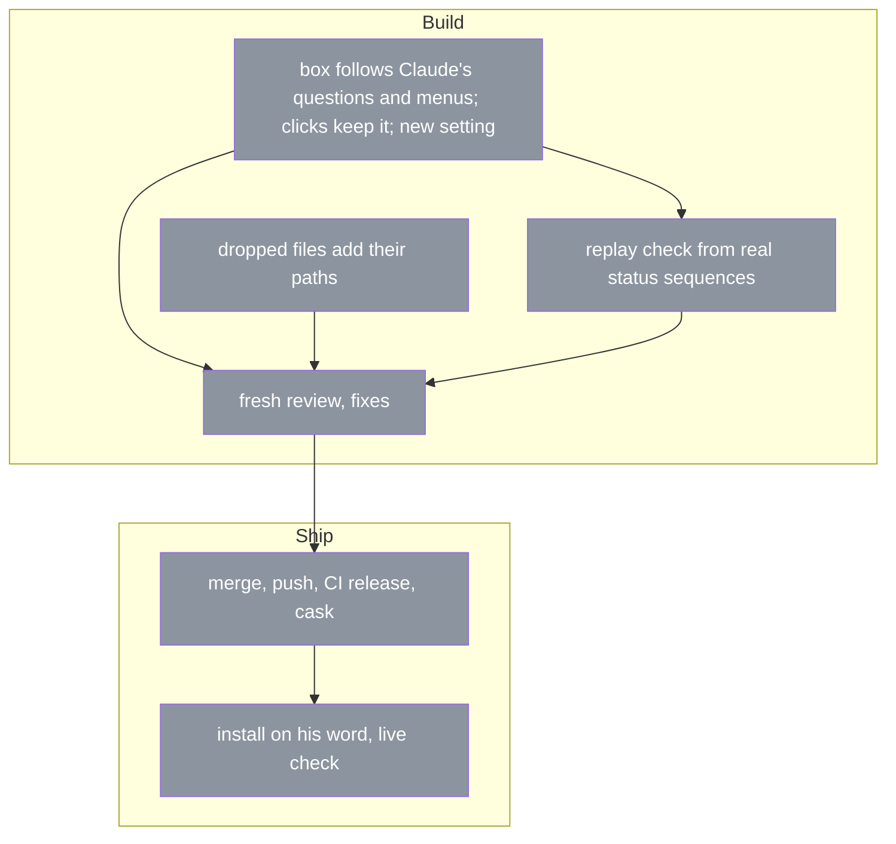

# Patton — The compose box

<!-- MAP:BEGIN -->
## 🗺 THE MAP — S56: an always-open compose box that steps aside when Claude asks

**Goal:** Under every Claude Code tab, a real text box is always open and takes everything Michael types; it steps aside on its own while Claude shows a permission prompt, a question or a menu, and comes back when he has answered. Michael 2026-11-20, on the Claude desktop app's "proper compose box": "How do we get that?", then, on a box opened by hand: "what's the point of one that I have to open manually … I don't know which prompt I'm going to need it for", then "ok" to the always-open design (page: https://claude.ai/code/artifact/503c49fd-8ae5-4501-be32-fe371f388337).
**Done when:** a jsdom check on the real Pane proves, from Claude Code's real status sequences in main.log, that the box steps aside for every question held 250 ms or more and for none of the three shorter flashes, comes back when each ends, keeps the keyboard through a click into the terminal, steps aside after a `/` line until Claude next reports, and that a dropped file's path lands in the box (or the terminal when the box is off); lint, `tsc`, `npm run check`, a no-install package and a fresh review with no open major; released by CI; installed only on Michael's word.
**Last verified:** 2026-11-20 10:45 (Session 56: design settled, nothing built yet)

| ID | Task | Status | Depends on | Evidence |
|----|------|--------|------------|----------|
| `box_core` | Design D1–D4 and D6 below: the `composeBox` setting (on by default), stepping aside on 7501 `blocked` held 250 ms and on a `/` line until Claude's next report, coming back when either ends, a click into the terminal keeping the box's keyboard, `[COMPOSE]` log lines for every switch | todo | — | — |
| `box_drop` | Design D5: a file dropped on a pane adds its escaped path to the box at the caret, or types it into the terminal when the box is off, as Terminal.app does; `scripts/check-file-drop.mjs` | todo | — | — |
| `box_replay` | Design D7: `scripts/check-compose-box.mjs` drives the real Pane with the 25 real question episodes from main.log (10–20 Nov) and the cases in D1–D5; every new assertion fails on main | todo | `box_core` | — |
| `box_review` | Fresh review with probes that never saw the build; every major and minor fixed by a fresh builder; checks re-run | todo | `box_core`, `box_drop`, `box_replay` | — |
| `box_release` | ff-merge to main, push (no stray no-release marker on the head), CI release green, cask sha matches the downloaded DMG | todo | `box_review` | — |
| `box_ship` | Install on Michael's word with Patton quit; live: the box is open under a Claude tab; a permission prompt takes the keyboard and answering hands it back (`[COMPOSE] aside` / `back` in main.log); a click in the terminal leaves typing in the box; a dropped file adds its path | todo | `box_release` | — |
<!-- MAP:END -->

## Why the 6 November box failed, and what is different now

Compose-first (S40, `cb38c2c`…`8af2355`) ran on 6 Nov 2026 from 11:39 to 18:45 in 10 Claude panes (main.log.1): 33 sends, four long drafts (32, 38, 45, 449 lines), 25 clicks into the terminal handing the keyboard over (`[COMPOSE] handoff … route:focus`), 20 reclaims when Claude started work, 15 keys forwarded from the empty box. Then Settings switched it off; no reason recorded; S43: "just leave off". March's earlier box (removed `98a216e`) fought mode guessing and focus theft.

The 6 Nov box had no signal for "Claude is asking you something": it ran on the title glyph and the Stop hook. Since S43 (7 Nov) Patton reads Claude Code's own OSC 7501 reports. main.log 10–20 Nov holds 25 question episodes (12 permission, 8 question, 4 auth, 1 with no kind), each reported as `blocked` when it appeared and left (to `working` 24, `error` 1) when answered; three lasted under 0.1 s (0.06, 0.07, 0.07 s, most likely auto-approved), the rest 6.6 s and up.

## Design (settled; Michael approved the always-open box with "ok", 2026-11-20)

- **D1. The setting.** A new settings key `composeBox` (boolean, on by default, read `!== false` per the electron-store gotcha), Settings label "Compose box under Claude Code tabs", replacing `composeFirst` in the panel, main's store validation, types, constants and `app.ts`. The old `composeFirst` key is no longer read, so the off he set on 6 Nov does not carry over. The per-tab palette override stays, renamed to "Compose box: toggle for this tab". Internal names in `pane.ts` / `tab.ts` may stay `composeFirst*`; only the stored key and the words he sees change.
- **D2. Claude asks: the box steps aside.** While the box is engaged, when the pane's 7501 root is `blocked` (any kind) or a background task's record is `blocked` (Pause all's `taskBlocked`), and that has held 250 ms, the box steps aside: the editor container gets class `aside` (box dimmed through tokens, draft kept), Send's slot shows the label "Answer above" in Send's place (title and an aria-live region carry "Claude is asking you something above · your draft is kept"; the slot is one width in both states and no row is added, so neither the box nor the terminal resizes), and the keyboard moves to the terminal if the box had it or the pane could take it (`canTakeKeyboard()`). If the box had a keydown in the last 1000 ms, the dim is immediate but the keyboard stays until 1000 ms pass with no keydown in the box, and never longer than 3000 ms after the aside began, however steady the typing (logged as `deferredMs` on the aside line, then `[COMPOSE] aside keyboard {pane, afterMs}`); the wait is dropped if the question ends first, if a click in the box chooses the box (`[COMPOSE] aside keyboard kept {pane, reason:'click'}`; the box stays dimmed), or if, when it fires, the pane is off screen or no longer may take the keyboard (`[COMPOSE] aside keyboard dropped`). While Claude asks (the live blocked fact, from its first report, the 250 ms hold or not), Enter, ⌘Enter or Send in the box sends nothing: the draft stays, Send's slot reads "Answer above first" for 1.5 s (also before the box is dimmed; then the slot and its live region show the current words again), `[COMPOSE] send held {pane, held}` at most once a second, `held` counting the sends held since the last line. In that time the box forwards nothing to Claude either: Enter, arrows, Esc, Tab and the rest stay in the box (an empty-box Enter would pick the default option, Esc cancel the question; Esc still hands the keyboard to the terminal), and he answers in the terminal. A `menu` aside keeps forwarding (D3). A drop while aside adds its paths without moving the keyboard, and a box reopened (⌘E) during a question opens aside, the keyboard left where it is. When the blocked state ends (any other root state, no blocked child), the box comes back at once: class removed, and the keyboard returns to the box if the terminal of this pane has it or nothing in the window does (never from a panel, dialog or another pane). A blocked state that ends inside 250 ms changes nothing. Log `[COMPOSE] aside {pane, reason:'blocked', kind}` and `[COMPOSE] back {pane, reason, afterMs}`.
- **D3. A menu he opens: the box steps aside too.** When the box sends a slash command (the trimmed first line matches `^/[A-Za-z][\w:-]*(\s|$)`, so a path such as `/Users/…` does not count; only on a pane with 7501 reports; his own send; not Patton's own typing with origin `patton`, such as the checkpoint button or Pause all), the box steps aside with reason `menu` and the label "Menu above" (full words "Claude may be showing a menu above · click the box to type here"), until the next 7501 report, Stop hook or start of a turn for the pane (the rule Pause all's `menu` fact uses: `slashSubmitAt >= lastSignalAtMs`). A click in the box takes the keyboard back at any time (the hint and dim go when it does). The empty-box key forwarding (arrows, Enter, Esc, Tab, Shift+Tab, Page keys) stays as it is.
- **D4. Clicks into the terminal keep the box's keyboard.** With the box engaged, not aside, and the pane on 7501 reports, a click in the terminal no longer hands the keyboard over: selecting text still works, mouse reports still reach Claude Code, and typing still goes to the box. ⌘C with nothing selected in the box copies this pane's terminal selection. The old click hand-off stays only for a pane without 7501 reports (the status-reports switch off), where nothing says when Claude asks. Esc in a box with a draft still hands over (existing), and ⌘E from the box still closes it (existing).
- **D5. Dropped files.** A file or files dropped on a pane: with the box engaged, their paths go into the box at the caret; otherwise they are typed into the terminal as text, as Terminal.app does. Paths escaped as Terminal.app escapes them (a backslash before spaces and shell specials), joined by spaces, with a trailing space. The path comes from Electron's `webUtils.getPathForFile` through the preload; nothing is read from the file. dragover/drop take `preventDefault` so no drop navigates the window. Log `[DROP] files {pane, count, target}` (no paths in the log).
- **D6. Unchanged.** Send routes (typed line, bracketed paste for multi-line), history, image paste chips, placeholder, the Okay? row, Pause all.
- **D7. The replay check.** `scripts/check-compose-box.mjs` (jsdom, the real Pane, as `check-okay-button.mjs` does) feeds 7501 state sequences with the real timing of the 25 episodes (fixture: state, kind and offsets only, no message text) and asserts D2 per episode (aside for the 22 held ≥ 250 ms, none for the 3 flashes, back at each end, focus where D2 says); then D3 and D4 cases. D5's cases live in `scripts/check-file-drop.mjs`. Each new assertion must fail on main (run it against main's `pane.ts` and record the failures). Added to `npm run check`.
