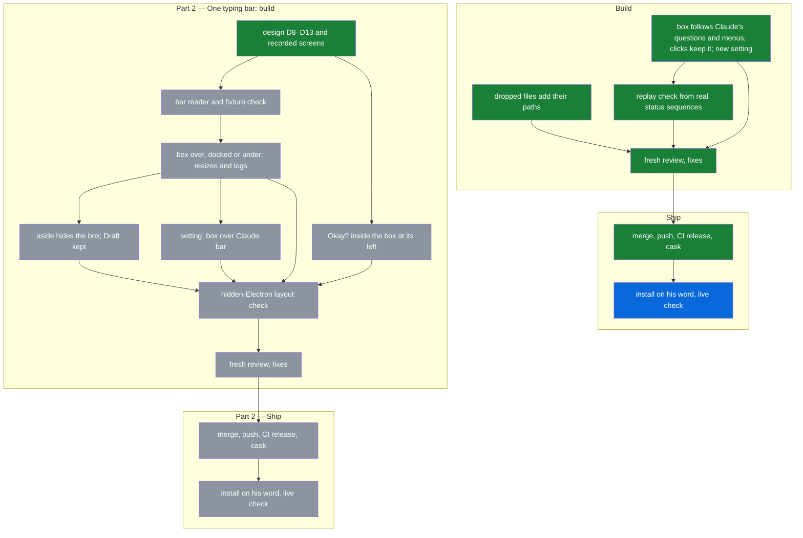

# Patton — The compose box

<!-- MAP:BEGIN -->
## 🗺 THE MAP — S56: an always-open compose box that steps aside when Claude asks; S58: one typing bar

**Goal:** (S58) One typing bar under a Claude Code tab: Patton's box lies over Claude Code's own input bar, found from the screen, with the Okay? button inside the box at its left (Michael 2026-11-20: "the OK button is now in the wrong place"; "we now have two typing bars, which just doesn't look very good"; "ok" to sketch A, https://claude.ai/code/artifact/8bf5f5bc-0dab-4cab-afa2-cd9219a9f1a8).
**Done when:** a hidden-Electron check that feeds the real Pane recorded Claude Code v2.1.321 screens shows the box covering exactly Claude's three bar rows (start-up, mid-turn, after a turn, a queued message), docking on the bottom edge when scrolled up, going under the terminal when Claude's bar holds text or isn't found, hidden with "Draft kept" during a question, Okay? inside it at its left, at UI scale 1, 1.1 and 1.5 (D13); lint, `tsc`, `npm run check`, a no-install package and a fresh review with no open major; released by CI; installed only on Michael's word.
_Previous goal (S56, reached except `box_ship`'s live check):_ Under every Claude Code tab, a real text box is always open and takes everything Michael types; it steps aside on its own while Claude shows a permission prompt, a question or a menu, and comes back when he has answered. Michael 2026-11-20, on the Claude desktop app's "proper compose box": "How do we get that?", then, on a box opened by hand: "what's the point of one that I have to open manually … I don't know which prompt I'm going to need it for", then "ok" to the always-open design (page: https://claude.ai/code/artifact/503c49fd-8ae5-4501-be32-fe371f388337). **Done when:** a jsdom check on the real Pane proves, from Claude Code's real status sequences in main.log, that the box steps aside for every question held 250 ms or more and for none of the three shorter flashes, comes back when each ends, keeps the keyboard through a click into the terminal, steps aside after a `/` line until Claude next reports, and that a dropped file's path lands in the box (or the terminal when the box is off); lint, `tsc`, `npm run check`, a no-install package and a fresh review with no open major; released by CI; installed only on Michael's word.
**Last verified:** 2026-11-20 11:40 (Session 56: build, two fresh reviews, fixes and checks this session)

| ID | Task | Status | Depends on | Evidence |
|----|------|--------|------------|----------|
| `box_core` | Design D1–D4 and D6 below: the `composeBox` setting (on by default), stepping aside on 7501 `blocked` held 250 ms and on a `/` line until Claude's next report, coming back when either ends, a click into the terminal keeping the box's keyboard, `[COMPOSE]` log lines for every switch | done | — | `eac1ef3` (D1 setting), `3a3094b` (D2–D4) · `src/renderer/services/compose-aside.ts`, `pane.ts` compose block |
| `box_drop` | Design D5: a file dropped on a pane adds its escaped path to the box at the caret, or types it into the terminal when the box is off, as Terminal.app does; `scripts/check-file-drop.mjs` | done | — | `ee2b218`, `03b1c02` · `src/renderer/services/file-drop.ts`; `check-file-drop.mjs` 48 |
| `box_replay` | Design D7: `scripts/check-compose-box.mjs` drives the real Pane with the 25 real question episodes from main.log (10–20 Nov) and the cases in D1–D5; every new assertion fails on main | done | `box_core` | `0465dab` · `check-compose-box.mjs` 175 at first, 96 failing on main; 255 after the fixes; layout `6ef83af` (`check-ui-text-scale.cjs` 210: container height, textarea and Send-slot widths equal in every aside state at x1, x1.1, x1.5) |
| `box_review` | Fresh review with probes that never saw the build; every major and minor fixed by a fresh builder; checks re-run | done | `box_core`, `box_drop`, `box_replay` | review 1: 2 major, 4 minor, 2 nit, all fixed `b7e0bac`, `03b1c02`; review 2: 1 major (Enter inside the 250 ms hold approved a prompt), 3 minor, nits, plus broadcast into a blocked pane; all fixed `2ebb0a7`, `0a7af2f`; `npm run check` 30/30 |
| `box_release` | ff-merge to main, push (no stray no-release marker on the head), CI release green, cask sha matches the downloaded DMG | done | `box_review` | pushed `eef0399` (no marker on the head), run 44728983899 green, tag `v1.31.0`, cask 1.31.0 sha `65ad2b08…` matches the downloaded DMG |
| `box_ship` | Install on Michael's word with Patton quit; live: the box is open under a Claude tab; a permission prompt takes the keyboard and answering hands it back (`[COMPOSE] aside` / `back` in main.log); a click in the terminal leaves typing in the box; a dropped file adds its path | live | `box_release` | **S57 (20 Nov 11:55):** installed from tag `v1.31.0` with Patton quit: /Applications reports 1.31.0, asar 11:55:30, `codesign --verify --deep --strict` ok, file list identical to `out/`, `[COMPOSE] aside` in the installed bundle. Live part waits on his sessions in it |
| `bar_design` | Design D8–D13 (one typing bar) settled and written; real Claude Code v2.1.321 screens recorded as the fixture behind D8 | done | — | `docs/compose-box.md` (Design, part 2) · `scripts/fixtures/claude-bar-screens.json` · `docs/mocks/one-typing-bar.html` |
| `bar_reader` | D8: a pure reader of the buffer at the cursor (found / empty / holds text / why) and a check over every fixture step, the `turn` recording and synthetic edge lines | todo | `bar_design` | — |
| `bar_placement` | D9 and D12: the box over Claude's bar, docked on the bottom edge when scrolled up, or under the terminal; the terminal resizes only between under and the overlays; growth upward to a third of the pane; paste strip on the box; wheel to the terminal; `[COMPOSE] place` and `bar not found` logs | todo | `bar_reader` | — |
| `bar_aside` | D10: placement frozen from Claude's first `blocked` report and through any aside; in the overlays the box hides (focusable through D2's typing grace) and "Draft kept" shows with a draft; back where it was after | todo | `bar_placement` | — |
| `okay_in_box` | D11: Okay? inside the box at its left whenever the box is engaged; the row under the terminal only when the box isn't; same ask rules; a press keeps the box's keyboard | todo | `bar_design` | — |
| `over_setting` | D12: Settings row "Lay the compose box over Claude Code's own input bar" (`composeOverBar`, on by default, read `!== false`); off is the v1.31 layout with Okay? inside the box | todo | `bar_placement` | — |
| `bar_layout_check` | D13: hidden-Electron check of the real Pane fed the fixture's bytes, at UI scale 1, 1.1 and 1.5; every new assertion fails on main; `check-compose-box.mjs` and `check-okay-button.mjs` updated, not weakened | todo | `bar_placement`, `bar_aside`, `okay_in_box`, `over_setting` | — |
| `bar_review` | Fresh review with probes that never saw the build; every major and minor fixed by a fresh builder; checks re-run | todo | `bar_layout_check` | — |
| `bar_release` | ff-merge to main, push (no stray no-release marker on the head), CI release green, cask sha matches the downloaded DMG | todo | `bar_review` | — |
| `bar_ship` | Install on Michael's word with Patton quit; live: one bar under a Claude tab, the box over Claude's, Okay? at its left; `[COMPOSE] place` lines in main.log; a question hides it and it comes back | todo | `bar_release` | — |
<!-- MAP:END -->

## Why the 6 November box failed, and what is different now

Compose-first (S40, `cb38c2c`…`8af2355`) ran on 6 Nov 2026 from 11:39 to 18:45 in 10 Claude panes (main.log.1): 33 sends, four long drafts (32, 38, 45, 449 lines), 25 clicks into the terminal handing the keyboard over (`[COMPOSE] handoff … route:focus`), 20 reclaims when Claude started work, 15 keys forwarded from the empty box. Then Settings switched it off; no reason recorded; S43: "just leave off". March's earlier box (removed `98a216e`) fought mode guessing and focus theft.

The 6 Nov box had no signal for "Claude is asking you something": it ran on the title glyph and the Stop hook. Since S43 (7 Nov) Patton reads Claude Code's own OSC 7501 reports. main.log 10–20 Nov holds 25 question episodes (12 permission, 8 question, 4 auth, 1 with no kind), each reported as `blocked` when it appeared and left (to `working` 24, `error` 1) when answered; three lasted under 0.1 s (0.06, 0.07, 0.07 s, most likely auto-approved), the rest 6.6 s and up.

## Design (settled; Michael approved the always-open box with "ok", 2026-11-20)

- **D1. The setting.** A new settings key `composeBox` (boolean, on by default, read `!== false` per the electron-store gotcha), Settings label "Compose box under Claude Code tabs", replacing `composeFirst` in the panel, main's store validation, types, constants and `app.ts`. The old `composeFirst` key is no longer read, so the off he set on 6 Nov does not carry over. The per-tab palette override stays, renamed to "Compose box: toggle for this tab". Internal names in `pane.ts` / `tab.ts` may stay `composeFirst*`; only the stored key and the words he sees change.
- **D2. Claude asks: the box steps aside.** While the box is engaged, when the pane's 7501 root is `blocked` (any kind) or a background task's record is `blocked` (Pause all's `taskBlocked`), and that has held 250 ms, the box steps aside: the editor container gets class `aside` (box dimmed through tokens, draft kept), Send's slot shows the label "Answer above" in Send's place (title and an aria-live region carry "Claude is asking you something above · your draft is kept"; the slot is one width in both states and no row is added, so neither the box nor the terminal resizes), and the keyboard moves to the terminal if the box had it or the pane could take it (`canTakeKeyboard()`). If the box had a keydown in the last 1000 ms, the dim is immediate but the keyboard stays until 1000 ms pass with no keydown in the box, and never longer than 3000 ms after the aside began, however steady the typing (logged as `deferredMs` on the aside line, then `[COMPOSE] aside keyboard {pane, afterMs}`); the wait is dropped if the question ends first, if a click in the box chooses the box (`[COMPOSE] aside keyboard kept {pane, reason:'click'}`; the box stays dimmed), or if, when it fires, the pane is off screen or no longer may take the keyboard (`[COMPOSE] aside keyboard dropped`). While Claude asks (the live blocked fact, from its first report, the 250 ms hold or not), Enter, ⌘Enter or Send in the box sends nothing: the draft stays, Send's slot reads "Answer above first" for 1.5 s (also before the box is dimmed; then the slot and its live region show the current words again), `[COMPOSE] send held {pane, held}` at most once a second, `held` counting the sends held since the last line. In that time the box forwards nothing to Claude either: Enter, arrows, Esc, Tab and the rest stay in the box (an empty-box Enter would pick the default option, Esc cancel the question; Esc still hands the keyboard to the terminal), and he answers in the terminal. A `menu` aside keeps forwarding (D3). Broadcast input (a tab's broadcast mode) skips a pane whose Claude asks, so another pane's typing never answers it: `[BROADCAST] skipped {pane, reason:'blocked'}`. A drop while aside adds its paths without moving the keyboard, and a box reopened (⌘E) during a question opens aside, the keyboard left where it is. When the blocked state ends (any other root state, no blocked child), the box comes back at once: class removed, and the keyboard returns to the box if the terminal of this pane has it or nothing in the window does (never from a panel, dialog or another pane). A blocked state that ends inside 250 ms changes nothing. Log `[COMPOSE] aside {pane, reason:'blocked', kind}` and `[COMPOSE] back {pane, reason, afterMs}`.
- **D3. A menu he opens: the box steps aside too.** When the box sends a slash command (the trimmed first line matches `^/[A-Za-z][\w:-]*(\s|$)`, so a path such as `/Users/…` does not count; only on a pane with 7501 reports; his own send; not Patton's own typing with origin `patton`, such as the checkpoint button or Pause all), the box steps aside with reason `menu` and the label "Menu above" (full words "Claude may be showing a menu above · click the box to type here"), until the next 7501 report, Stop hook or start of a turn for the pane (the rule Pause all's `menu` fact uses: `slashSubmitAt >= lastSignalAtMs`). A click in the box takes the keyboard back at any time (the hint and dim go when it does). The empty-box key forwarding (arrows, Enter, Esc, Tab, Shift+Tab, Page keys) stays as it is.
- **D4. Clicks into the terminal keep the box's keyboard.** With the box engaged, not aside, and the pane on 7501 reports, a click in the terminal no longer hands the keyboard over: selecting text still works, mouse reports still reach Claude Code, and typing still goes to the box. ⌘C with nothing selected in the box copies this pane's terminal selection. The old click hand-off stays only for a pane without 7501 reports (the status-reports switch off), where nothing says when Claude asks. Esc in a box with a draft still hands over (existing), and ⌘E from the box still closes it (existing).
- **D5. Dropped files.** A file or files dropped on a pane: with the box engaged, their paths go into the box at the caret; otherwise they are typed into the terminal as text, as Terminal.app does. Paths escaped as Terminal.app escapes them (a backslash before spaces and shell specials), joined by spaces, with a trailing space. The path comes from Electron's `webUtils.getPathForFile` through the preload; nothing is read from the file. dragover/drop take `preventDefault` so no drop navigates the window. Log `[DROP] files {pane, count, target}` (no paths in the log).
- **D6. Unchanged.** Send routes (typed line, bracketed paste for multi-line), history, image paste chips, placeholder, the Okay? row, Pause all.
- **D7. The replay check.** `scripts/check-compose-box.mjs` (jsdom, the real Pane, as `check-okay-button.mjs` does) feeds 7501 state sequences with the real timing of the 25 episodes (fixture: state, kind and offsets only, no message text) and asserts D2 per episode (aside for the 22 held ≥ 250 ms, none for the 3 flashes, back at each end, focus where D2 says); then D3 and D4 cases. D5's cases live in `scripts/check-file-drop.mjs`. Each new assertion must fail on main (run it against main's `pane.ts` and record the failures). Added to `npm run check`.

## Design, part 2: one typing bar (settled; Michael approved A with "ok", 2026-11-20 12:23)

Michael, 20 Nov 12:10, on v1.31.0 (screenshot of the Okay? row between the terminal and the box): "I think the OK button is now in the wrong place", then "we now have two typing bars, which just doesn't look very good. Is there a way to [re]move? Maybe that's what we have to do." Sketch page with A to D: https://claude.ai/code/artifact/8bf5f5bc-0dab-4cab-afa2-cd9219a9f1a8 (source `docs/mocks/one-typing-bar.html`); he chose A ("ok"). Claude Code v2.1.321 has no setting, environment switch or terminal capability that hides its own input bar (checked in the installed binary: every setting description, the environment switches, the eight terminal capabilities it probes), so Patton covers it.

- **D8. Claude's bar, found from the screen.** After every redraw Claude Code (classic renderer) parks the terminal's cursor on its own input line. The bar is *found* when, in the active buffer at the cursor's row R, line R starts with `❯` and lines R−1 and R+1 are each one or more `─` and nothing else (trailing blanks ignored). A found bar is *empty* when every cell on R after the `❯` and its space is blank, or dim (SGR 2: Claude's own hint, such as "Press up to edit queued messages"), or the inverse caret cell when that cell is blank or the text after it is dim; any other non-blank cell (typed text, which is drawn in the default colour, a `/`, a pasted path) means it *holds text*. Readings are taken at rest: after xterm has parsed a write (`onWriteParsed`), at most once per animation frame, and on scroll and resize. A reading that doesn't match keeps the last good position (in a real turn 4 of 26 output bursts ended mid-redraw, the cursor on the footer); the bar counts as *lost* only when no reading has matched for 400 ms. Evidence, `scripts/fixtures/claude-bar-screens.json` (recorded 20 Nov, v2.1.321, 100×30): found and empty at start-up, mid-turn, after a turn and with a queued message (the queue renders above the bar); found holding text with typed text and with `/`; not found with wrapped input, multi-line input, a recalled history entry (its top rule reads `─── History n/m ───`) and a question dialog (its `❯ 1.` row has no rules beside it).
- **D9. Where the box goes, while engaged and not aside.**
  - `over`: the bar is found and empty and its three rows are all in the viewport. The box lies over those three rows as an overlay inside the terminal container: its left and right edges on the terminal grid's, its top on the top of row R−1 and its bottom on the bottom of row R+1, opaque in the terminal's background so nothing of Claude's bar shows through. Taller contents (a long draft, a large UI scale) grow it upward from that bottom edge, up to a third of the pane, then the text scrolls inside it. The terminal takes the pane's whole height: neither the box nor the Okay? row takes rows under it.
  - `dock`: the bar is found and empty but he has scrolled up, so its rows aren't all in view. The same overlay sits on the terminal's bottom edge, with a hairline on its top edge, until he scrolls back down.
  - `under`: the bar is lost or holds text, or `composeOverBar` is off, or no reading has matched yet in this session. The box sits under the terminal in the flow, as in v1.31 (with Okay? inside it, D11).
  - While the keyboard is handed to Claude's own bar (`composeHandedOff`: Esc with a draft), `under`, so he sees both; placement is worked out again when the box takes the keyboard back.
  - Changes: `under` → `over` or `dock` on the first matching reading; `over` or `dock` → `under` at once when the bar holds text, and 400 ms after the last match when it is lost; `over` ↔ `dock` on scroll. The terminal resizes only on a change between `under` and the overlays, never while the overlay grows or shrinks. Every change logs `[COMPOSE] place {pane, placement, from, reason}` (reason: found, scrolled, in-view, holds-text, lost, handoff, setting, aside-end); a lost bar also logs `[COMPOSE] bar not found {pane, why}` (why: no-glyph, no-rule-above, no-rule-below) at most once a minute per pane, so main.log tells a changed Claude Code from a passing screen.
- **D10. Claude asks, or a menu may be open.** From Claude's first `blocked` report (the live fact, before the 250 ms hold) and for as long as an aside (D2, D3) lasts, placement is frozen: no reading changes it, since the question or menu replaces Claude's bar. In `over` or `dock` the aside hides the box: at once it turns fully transparent and stops taking the pointer; while D2's typing grace keeps the keyboard in it, it stays focusable (opacity, not `visibility: hidden`, which would drop the keyboard); after that, `visibility: hidden`. While the hidden box holds a draft, a small note "Draft kept" sits at the pane's bottom right (its own outline, no click, announced once through an aria-live region). In `under` the aside is the v1.31 one (dimmed in place, the label in Send's slot). When the aside ends the box comes back where it was and placement resumes; if the bar isn't found within 400 ms, `under`. D2's and D3's rules for keys, sends and the keyboard are unchanged.
- **D11. Okay? sits inside the box, at its left,** whenever the box is engaged, in every placement; it hides with the box during an aside. Same behaviour as the row's (`services/okay-ask.ts`): one ask at a time, Sent / Queued / the refusal for 3 s; a press doesn't take the keyboard from the box (mousedown `preventDefault`). The Okay? row under the terminal shows only while Claude runs and the box is not engaged (the box off, or closed with ⌘E), as in v1.28–v1.30. Michael 18 Nov: "a button in the bottom left"; 20 Nov: "the OK button is now in the wrong place".
- **D12. The rest.** In `over` and `dock` the paste strip (image thumbnails) sits on the box's top edge. A wheel over the box, outside a textarea that can still scroll that way, scrolls the terminal. D4 (clicks in the terminal keep the box's keyboard) is unchanged. Settings gains "Lay the compose box over Claude Code's own input bar" (`composeOverBar`, on by default, read `!== false`), just under the compose box setting; off gives the v1.31 layout with Okay? inside the box. The overlay is three terminal rows tall at every Font Size and UI scale where its contents fit, and grows upward where they don't.
- **D13. Checks.** A pure reader (`services/claude-bar.ts`) takes the buffer's lines and cells at the cursor and returns found / empty / holds text / why; a check runs it over every marked step of the fixture against the fixture's `expected` verdicts, over every chunk of the `turn` recording (at least 22 of 26 found), and over synthetic edge lines (dim hint, caret on a typed letter, a labelled rule, a lone `❯`). A hidden-Electron check (as `check-ui-text-scale.cjs` does) mounts the real Pane with a stub bridge, feeds the fixture's bytes through its real terminal, and measures, at UI scale 1, 1.1 and 1.5: in `over` the box's rectangle covers rows R−1 to R+1 within 1 px and no other row; the terminal's row count is the whole pane's; `dock` after scrolling up and `over` again after scrolling down; `under` on the typed, wrapped, multi-line and history screens, and over again once cleared; during the question screen with a draft, the box hidden and "Draft kept" shown, and the box back after; Okay? inside the box at its left and no Okay? row; with `composeOverBar` off, `under` throughout. The jsdom checks of the box (`check-compose-box.mjs`, `check-okay-button.mjs`) are updated, not weakened. Every new assertion fails on main.
