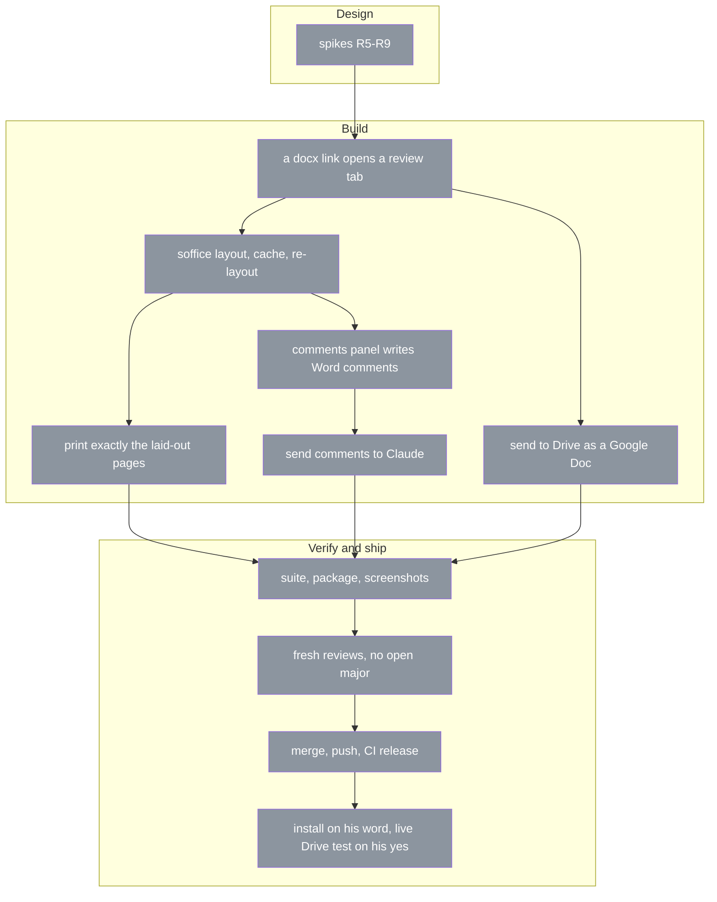

# Patton — The review tab (designed S60, building S61)

<!-- MAP:BEGIN -->
## 🗺 THE MAP — S61: Word files open in a Patton review tab

**Goal:** (S61) A .docx Claude links to opens in a Patton tab laid out as LibreOffice prints it, printable, sendable to his Drive as a Google Doc, with comments he adds on selected text saved into the file as real Word comments and sent to Claude in one message; Open in Word one click away.
**Done when:** a .docx opened from a file link (terminal or the session bar's Links) shows the same page count as `soffice --headless --convert-to pdf` of it; Print opens the print dialog with exactly those pages; Send to Drive uploads it as a Google Doc and shows the Doc's link (proven against a dry run until his yes); a comment added on selected text lands in `word/comments.xml` and LibreOffice renders it in the margin; "Send comments to Claude" types them into the tab's Claude session as one message; Open in Word is one click.
**Last verified:** 2026-11-22 (Session 61: map written)

| ID | Task | Status | Depends on | Evidence |
|----|------|--------|------------|----------|
| `rt_spike` | Answer the open questions (R5-R9) by probe | todo | — | — |
| `rt_open` | A .docx file link (terminal, session bar) opens the review tab; .docm refused; other Office files unchanged | todo | `rt_spike` | — |
| `rt_layout` | soffice to PDF in a private profile, timeout, cached by mtime, re-laid out on change; pdf.js pages; missing soffice message | todo | `rt_open` | — |
| `rt_print` | Print opens the dialog with exactly the laid-out pages | todo | `rt_layout` | — |
| `rt_drive` | Send to Drive as a Google Doc, link shown and added to Links; Lindus files ask first | todo | `rt_open` | — |
| `rt_comments` | Comment on selected text, saved as a real Word comment | todo | `rt_layout` | — |
| `rt_claude` | Send comments to Claude as one message | todo | `rt_comments` | — |
| `rt_check` | Lint, types, `npm run check`, package (asar mtime), light and dark screenshots | todo | `rt_print`, `rt_drive`, `rt_claude` | — |
| `rt_review` | Fresh reviews with probes, every finding fixed | todo | `rt_check` | — |
| `rt_release` | Merge to main, push, CI release | todo | `rt_review` | — |
| `rt_ship` | Install on his word; the first real Drive upload on his yes | todo | `rt_release` | — |
<!-- MAP:END -->

Michael, 22 Nov 2026: "Capability to open docs in new tab within patton like its a word doc but without having to go into the Word downloads folder and then open Word", then, on the four-option page (https://claude.ai/code/artifact/14acb684-5b55-4851-a978-e6c7db7251d3, `docs/mocks/document-tab.html`): "all your options look the same. Let's just think about the functionality", with four needs:

- "I want the formatting to be preserved."
- "I want it to be printable, like our Word docs are right now."
- "I want it to be able to go straight onto G Drive if some of these things are going to G Drive as a Google Doc."
- "Ideally, I want to be able to add comments in the pane and for the original thing, to be able to see them." On who sees them, he chose both the Word file and Claude ("1 ok", 16:29).

He approved the design for building on 22 Nov 2026 ("ok").

## Design

- **R1. Layout.** A Word file opens in a Patton tab laid out by LibreOffice (`/opt/homebrew/bin/soffice --headless --convert-to pdf`, private profile, comments in the margin via `ExportNotesInMargin`), shown in Electron's built-in PDF viewer. About 1–2 s for a one-page file. Re-laid out when the file changes.
- **R2. Print.** A Print button prints the PDF as shown.
- **R3. Send to Drive.** A "Send to Drive" button uploads the .docx converted to a Google Doc (Drive API with `gcloud auth print-access-token --account michaeljryoung@gmail.com`, or `rclone copy --drive-import-formats docx` to `gdrive:`), shows the Doc's link, and adds it to the session bar's Links. Personal Drive; a Lindus document asks first (his rule on Lindus accounts). Word comments carry into the Google Doc.
- **R4. Comments.** Select text in the tab and add a comment in a side panel. Patton writes it into the .docx as a real Word comment, anchored by the quoted text, so Word, the Google Doc and Claude all see it. A "Send comments to Claude" button types them into the tab's Claude session for a revision.
- **Dropped:** a live claude.ai page in Patton (would hold his claude.ai login; Google sign-in may refuse embedded browsers), docx-preview's web view (no page breaks in 383 of his last 503 Word files), Quick Look, mammoth (drops deleted text).
- **Open questions for the build:** printing from Electron's PDF viewer inside a tab (verify); anchoring a comment selected in the PDF back to the .docx text (quote match, first occurrence after the page's start); which Drive folder.
