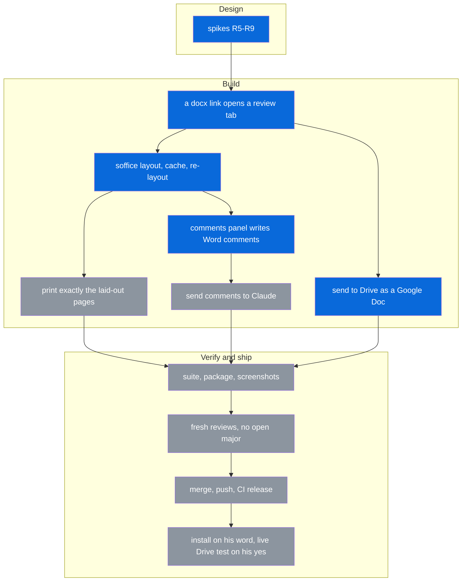

# Patton — The review tab (designed S60, building S61)

<!-- MAP:BEGIN -->
## 🗺 THE MAP — S61: Word files open in a Patton review tab

**Goal:** (S61) A .docx Claude links to opens in a Patton tab laid out as LibreOffice prints it, printable, sendable to his Drive as a Google Doc, with comments he adds on selected text saved into the file as real Word comments and sent to Claude in one message; Open in Word one click away.
**Done when:** a .docx opened from a file link (terminal or the session bar's Links) shows the same page count as `soffice --headless --convert-to pdf` of it; Print opens the print dialog with exactly those pages; Send to Drive uploads it as a Google Doc and shows the Doc's link (proven against a dry run until his yes); a comment added on selected text lands in `word/comments.xml` and LibreOffice renders it in the margin; "Send comments to Claude" types them into the tab's Claude session as one message; Open in Word is one click.
**Last verified:** 2026-11-22 (Session 61: main half built and checked; renderer half not started)

| ID | Task | Status | Depends on | Evidence |
|----|------|--------|------------|----------|
| `rt_spike` | Answer the open questions (R5-R9) by probe | live | — | R5-R10 below; spikes (a), (c), (d) proven by probe; (b) print designed (R6), not yet probed |
| `rt_open` | A .docx file link (terminal, session bar) opens the review tab; .docm refused; other Office files unchanged | live | `rt_spike` | main half only: `ipc-handlers.ts` sends `review:open` for a .docx (`review-docs.ts::openReview`); NO renderer listener yet, so on this branch a .docx link does nothing until the renderer half lands |
| `rt_layout` | soffice to PDF in a private profile, timeout, cached by mtime, re-laid out on change; pdf.js pages; missing soffice message | live | `rt_open` | main half: `src/main/review-layout.ts` (private seeded profile, execFile, 90 s timeout, cache by path+mtime+size, VBA refused), probe: 2 pages in 2.0 s, cached 1 ms, profile keeps macros off after first run; pdf.js view not built |
| `rt_print` | Print opens the dialog with exactly the laid-out pages | todo | `rt_layout` | — |
| `rt_drive` | Send to Drive as a Google Doc, link shown and added to Links; Lindus files ask first | live | `rt_open` | main half: `src/main/drive-upload.ts` (Drive API, dry run via `PATTON_DRIVE_DRY_RUN=1`); no check yet; no UI |
| `rt_comments` | Comment on selected text, saved as a real Word comment | live | `rt_layout` | main half done: `src/main/docx-zip.ts`, `docx-comments.ts`, `review-docs.ts` ADD_COMMENT (atomic replace, Word lock refused) · `node scripts/check-review-comments.mjs` 22 ok incl. LibreOffice margin render and .odt with 2 annotations; panel not built |
| `rt_claude` | Send comments to Claude as one message | todo | `rt_comments` | — |
| `rt_check` | Lint, types, `npm run check`, package (asar mtime), light and dark screenshots | todo | `rt_print`, `rt_drive`, `rt_claude` | — |
| `rt_review` | Fresh reviews with probes, every finding fixed | todo | `rt_check` | — |
| `rt_release` | Merge to main, push, CI release | todo | `rt_review` | — |
| `rt_ship` | Install on his word; the first real Drive upload on his yes | todo | `rt_release` | — |
<!-- MAP:END -->

Michael, 22 Nov 2026: "Capability to open docs in new tab within patton like its a word doc but without having to go into the Word downloads folder and then open Word", then, on the four-option page (https://claude.ai/code/artifact/14acb684-5b55-4851-a978-e6c7db7251d3, `docs/mocks/document-tab.html`): "all your options look the same. Let's just think about the functionality", with four needs:

- "I want the formatting to be preserved."
- "I want it to be printable, like our Word docs are right now."
- "I want it to be able to go straight onto G Drive if some of these things are going to G Drive as a Google Doc."
- "Ideally, I want to be able to add comments in the pane and for the original thing, to be able to see them." On who sees them, he chose both the Word file and Claude ("1 ok", 16:29).

He approved the design for building on 22 Nov 2026 ("ok").

## Design

- **R1. Layout.** A Word file opens in a Patton tab laid out by LibreOffice (`/opt/homebrew/bin/soffice --headless --convert-to pdf`, private profile, comments in the margin via `ExportNotesInMargin`), shown in Electron's built-in PDF viewer. About 1–2 s for a one-page file. Re-laid out when the file changes.
- **R2. Print.** A Print button prints the PDF as shown.
- **R3. Send to Drive.** A "Send to Drive" button uploads the .docx converted to a Google Doc (Drive API with `gcloud auth print-access-token --account michaeljryoung@gmail.com`, or `rclone copy --drive-import-formats docx` to `gdrive:`), shows the Doc's link, and adds it to the session bar's Links. Personal Drive; a Lindus document asks first (his rule on Lindus accounts). Word comments carry into the Google Doc.
- **R4. Comments.** Select text in the tab and add a comment in a side panel. Patton writes it into the .docx as a real Word comment, anchored by the quoted text, so Word, the Google Doc and Claude all see it. A "Send comments to Claude" button types them into the tab's Claude session for a revision.
- **Dropped:** a live claude.ai page in Patton (would hold his claude.ai login; Google sign-in may refuse embedded browsers), docx-preview's web view (no page breaks in 383 of his last 503 Word files), Quick Look, mammoth (drops deleted text).
- **Open questions for the build:** printing from Electron's PDF viewer inside a tab (verify); anchoring a comment selected in the PDF back to the .docx text (quote match, first occurrence after the page's start); which Drive folder.

## Decisions from the spikes (S61)

- **R5. pdf.js, not Electron's PDF viewer.** A hidden Electron 44.9.3 window with `plugins: true` showing the PDF exposes no guest webContents (`getAllWebContents()` lists only the window), and after `selectAll()` the page's `getSelection()` is empty: the viewer's text is out of Patton's reach. Patton's window also runs sandboxed with `object-src 'none'`. So pages are drawn by `pdfjs-dist` 6.5.438 (devDependency: Vite bundles it into the renderer; no install scripts; its optional `@napi-rs/canvas` is unused in the renderer) on canvases with pdf.js's text layer, so selection, print and highlights are Patton's own. Run it with `isEvalSupported: false`; its worker is a bundled `?url` asset under `script-src 'self'` (to prove in the packaged build).
- **R6. Print (designed, not yet probed).** Render each page to an image at print resolution into a print-only container, `@page { size: <page size>; margin: 0 }`, one page per sheet, everything else hidden under `@media print`, then `window.print()`. Proof: `webContents.printToPDF` of the tab gives the same page count as `soffice --convert-to pdf`.
- **R7. Comments.** Anchored by quote: both sides stripped of whitespace, NFKC-normalised, soft hyphens and zero-width marks dropped; the occurrence is the count of the same key in the PDF text before the selection; a count past the body's last match takes the last (headers, footers and margin comments are in the PDF, not the body). Written as real OOXML (`commentRangeStart/End`, a `commentReference` run, `word/comments.xml`, its relationship and content type), splitting runs with their own properties; other parts copied byte for byte. Proven: a python-docx file with two comments re-opens in LibreOffice 26.8 with both in the margin, page count unchanged (2). The file is replaced atomically; refused while Word holds it (`~$` owner file).
- **R8. Drive: the Drive API with his personal gcloud login, not rclone.** This Mac's `gdrive:` remote is the Lindus Drive (its folders are Lindus trial material) with scope `drive.readonly`, so it could neither take an upload nor reach his personal Drive. `gcloud auth print-access-token --account <personal>` already carries the `drive` scope (tokeninfo, 22 Nov), so no new access is asked for. Multipart upload with `mimeType: application/vnd.google-apps.document` converts it; the folder (setting `driveFolder`, default "Patton") is found or made at the top of My Drive; the reply's `webViewLink` is the Doc's link. The account is the setting `driveAccount`, else the one @gmail.com account gcloud holds. Each send makes a new Doc (not yet checked live).
- **R9. Where a review tab lives.** A normal Patton tab (a shell in the origin pane's folder) carrying the review view as its cover (`Tab.setCover`, as the project board does), titled with the file name, so close, groups and the strip need no new tab kind. "Send comments to Claude" types into the pane that was focused when the link opened. Not restored after a relaunch (the tab comes back as its shell).
- **R10. Threat model.** soffice runs by execFile on a copy named `document.docx` in a fresh private temp folder, in Patton's own profile seeded with `DisableMacrosExecution`, `MacroSecurityLevel` 3, `BlockUntrustedRefererLinks` and links not updated (kept by LibreOffice after its first run, probe); a file with `vbaProject.bin` is refused and `.docm` is revealed by the link policy; 50 MB cap, zip64/encrypted/odd compression refused, inflate bounded. Main holds the real path under an opaque id per window and re-checks it (regular, not executable, `.docx`) on every action. The token never leaves main or reaches a log. Document text reaches the DOM only through pdf.js's text layer (textContent) and the comment list (textContent, never innerHTML). Residual: LibreOffice may still fetch remote images a file links to.
