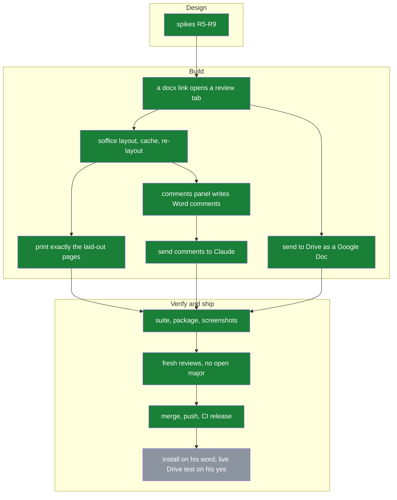

# Patton — The review tab (designed S60, building S61)

<!-- MAP:BEGIN -->
## 🗺 THE MAP — S61: Word files open in a Patton review tab

**Goal:** (S61) A .docx Claude links to opens in a Patton tab laid out as LibreOffice prints it, printable, sendable to his Drive as a Google Doc, with comments he adds on selected text saved into the file as real Word comments and sent to Claude in one message; Open in Word one click away.
**Done when:** a .docx opened from a file link (terminal or the session bar's Links) shows the same page count as `soffice --headless --convert-to pdf` of it; Print opens the print dialog with exactly those pages; Send to Drive uploads it as a Google Doc and shows the Doc's link (proven against a dry run until his yes); a comment added on selected text lands in `word/comments.xml` and shows in the side panel with its highlight on the page, the pages staying at 100% (no margin notes, as Word prints by default); "Send comments to Claude" types the ones not yet sent into the tab's Claude session as one message; Open in Word is one click.
**Last verified:** 2026-11-22 22:21 (Session 61 combine: `fix/review-tab-main` merged; layout version on comments, main's Lindus check in the panel, bounded Print, gated checkpoint and Pause all Enters; lint, tsc, `npm run check` 52/52, no-install asar 22:19, `check-review-tab.cjs` 76 ok against it; a fresh review of the combine not yet done)

| ID | Task | Status | Depends on | Evidence |
|----|------|--------|------------|----------|
| `rt_spike` | Answer the open questions (R5-R9) by probe | done | — | R5-R10 below; spikes (a), (c), (d) proven by probe; (b) print designed (R6), not yet probed **S61:** R5–R10 recorded above |
| `rt_open` | A .docx file link (terminal, session bar) opens the review tab; .docm refused; other Office files unchanged | done | `rt_spike` | renderer half built (`services/review-tabs.ts`, `components/review-view.ts`); `node scripts/check-review-tab.cjs` (hidden Electron, real main half and LibreOffice) 42 ok, 44 with `REVIEW_ASAR`: review:open makes a tab titled with the file name; `check-link-open-policy.mjs` 146 ok (a .docx goes to the review tab, or to Word with `reviewTab` off; macro-enabled files revealed); not yet seen in the installed app **S61:** released in v1.38.0; `check-review-tab.cjs` 76 ok on the packaged asar, `check-link-open-policy.mjs` |
| `rt_layout` | soffice to PDF in a private profile, timeout, cached by mtime, re-laid out on change; pdf.js pages; missing soffice message | done | `rt_open` | main half as before; pdf.js pages + text layer drawn (`services/review-pdf.ts`), worker mode logged; the worker is started by Patton (the packaged CSP refuses pdf.js's own blob: wrapper) from a URL `index.ts` hands in through `setPdfWorkerUrl`; check: 2 pages = soffice's 2, pdf.js in its Web Worker; against the built asar (21:06 on 22 Nov, `REVIEW_ASAR`) the packaged worker asset starts as a real Web Worker under the app's CSP and opens the PDF (2 pages); the status line shows the page count (and again after Print); the comment's highlight is snapped to the page's ink (`services/review-ink.ts`): the check reads the canvas itself and finds ink at both edges and a gap just outside **S61:** released in v1.38.0; page count equals soffice on a 3-page docx with a table and an image (fresh grader), no margin notes, profile URL encoded |
| `rt_print` | Print opens the dialog with exactly the laid-out pages | done | `rt_layout` | pages at 200 dpi in a print-only container, @page per size, `window.print()`; check: printToPDF of the window 2 pages = soffice's 2, afterprint cleans up; the real print dialog not yet seen (nothing in these checks opens it); **S61 combine:** bounded: one canvas reused, each page a JPEG blob behind an ``, decoded only at print; a 100-page file: printToPDF 100 pages, each with its 1653 × 2338 page image (`pdfimages`), app peak +58 MB (it was +1,117 MB drawing all at once; PNG blobs +653 MB, 600 of it the print compositor); the 3-page check file prints 3 pages, each imaged; CSP `img-src` takes `blob:` **S61:** released in v1.38.0; printToPDF page count equals the layout, 100-page print +57 MB |
| `rt_drive` | Send to Drive as a Google Doc, link shown and added to Links; Lindus files ask first | done | `rt_open` | `src/main/drive-upload.ts`, `scripts/check-drive-upload.mjs`; one real upload on his yes, 22 Nov 23:00: personal account, Google Doc in `Patton`, text and table intact, test doc deleted (S61) |
| `rt_comments` | Comment on selected text, saved as a real Word comment | done | `rt_layout` | panel built; check: text selected on page 2 -> comment in `word/comments.xml`, anchored in page 2's paragraph, listed in the panel, LibreOffice still 2 pages; the check's file now has a table and a picture (both seen on page 1); `check-review-comments.mjs` 21 ok; **S61 combine:** merged `fix/review-tab-main` (valid XML for tracked-change runs, guarded atomic save with LibreOffice re-open and backups in userData, per-file queue): `check-review-comments.mjs` 39 ok, `check-review-write.mjs` 14 ok; the renderer now sends the layout's `version` with each comment (checked equal to the file's mtime:size it was selected on), and a comment on an outdated layout is refused by main, the file untouched, the panel saying so, his text kept and the file laid out again (hidden-Electron check) **S61:** released in v1.38.0; `check-review-comments.mjs`, `check-review-write.mjs` (guarded atomic save, LibreOffice re-open) |
| `rt_claude` | Send comments to Claude as one message | done | `rt_comments` | `Pane.pasteReviewComments`: one bracketed paste then Enter, refused while 7501 blocked (re-checked at write); check: pasted message holds the comment, origin tab shown, blocked -> visible note and no pty write; **S61 combine:** the checkpoint's `/checkpoint` and Pause all's `pause` now gate on the same live 7501 `blocked` fact at the write and at the Enter (`Pane.asksNowRefusal`): `check-pause-all.mjs` 118 ok, 8 of its 10 new assertions fail on the code before **S61:** released in v1.38.0; one paste then a gated Enter, refused while blocked (`check-review-tab.cjs`, §9.14) |
| `rt_check` | Lint, types, `npm run check`, package (asar mtime), light and dark screenshots | done | `rt_print`, `rt_drive`, `rt_claude` | `npm run check` 54/54 and `check-review-tab.cjs` 76 ok on the packaged asar, `integrate/s61` `b989d65` (S61) |
| `rt_review` | Fresh reviews with probes, every finding fixed | done | `rt_check` | three fresh reviews (main side, renderer with the bar graded, fix round), every finding fixed incl. two criticals: `68a0c02`, `8ce22b8`, `9bf91a6`, `b85d076`, `ed7282f`, `d554885`, `7a42183` (S61) |
| `rt_release` | Merge to main, push, CI release | done | `rt_review` | main `1e270d6`, run 45134218680 green, tag `v1.38.0`, cask `218b4a84…` equals the DMG digest (S61) |
| `rt_ship` | Install on his word; the first real Drive upload on his yes | todo | `rt_release` | — |
<!-- MAP:END -->

Michael, 22 Nov 2026: "Capability to open docs in new tab within patton like its a word doc but without having to go into the Word downloads folder and then open Word", then, on the four-option page (https://claude.ai/code/artifact/14acb684-5b55-4851-a978-e6c7db7251d3, `docs/mocks/document-tab.html`): "all your options look the same. Let's just think about the functionality", with four needs:

- "I want the formatting to be preserved."
- "I want it to be printable, like our Word docs are right now."
- "I want it to be able to go straight onto G Drive if some of these things are going to G Drive as a Google Doc."
- "Ideally, I want to be able to add comments in the pane and for the original thing, to be able to see them." On who sees them, he chose both the Word file and Claude ("1 ok", 16:29).

He approved the design for building on 22 Nov 2026 ("ok").

## Design

- **R1. Layout.** A Word file opens in a Patton tab laid out by LibreOffice (`/opt/homebrew/bin/soffice --headless --convert-to pdf`, private profile), drawn by pdf.js (R5). About 1–2 s for a one-page file. Re-laid out when the file changes. **Without margin notes** (S61 review): `ExportNotesInMargin` made LibreOffice shrink every page to 75% once a file had one comment, on screen and in print; the pages now show and print at 100%, as Word prints by default, and comments live in the side panel with their highlights on the page (`ExportNotes` off too, so none ride along as PDF annotations). The filter is part of the layout cache's key. Only pages within a screen of the view keep a canvas (a 100-page file at DPR 2 held ~1.3 GB of canvases; now 2–3 pages, ~40 MB, measured); a hidden tab keeps what it drew. A selection keeps the pages it touches drawn up to 3 pages; a longer one (Cmd+A) keeps only the pages its two ends sit on (S61 final fixes: Cmd+A over 40 pages had kept every one).
- **R2. Print.** A Print button prints the PDF as shown.
- **R3. Send to Drive.** A "Send to Drive" button uploads the .docx converted to a Google Doc (Drive API with `gcloud auth print-access-token --account michaeljryoung@gmail.com`, or `rclone copy --drive-import-formats docx` to `gdrive:`), shows the Doc's link, and adds it to the session bar's Links. Personal Drive; a Lindus document asks first (his rule on Lindus accounts). Word comments carry into the Google Doc.
- **R4. Comments.** Select text in the tab and add a comment in a side panel. Patton writes it into the .docx as a real Word comment, anchored by the quoted text, so Word, the Google Doc and Claude all see it. A "Send comments to Claude" button types them into the tab's Claude session for a revision: the comments not yet sent (every author's, each with its author and the text it is on), counted on the button ("Send 3 comments to Claude") and marked sent in the panel once Claude has them (remembered per file for the run of Patton). The paste and its Enter are each gated on the live 7501 `blocked` fact: if Claude starts asking in between, no Enter goes, the note says the comments sit unsent in Claude's input, and they stay unsent.
- **Dropped:** a live claude.ai page in Patton (would hold his claude.ai login; Google sign-in may refuse embedded browsers), docx-preview's web view (no page breaks in 383 of his last 503 Word files), Quick Look, mammoth (drops deleted text).
- **Open questions for the build:** printing from Electron's PDF viewer inside a tab (verify); anchoring a comment selected in the PDF back to the .docx text (quote match, first occurrence after the page's start); which Drive folder.

## Decisions from the spikes (S61)

- **R5. pdf.js, not Electron's PDF viewer.** A hidden Electron 44.9.3 window with `plugins: true` showing the PDF exposes no guest webContents (`getAllWebContents()` lists only the window), and after `selectAll()` the page's `getSelection()` is empty: the viewer's text is out of Patton's reach. Patton's window also runs sandboxed with `object-src 'none'`. So pages are drawn by `pdfjs-dist` 6.5.438 (devDependency: Vite bundles it into the renderer; no install scripts; its optional `@napi-rs/canvas` is unused in the renderer) on canvases with pdf.js's text layer, so selection, print and highlights are Patton's own. (`isEvalSupported` no longer exists in 6.5: pdf.js has no eval to turn off, read S61); its worker is a bundled `?url` asset under `script-src 'self'` (to prove in the packaged build).
- **R6. Print.** Each page is drawn at 200 dpi, one at a time on one reused canvas, and kept only as a JPEG blob (quality 0.95) behind an `` (a `blob:` URL, never decoded ahead) in a print-only container, `@page { size: <page size>; margin: 0 }`, one page per sheet, everything else hidden under `@media print`, then `window.print()`; the status line counts the pages while it prepares a long file. Chromium decodes each image only as it prints that sheet. Proof: `webContents.printToPDF` of the tab gives the same page count as `soffice --convert-to pdf`. Memory (S61, a 100-page file, every process of the app sampled every 100 ms through `printToPDF`): drawing every page and decoding it ahead (PNG data URLs, `img.decode()`) grew the app by 1,117 MB at its peak (532 MB in the page); PNG blobs decoded only at print time grew it by 653 MB, 600 MB of it in Chromium's print compositor; JPEG blobs grow it by 58 MB (the compositor by 0, the page by 38 MB; about 6 MB of JPEG held), and the printed PDF carries each page as that JPEG (`pdfimages`: 1653 × 2338, 200 ppi). Text at 300 dpi reads the same as from the PNGs, by eye. `img-src` in the app's CSP takes `blob:` for these (scripts and workers still don't). Printing the laid-out PDF itself was not taken: it needs Chromium's PDF viewer in a window of its own, whose printing from Electron was not probed, and `lp` would skip the print dialog.
- **R7. Comments.** Anchored by quote: both sides stripped of whitespace, NFKC-normalised, soft hyphens and zero-width marks dropped; the occurrence is the count of the same key in the PDF text before the selection; a count past the body's last match takes the last (headers, footers and margin comments are in the PDF, not the body). Written as real OOXML (`commentRangeStart/End`, a `commentReference` run, `word/comments.xml`, its relationship and content type), splitting runs with their own properties; other parts copied byte for byte. Proven: a python-docx file with two comments re-opens in LibreOffice 26.8 with both in the margin, page count unchanged (2). Run properties are read whole (a `w:rPrChange` holds a nested `w:rPr`) and runs nest (a text box inside a run), strict-OOXML and `../` comment targets are followed (an external one is refused), and a selection may cross a tracked deletion (`w:delText` is in the key; the reference run goes after the deletion, so accepting it keeps the comment); a range from a text box into the page is refused. Writing is guarded, in order, and his file is untouched if any step fails, the panel saying why: one write at a time per file; refused while Word holds it (`~$` owner file); refused if the page he selected on (the layout's `version`, when the renderer sends it) shows other text than the file now (Patton's own comments don't count); every changed part must parse as XML (`xml-wellformed.ts`); LibreOffice must open and lay out the result (plain PDF, Patton's profile); the file must not have changed since it was read; a read-only file (no owner write, or not writable by him) is refused with a message; the file as it was is kept in userData/`review-backups/` (folder 700, files 600, newest 20), never beside it; then a uniquely named temp file beside it, synced, and right before the rename Word's owner file and the file's version are checked again; the backup is removed if the replace fails or is refused, and older backups are pruned only once it succeeded; temp and backup names cut his file's name to whole characters (100 and 120 bytes), so a long name never fails with ENAMETOOLONG (S61 final fixes). `scripts/check-review-comments.mjs`, `check-review-write.mjs`.
- **R8. Drive: the Drive API with his personal gcloud login, not rclone.** This Mac's `gdrive:` remote is the Lindus Drive (its folders are Lindus trial material) with scope `drive.readonly`, so it could neither take an upload nor reach his personal Drive. `gcloud auth print-access-token --account <personal>` already carries the `drive` scope (tokeninfo, 22 Nov), so no new access is asked for. Multipart upload with `mimeType: application/vnd.google-apps.document` converts it; the folder (setting `driveFolder`, default "Patton") is found or made at the top of My Drive; the reply's `webViewLink` is the Doc's link. The account is the setting `driveAccount`, else the one @gmail.com account gcloud holds. Each send makes a new Doc (not yet checked live). The personal token is accepted by the Drive API: a read-only `GET drive/v3/about?fields=user` answered `michaeljryoung@gmail.com` (22 Nov); no upload tried. Asked first (`confirm-lindus`, saying why) when any of: the symlink-resolved path is in the Lindus Google Drive mount (`~/Library/CloudStorage/GoogleDrive-…@lindushealth.com`), any folder or file name on it says Lindus (any case), `docProps` core, app or custom properties say Lindus (creator, company, an @lindushealth.com author), any `word/*.xml` part's text says Lindus as a word, the gaps between words kept (body, headers, footers, notes, comments; "medical industry" is not it, "LindusHealth" is), or the file can't be read to check (`lindusSignal` in `drive-upload.ts`). The parts are read streaming (`lindus-scan.ts`: inflated a slice at a time, tags stripped as they come, at most 256 MB of XML, a part inflating past its declared size stops the check as unreadable), once per click: the send reuses the panel's answer when the file is the version it read (S61 final fixes: 40 MB of text checked in about 40 ms, the event loop never held over 6 ms, +9 MB; the old whole-part parse took 3.2 s and 3.2 GB in the check).
- **R9. Where a review tab lives.** A normal Patton tab (a shell in the origin pane's folder) carrying the review view as its cover (`Tab.setCover`, as the project board does), titled with the file name, so close, groups and the strip need no new tab kind. "Send comments to Claude" types into the pane that was focused when the link opened. Not restored after a relaunch, and not saved in the session at all (S61 review: it came back as the bare shell it lies over); Reopen Closed Tab does not bring it back as an empty terminal either. A file moved, renamed or deleted while open keeps its last pages with a note, and shows again if it comes back where it was.
- **R10. Threat model.** soffice runs by execFile on a copy named `document.docx` in a fresh private temp folder, in Patton's own profile seeded with `DisableMacrosExecution`, `MacroSecurityLevel` 3, `BlockUntrustedRefererLinks` and links not updated (kept by LibreOffice after its first run, probe); a file with `vbaProject.bin` is refused and `.docm` is revealed by the link policy; 50 MB cap, zip64/encrypted/odd compression refused, inflate bounded. LibreOffice's profile is passed as a percent-encoded file URL (userData is under "Application Support"; an unencoded `file://` made every installed layout fail). Main holds the real path under an opaque id per window and re-checks it (regular, not executable, `.docx`) on every action. The token never leaves main or reaches a log. Document text reaches the DOM only through pdf.js's text layer (textContent) and the comment list (textContent, never innerHTML). Comment writes go through the guards in R7, so a writer bug or a race can't leave his file malformed or lose a comment; a backup of each version written stays in userData for the last 20. Residual: LibreOffice may still fetch remote images a file links to; backups hold copies of confidential documents in userData (private, capped at 20, not otherwise cleared).
