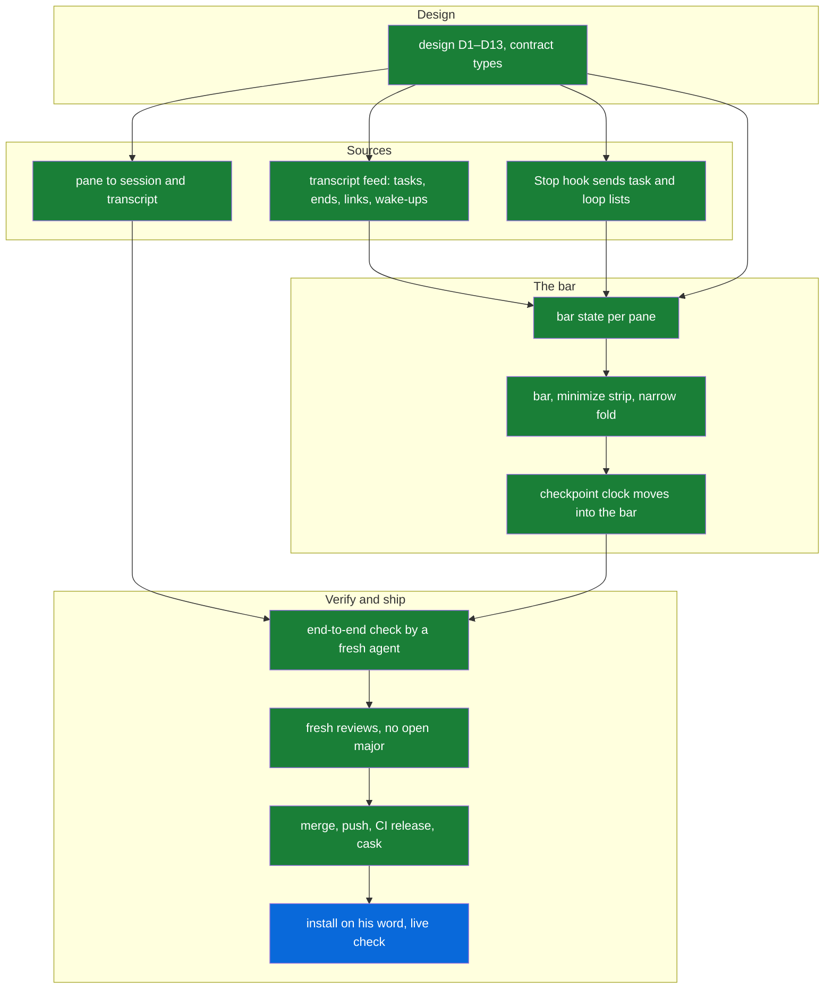

# Patton — The session bar

<!-- MAP:BEGIN -->
## 🗺 THE MAP — S60: a permanent session bar on the right of every Claude tab

**Goal:** (S60) A bar on the right of every Claude tab lists what the session has running (agents, shells, monitors, workflows), its loops, its failures, the links Claude gave him, and the checkpoint clock moved from the tab strip; a ⇥ button minimizes it to a strip (Michael 2026-11-22: "it has a bar on right that lists various things including background tasks ... atm theyre hidden at the bottom"; on sketch v3 https://claude.ai/code/artifact/08d6e409-4c7d-4f4e-8fe1-ceb84b75c586: "do it").
**Done when:** an end-to-end check written by an agent that didn't build drives a fake Claude session (a process with `~/.claude/sessions/<pid>.json` and a growing transcript under a temporary HOME) through the real Pane in hidden Electron and shows: a background shell's row within 1 s of its start line and struck through within 1 s of its notice and gone after its 30 s linger; a failed task's row kept until its × is pressed; a link written twice listed once, and a `v2` file replacing its `v1`; the checkpoint clock in the bar and not on the tab strip; ⇥ folding the bar to the strip and ⇤ restoring it; at UI scale 1, 1.1 and 1.5. Plus lint, `tsc`, `npm run check`, a no-install package and a fresh review with no open major; released by CI; installed only on his word.
**Last verified:** 2026-11-23 (Session 62 reality check: all 10 done nodes re-checked, every check script they name passes (`check-session-link.mjs` 24, `check-session-feed.mjs` 69, `check-hook-lists.mjs` 55, `check-session-bar-model.mjs` 81, `check-session-feed-robust.mjs` 29, `check-session-feed-ipc.mjs` 10, `check-session-bar-e2e.cjs` 57, `check-session-bar-layout.cjs` 102 in the full suite 54/54), shas and tags resolve; `bar_ship` stays live) [earlier: 2026-11-22, Session 60: built, checked, reviewed and released as v1.35.0 and v1.36.0; statuses checked against the tags and casks]

| ID | Task | Status | Depends on | Evidence |
|----|------|--------|------------|----------|
| `bar_design` | D1–D13 below; the contract types and IPC names in `src/shared/session-feed.ts` | done | — | `docs/session-bar.md` · `src/shared/session-feed.ts` |
| `session_link` | D8: main finds a pane's Claude process, its `~/.claude/sessions/<pid>.json`, and the transcript; re-resolves on `/clear` and resume; the Stop hook's `tp` as a fallback | done | `bar_design` | `src/main/session-link.ts`, `session-feed.ts`, `session-feed-ipc.ts` · `scripts/check-session-link.mjs` (live, temporary HOME), `check-session-feed-ipc.mjs` (reviewed in `bar_review`) |
| `transcript_feed` | D9: main tails the transcript and sends `SessionFeedEvent`s (task start and end, links, wake-ups, attach and detach) to the pane's renderer; pure parser with fixtures | done | `bar_design` | `src/main/transcript-parser.ts`, `transcript-tail.ts` · `scripts/check-session-feed.mjs` 26 over `scripts/fixtures/session-feed-lines.jsonl` · `e8de922`, `bbb3cae`, `f602ef2` (reviewed in `bar_review`) |
| `hook_lists` | D10: the Stop hook adds `tl`, `cl` and `tp`; the renderer parses them; probe cases and a size cap | done | `bar_design` | `5db181c`: `resources/claude-code-stop-hook.sh` sends `tl`/`cl`/`tp`; `scripts/check-hook-lists.mjs` 55; `probe-stop-hook.sh` 111 |
| `bar_model` | D3–D6: per-pane state merging 7501 children, the feed and the Stop lists; ended rows linger 30 s; failures until dismissed; links keyed and versioned; pure, with checks | done | `bar_design`, `transcript_feed`, `hook_lists` | `scripts/check-session-bar-model.mjs` 72 ok (a list the hook cut ends nothing), S60 |
| `bar_ui` | D1, D2, D11: the bar beside the terminal on Claude tabs, ⇥ and the strip, narrow fold, persisted per window, ARIA, `[BAR]` logs; layout check at UI scale 1, 1.1, 1.5 | done | `bar_model` | `check-session-bar-layout.cjs` 204 ok (68 a scale, with the dismiss-all lines; 165 before them, 55 a scale; 96 at S60, 32 a scale), on `0f4e3dd` every assertion that runs fails (51, the run stops at 17 a scale), S63 |
| `ckpt_move` | D7: the checkpoint clock and its button leave the tab strip for the bar and the strip; tabs keep the red circle | done | `bar_ui` | no `.tab-bar-checkpoint` (`scripts/check-session-bar-layout.cjs`, `scripts/check-tab-strip-dblclick.mjs`, `scripts/check-pause-all.mjs`, `scripts/check-ui-text-scale.cjs`: 13 tabs fit from 810 / 880 px), S60 |
| `bar_e2e` | D13's end-to-end check, written by an agent that didn't build; every assertion fails on main | done | `session_link`, `ckpt_move` | `scripts/check-session-bar-e2e.cjs` 57 ok, 0 not ok in `npm run check` on `feat/sb-barui` (real pty, session feed, TabManager and bar in hidden Electron, UI scale 1, 1.1, 1.5), S60 |
| `bar_review` | Fresh reviews with probes until no open major | done | `bar_e2e` | three fresh reviews with probes: 0 major / 6 minor, fixed in `41ff187`, `7e3b2f6`, `4520173`; then 0 major; then the final one, 0 major / 3 minor (a stale `tp` hint re-attaching an exited session, a transcript swapped for a symlink, a refused Checkpoint click invisible on the strip) plus 2 nits, fixed in `5f8ab6d` with assertions failing before (`scripts/check-session-feed-robust.mjs` 29 ok, `check-session-bar-layout.cjs` 102 ok); `scripts/probe-stop-hook.sh` 111 ok |
| `bar_release` | Merge by fast-forward, push, CI release, cask matches the DMG | done | `bar_review` | v1.35.0 tag at `ce48413`, cask `1300f5ac…` matches the DMG; the final fixes, bookmarks and sound as v1.36.0 at `613f9a8`, cask `31e8b956…` matches |
| `bar_ship` | Install on his word with Patton quit; live: `[BAR] attach` lines, a shell row appears and goes, a link listed, the clock in the bar | live | `bar_release` | S60: released, not installed (/Applications v1.33.0); waits on his word with Patton quit. **S62:** unchanged: /Applications still reports 1.33.0 (asar 20 Nov 16:24:11), which predates the bar, and main.log has 0 `[BAR]` lines (v1.35.0's `[BAR] attach` is in `src/main/session-feed.ts`) |
<!-- MAP:END -->

## Design (settled with Michael, 22 Nov 2026, sketch v3)

His choices: permanent, with a minimize button, not a shortcut ("not a shortcut, a button with minimize, i hate hvaing to remember"); Running, Scheduled, Failures, Links and the checkpoint; no checklist (0 of his 61 sessions in four days kept one) and no changes ("i dont think changes is helpful"); links "should replace if newer version of a link are shared"; "failures or issues is a good idea"; "move the checkpoint button into this out of top bar"; shells live (yes to a hook; see D10 for why none is needed). Everything else below is method.

- **D1. Where.** One bar per window, on the right of the tab content, below the tab strip, shown while the active tab's focused pane runs Claude Code (7501 `app=claude-code`, else the Claude title fallback); hidden for a plain shell, the board and `wake`. Width 248 px × the UI text scale; ink hairline on its left; Patton's UI font and tokens. Header "Session" (plus the pane's project name when the tab holds more than one Claude pane) and a ⇥ button (`aria-label` "Minimize the session bar"). The terminal fits in what is left, through `fitGrid` only. Switching tabs never resizes a terminal that was already fitted with the same bar state.
- **D2. Minimized.** ⇥ folds the bar to a strip 26 px × the UI scale: a ⇤ button (`aria-label` "Open the session bar"), the running count, the failure count (only while above 0, as "!N" in the failure red; none when 0), and a small checkpoint button whose tooltip carries the context %. The choice is per window, kept across relaunch with the window's state, and changed only by those two buttons. When the terminal would be under 80 columns with the bar open, the bar shows minimized without changing the saved choice.
- **D3. Running.** Rows: kind (Agent, Workflow, Teammate, Cloud, Shell, Monitor), description (up to 3 lines, then an ellipsis, in the UI font for every kind of row; the full text and a shell's command in the tooltip and accessible name), age ("40 s", "6 min", "3 h 34", tabular; refreshed every 10 s). Over an hour: the accent colour. Oldest first. An ended row stays 30 s struck through, then goes. Sources: agents, workflows, teammates and cloud sessions from 7501 child records (live, already parsed); shells and monitors from the transcript feed (D9), reconciled at every Stop with the hook's list (D10): an id missing from the list ends, an unknown listed id is added from the list's own fields. Without a transcript, the Stop list alone.
- **D4. Scheduled.** Loops and crons from the Stop hook's `cl` (id, schedule, recurring, prompt): kind "Loop" or "Cron", the prompt cut to 60 characters, and the next fire time (HH:MM, local) from the 5-field schedule; one that doesn't parse shows the schedule itself. One-off wake-ups from the transcript's ScheduleWakeup calls (D9), dropped once their time passes; if `cl` also lists them, one row.
- **D5. Failures.** A row when a background task's notice reports it failed or was killed (with the exit code when given), or when 7501's root record reports `error` (its `msg`). Kind, description or message, time, and a × button (`aria-label` "Dismiss"). Kept until dismissed; at most 10 per pane, oldest dropped. Not kept across relaunch.
- **D6. Links.** Taken from Claude's own text in the transcript (assistant messages only): claude.ai artifact URLs, Google Docs, Sheets and Drive URLs, GitHub release and pull-request URLs, and absolute or `~` paths under `~/Downloads` ending in .docx, .pdf, .xlsx, .pptx, .csv, .html or .png. Label: the markdown link text when there is one; else, for a page, "Page" and the id's first 8 characters; for a file, its name. A URL is keyed by itself (trailing punctuation stripped): shared again, its row moves to the top with the new time. A file is keyed by its name, lower-cased, with version marks removed (` v2`, `-v3`, `_v4`, ` (2)`) and its extension kept: a newer one replaces the older row. Newest first, at most 8. A click opens it through `link-open-policy` (main), never directly.
  - *Page titles (22 Nov 2026):* a page link with only the made-up "Page <id start>" label shows the page's own `<title>` once main has learned it (from the published file, else the Artifact call's `input.title`; `src/main/page-titles.ts`, read in the renderer through `services/page-titles.ts`); a markdown label Claude gave still wins. The same titles name artifact bookmarks with an automatic name (one typed as exactly "Artifact <id start>" counts as automatic and shows the title). Where it lives and its checks: `docs/reference/key-files.md`, Page titles.
  - Word, Excel and PowerPoint files (.docx, .xlsx, .pptx) now open in their default app through `link-open-policy`; the macro-enabled variants (.docm, .xlsm, .pptm) are only revealed in Finder, never opened.
- **D7. Checkpoint.** The tab strip's checkpoint clock (`CheckpointView`; its click runs /checkpoint in the focused pane with its skip rules) leaves the tab strip and becomes the bar's last section: the %, "context · last <age> ago", and a "Checkpoint" button with the clock's handler. The minimized strip keeps a small checkpoint button. Tabs keep the red finished-checkpoint circle.
- **D8. Session link (main).** For a pane's pty, find the Claude process among the shell's descendants whose pid has `~/.claude/sessions/<pid>.json`; read `sessionId`; the transcript is the one `~/.claude/projects/*/<sessionId>.jsonl` (realpath inside `~/.claude/projects`). Resolve when 7501 first reports `app=claude-code` for the pane, every 10 s while unresolved, and when the sessions file's `sessionId` changes (`/clear`, resume). The Stop hook's `tp` (D10) is accepted when it passes the same path checks and nothing else resolved. Logs `[BAR] attach {pane, how}` and `detach`.
- **D9. Transcript feed (main).** At attach, read the last 2 MB to find tasks already running (the next Stop reconciles them), then follow the file (fs.watch plus a 1 s size poll), parsing whole JSONL lines only. It sends `SessionFeedEvent`s (`src/shared/session-feed.ts`) to the pane's renderer: a background start when a tool result names the background id (shell, monitor, agent), an end when a task notice names the id and status, links from assistant text, wake-ups from ScheduleWakeup calls. All text is untrusted: control characters stripped, lengths capped, never more than the extracted fields sent. The exact line shapes are read from real transcripts on this Mac (structure and counts only, never content) and pinned in fixtures with made-up content. Built (S60): the shapes are listed in `src/main/transcript-parser.ts`'s header; a notice is written up to three times (a `queue-operation` enqueue, a `queued_command` attachment, a user line) and ends its id once; a notice for an id this transcript never started is dropped, because a subagent's own shells notify the parent's queue (939 of 2005 ends in 60 recent transcripts here).
- **D10. Hooks.** The Stop hook adds `tl` (base64 JSON of the running, non-ambient tasks: id, type, description cut to 80), `cl` (base64 JSON of `session_crons`: id, schedule, recurring, prompt cut to 80) and `tp` (base64 of `transcript_path`), keeping the whole sequence within the length Claude Code passes on (read in its code; the lists are cut, never the sequence). No second hook: the transcript records a background start the moment Claude Code gets the tool's result, so the feed shows a shell within a second without the PostToolUse hook Michael agreed to; it stays the fallback if the feed proves slower live.
- **D11. Logs.** `[BAR] attach / detach`, `[BAR] rows {pane, running, failures, links}` at most once a minute per pane, `[BAR] link {pane, kind}`, `[BAR] failure {pane, kind}`, `[BAR] failures dismissed {pane, count}`, `[BAR] minimize {state, reason}`, `[BAR] feed error {pane, why}`, all through `rlog()` or main's logger.
- **D12. Threat model.** Read-only on his own files; every path realpath-checked inside `~/.claude`; no network; transcript text shown only as text (the `shown-text` rules); links open only through `link-open-policy`, so nothing executable runs from a click.
- **D13. Checks.** Parser fixtures (lines → events); model checks (merge, reconcile, linger, failures, link keys and versions); hook probe cases (lists, cuts, size); a hidden-Electron layout check (bar width and terminal columns at UI scale 1, 1.1, 1.5; ⇥ and ⇤; narrow fold; no clock on the strip); and the end-to-end check in the map's bar, written by an agent that didn't build. Every new assertion fails on main.

**Changes after release (24 Nov 2026, S63).** (a) D3: row text was one line with a monospace font for Shell rows; Michael, from a screenshot of the Running section: "why are fonts different here and i cant mouse over to actually read what they are, i think should have up to 3 lines wrapped per thing so can read". Every row's text (Running, Scheduled, Failures, Links) is now the UI font and wraps to at most 3 lines (`-webkit-line-clamp: 3`); the kind and time stay on the first line. (b) D2: the folded strip showed two bare boxes ("2", "0"); Michael: "when i minimize rhs what does the 2nd number refer to". The failures box is now hidden at 0 and reads "!N" in the failure colour above 0. (c) After a fresh review: the kind column is 66 px × the scale ("Workflow", "Teammate" were cut to "WORKF…"); a link's tooltip is its label, then its address on a second line; a Failures row starts with its reason ("exit 137: npm run build"), so the clamp never cuts it; the time column is capped at 52 px × the scale and wraps (a long schedule, an older "21 Nov 08:05"), so the text keeps at least 70 px × the scale; an age tick patches each row's time in place instead of rebuilding the rows, so a tooltip being read stays.

**Change after release (24 Nov 2026, S63): dismiss all failures.** D5: Michael, from a screenshot of the Failures section with seven rows, each with its own ×, under "FAILURES 7": "we need a button to dimiss all failures, the x but at top level". The Failures header now carries a × beside the count (`aria-label` and title "Dismiss all failures", the row ×'s glyph and look, a focus ring, in the tab order), shown only while the section is. It empties the pane's list through `SessionBarModel.dismissAllFailures()` (the same list `dismissFailure` filters, one change, so a dismissed failure stays dismissed the same way and the folded strip's "!N" box hides at 0), logs `[BAR] failures dismissed {pane, count}` once per click, and, when the × had the keyboard, moves it to the next section's first button, else to ⇥. Checks: `scripts/check-session-bar-model.mjs` (dismiss all) and `scripts/check-session-bar-layout.cjs` ("dismiss all" lines).
