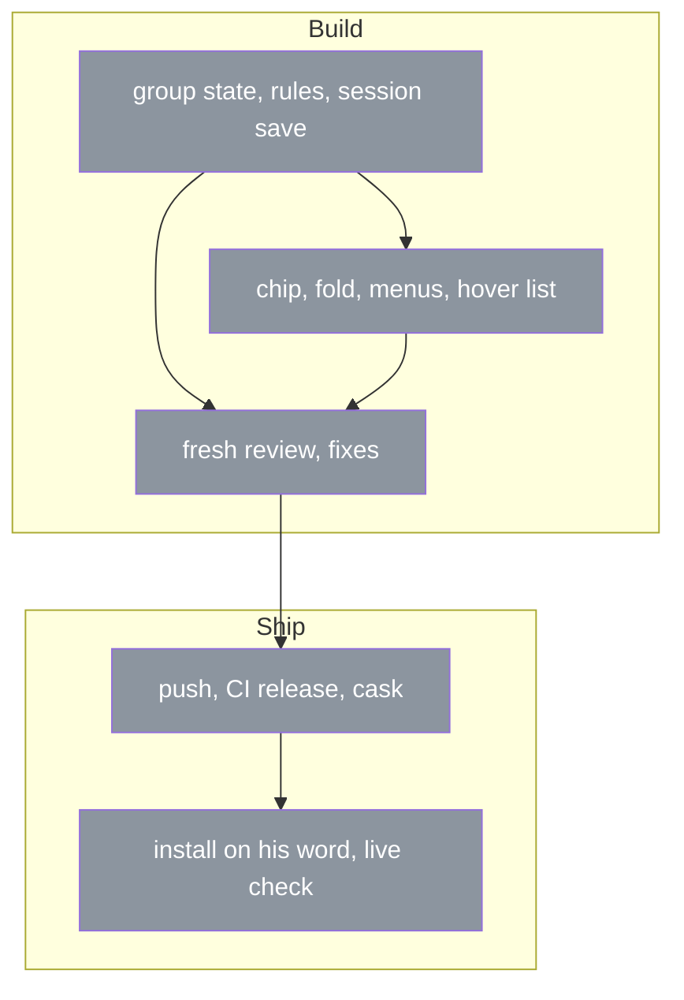

# Patton — Tab groups

<!-- MAP:BEGIN -->
## 🗺 THE MAP — S55: tab groups

**Goal:** Chrome-style tab groups on Patton's strip, drawn in ink, as the approved sketch shows (https://claude.ai/code/artifact/d5a87c0f-a03e-413a-8001-dcf6d6490b08). Michael 2026-11-19: "Could we put in place something like Google Chrome's tab groups, so you can then group some of the tabs and minimize the group or something?", "and name group"; on the sketch: "yes", "ink".
**Done when:** a jsdom check on the real TabBar and TabManager proves making, naming and folding a group (the folded chip shows its tab count and strongest dot), unfolding on any jump to a hidden tab, the selection leaving a group as it folds, Close Group, `wake` moving its whole group, and groups restored after a session save, with every new check failing on the old code; lint, `tsc`, `npm run check`, a no-install package and a fresh review with no open major pass; CI releases it with the cask matching the DMG; then it is installed on Michael's word and seen live (`[GROUP]` lines in main.log).
**Last verified:** —

| ID | Task | Status | Depends on | Evidence |
|----|------|--------|------------|----------|
| `groups_model` | A tab may belong to one group per window (id, name up to 60 characters, folded or not); a group's tabs are always one unbroken run; the pure rules (place after a group, take out, repair a broken run, strongest state, nearest visible tab) live in one service; groups, names and fold state ride the session save and come back on restore, broken runs repaired, a folded group holding the restored active tab unfolded, bad group data dropped by main without losing the session | todo | — | — |
| `groups_strip` | On the strip: a grey chip with the name in ink left of its tabs, a 2 px ink line along the top of the chip and its tabs; click folds and unfolds (folded: count and the strongest dot of its tabs, red checkpoint, green, flag, ring); hover or keyboard focus on a folded chip lists its tabs with their dots, a row opens that tab; tab menu gains Add Tab to New Group (name box opens on the chip), Add to <group>, Remove from Group; chip menu Rename Group…, Fold/Unfold Group, New Tab in Group, Ungroup, Close Group… (asks in the app, names the Claude sessions that end); folding the group holding the selected tab moves to the nearest visible tab, a new tab if none; any jump into a folded group unfolds it; ⌘⇧] / ⌘⇧[ skip folded tabs, ⌘1–9 count visible tabs; a drag drop takes the target tab's group; `wake` moves its whole group to the far left; `[GROUP]` log lines | todo | `groups_model` | — |
| `groups_review` | Fresh review with probes that never saw the build; every major and minor fixed by a fresh builder; checks re-run | todo | `groups_model`, `groups_strip` | — |
| `groups_release` | ff-merge to main, push (no stray no-release marker on the head), CI release green, cask sha matches the downloaded DMG | todo | `groups_review` | — |
| `groups_ship` | Install on Michael's word with Patton quit; live: a group made and named, folded with a dot on its chip, unfolded by a jump, back after a relaunch (`[GROUP]` lines in main.log) | todo | `groups_release` | — |
<!-- MAP:END -->

## Journal

### 2026-11-19 (Session 55)
- Michael asked for Chrome-style tab groups, named and foldable. Sketch published (the link in Goal); he approved it as drawn, in ink rather than colours. The four rules marked "my call" on the sketch stand: a green tab in a folded group pulses the chip without unfolding it, ⌘1–9 count visible tabs only, Close Group asks first, `wake` moves its whole group.
- Split from the main map in `docs/NEXT_STEPS.md`: with these five nodes it would pass the 40-node hard cap; the pointer node there is `tab_groups`.
