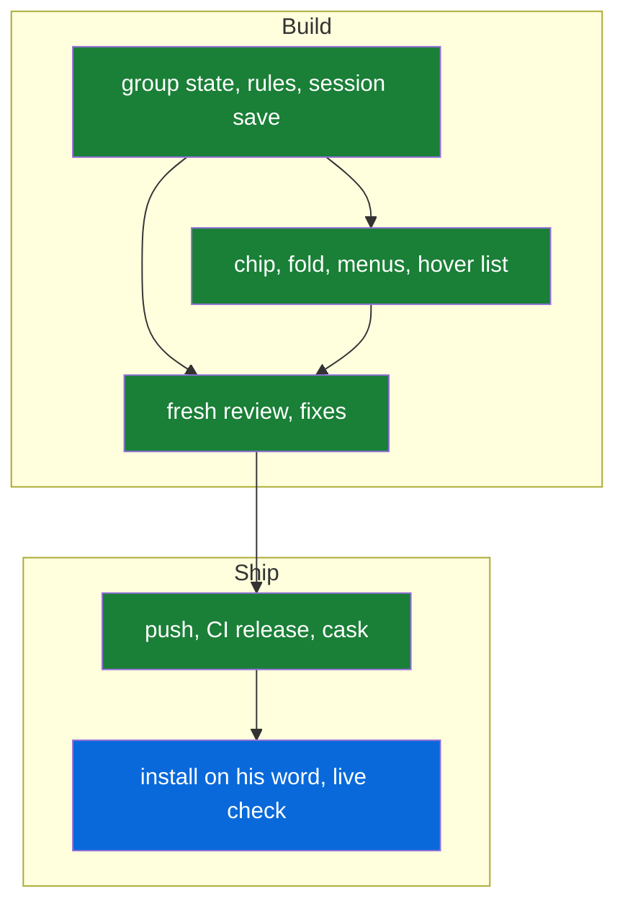

# Patton — Tab groups

<!-- MAP:BEGIN -->
## 🗺 THE MAP — S55: tab groups

**Goal:** Chrome-style tab groups on Patton's strip, drawn in ink as the approved sketch shows (since 22 Nov 2026 each group also takes a very light shade, see the Log) (https://claude.ai/code/artifact/d5a87c0f-a03e-413a-8001-dcf6d6490b08). Michael 2026-11-19: "Could we put in place something like Google Chrome's tab groups, so you can then group some of the tabs and minimize the group or something?", "and name group"; on the sketch: "yes", "ink".
**Done when:** a jsdom check on the real TabBar and TabManager proves making, naming and folding a group (the folded chip shows its tab count and strongest dot), unfolding on any jump to a hidden tab, the selection leaving a group as it folds, Close Group, `wake` moving its whole group, and groups restored after a session save, with every new check failing on the old code; lint, `tsc`, `npm run check`, a no-install package and a fresh review with no open major pass; CI releases it with the cask matching the DMG; then it is installed on Michael's word and seen live (`[GROUP]` lines in main.log).
**Last verified:** 2026-11-23 (Session 62 reality check: 4 done nodes re-checked, `check-tab-groups.mjs` 187 and `check-tab-groups-strip.mjs` 127 pass, tags and shas resolve; `groups_ship` stays live, now with 13 `[GROUP]` lines read from main.log) [earlier: 2026-11-19 12:52, Session 55: build, checks and reviews this session]

| ID | Task | Status | Depends on | Evidence |
|----|------|--------|------------|----------|
| `groups_model` | A tab may belong to one group per window (id, name up to 60 characters, folded or not); a group's tabs are always one unbroken run; the pure rules (place after a group, take out, repair a broken run, strongest state, nearest visible tab) live in one service; groups, names and fold state ride the session save and come back on restore, broken runs repaired, a folded group holding the restored active tab unfolded, bad group data dropped by main without losing the session | done | — | `src/renderer/services/tab-groups.ts`, `src/main/session-groups.ts`, `src/shared/tab-group-limits.ts`, group parts of `tab-manager.ts` · `e36f4f1`, `5c102b2`, `b5564f5` · `scripts/check-tab-groups.mjs` (187 checks; 17 of 18 planted mutations caught, the 18th behaves the same) |
| `groups_strip` | On the strip: a chip with the name in ink left of its tabs, filled in its group's very light shade (blue, green, sand in turn; 22 Nov 2026, was a grey chip with a 2 px ink line), with a 6 px line (`--group-line-w`; 2 px until 27 Nov 2026) in the shade's colour along the top of the chip and its tabs; click folds and unfolds (folded: count and the strongest dot of its tabs, red checkpoint, green, flag, ring); hover or keyboard focus on a folded chip lists its tabs with their dots, a row opens that tab; tab menu gains Add Tab to New Group (name box opens on the chip), Add to <group>, Remove from Group; chip menu Rename Group…, Fold/Unfold Group, New Tab in Group, Ungroup, Close Group… (asks in the app, names the Claude sessions that end); folding the group holding the selected tab moves to the nearest visible tab, a new tab if none; any jump into a folded group unfolds it; ⌘⇧] / ⌘⇧[ skip folded tabs, ⌘1–9 count visible tabs; a drag drop lands in the slot under the pointer and takes that slot's group (24 Nov 2026, Journal); `wake` moves its whole group to the far left; `[GROUP]` log lines | done | `groups_model` | `src/renderer/components/tab-bar.ts`, `styles/tabs.css` · `e36f4f1`, `ad4cb19`, `2001a64`, `77073ee`, `1cb8090`, `73487d4`, `7f092d8`, `58ec6eb` · `scripts/check-tab-groups-strip.mjs` (all fail on base `86978f8`), chip lines in `scripts/check-ui-text-scale.cjs` (27 measures, 15 fail with the group CSS removed, the rest are layout the browser gives) |
| `groups_review` | Fresh review with probes that never saw the build; every major and minor fixed by a fresh builder; checks re-run | done | `groups_model`, `groups_strip` | review 1 (code read): 0 major, 4 minor, 3 nit; fixes `b5564f5`…`73487d4`, two claims false (checks `9298023`); review 2 (probes, incl. a 95,472-case property test of the one-step move): 0 major, 1 minor (a drop from another window, older than groups) fixed `7f092d8`, nit `58ec6eb`; `npm run check` 28/28, lint, tsc, no-install asar 2026-11-19 12:51:42, /Applications untouched (13 Nov 09:29:50) |
| `groups_release` | ff-merge to main, push (no stray no-release marker on the head), CI release green, cask sha matches the downloaded DMG | done | `groups_review` | pushed `6a31a51` (no marker on the head), run 44527919306 green, tag `v1.30.0`, cask 1.30.0 sha `84fbe52e…` matches the downloaded DMG; /Applications still 1.26.1 |
| `groups_ship` | Install on Michael's word with Patton quit; live: a group made and named, folded with a dot on its chip, unfolded by a jump, back after a relaunch (`[GROUP]` lines in main.log) | live | `groups_release` | **S57 (20 Nov 11:55):** installed with v1.31.0 from its tag, Patton quit: /Applications reports 1.31.0, codesign ok, `[GROUP]` in the installed bundle. **S62 (main.log 20 Nov 16:32 → 23 Nov 20:50, one launch of v1.33.0; this replaces S60's "0 lines"):** 13 `[GROUP]` lines from 22 Nov 19:38: `created` 2, `tab added` 1, `named` 2, `folded` 2, `unfolded` 2 (reason `click`), `tab moved between groups` 3 (by reorder), `emptied` 1. So a group made, named, folded and unfolded by a click is seen. Still unseen: back after a relaunch (`[GROUP] restored` 0 lines, because no relaunch since 20 Nov 16:32), an unfold by a jump to a hidden tab (every `unfolded` reason is `click`), the dot on a folded chip (not logged). The light shades (v1.37.0) are not in the installed build. |
<!-- MAP:END -->

## Journal

### 2026-11-19 (Session 55)
- Michael asked for Chrome-style tab groups, named and foldable. Sketch published (the link in Goal); he approved it as drawn, in ink rather than colours. The four rules marked "my call" on the sketch stand: a green tab in a folded group pulses the chip without unfolding it, ⌘1–9 count visible tabs only, Close Group asks first, `wake` moves its whole group.
- Split from the main map in `docs/NEXT_STEPS.md`: with these five nodes it would pass the 40-node hard cap; the pointer node there is `tab_groups`.
- Built by a builder agent (out of context after the code), checks by two fresh agents (no bugs in the manager; two in the strip, fixed), chip measured at x1, x1.1, x1.5; two fresh reviews, each cut off by its context before finishing, together covered the code, the fixes and the remaining probes; 0 majors. Move Left / Move Right now take one step (into or out of a group, or past a folded one); ⌘W never confirms Close Group; the palette numbers tabs as ⌘1–9 do.

### 2026-11-22 (group shades)
- Decision: groups are told apart by a very light shade, no longer "ink only". Michael on the old look: "there should be slightly different shading ... so you can see which group each of them is in. At the moment, it's not super clear where outreach ends and where [Patton] begins ... very mild, very light coloring"; he picked option B (pale blue, green, sand) on the shades page (https://claude.ai/code/artifact/80e4187e-da0c-4482-90d9-46ac54ea1c36). A group's shade is its place among the groups on the strip, cycling after three (a fourth repeats the first, so closing a group moves the later ones up): its chip's fill, its inactive tabs' fill, and the line on top of both (6 px since 27 Nov 2026, below), from `--group1..3-tab/-chip/-line` in `main.css` (light in `:root`, dark in the dark block). Ungrouped tabs are unchanged; the selected tab stays `--bg` with its 3 px ink bar and takes only its group's line; hover moves a tab's fill 18% and a chip's 25% toward the line colour. Ink is 13.6:1 or better in light and 7.7:1 or better in dark (the hovered dark chip is the lowest) on every fill, hover and the selected tab's `--bg`; the chip's secondary lettering (count, chevron, unnamed name) is `--muted` half way to ink because `--muted` alone fell to 4.06:1 on the dark green chip (5.2:1 or better now); an inactive tab's `--muted` title is 5.6:1 (light) and 5.2:1 (dark) or better. The drop line on a chip or grouped tab is `--focus`, not `--accent`, which was 2.2 to 2.9:1 on the dark chips (now 4.0:1 or better, 3.1:1 or better in light). Checks: shade classes, tokens and contrast (ink and secondary text 4.5:1, status dots, flags, ring and drop line 3:1, read from the real tokens, both schemes) in `scripts/check-tab-groups-strip.mjs`; painted fills, lines, lettering, drop line and a really hovered tab, chip and selected tab, in light and in dark (the hidden window's `nativeTheme` switched), in `scripts/check-ui-text-scale.cjs`.

### 2026-11-24 (drop into a slot, a group's right edge joins it)
- Decision, from his words at 21:33: "in Google Chrome, you can drag a tab to the edge of the tab group, and it will include it, whereas in this, that doesn't work. You have to drag it into the middle of it." A dropped tab no longer takes the target tab's slot and group; it lands in a slot between tabs, as in Chrome. One pure function, `dropPlacement` (`services/tab-groups.ts`), decides; `TabManager.dropTabs` applies it (`[GROUP] drop` log) and `showDropCue` in `components/tab-bar.ts` draws it from the same function.
- The rule: the pointer over the left half of a visible tab means before it, the right half after it. Over a grouped tab: that group. The slot directly after an open group's last visible tab (the left half of the ungrouped tab touching its right edge) joins that group, at its end. Any other slot: ungrouped. The space left of a chip is outside the group. A drop on a chip's right half joins as before (after the group's last tab); its left half is outside (25 Nov). A folded group's hidden tabs are no slots, and the slot after a folded chip joins nothing. Between two adjacent groups, and before a group at the strip's start, there is no ungrouped TAB to point at, so the chip has two halves (25 Nov, journal below): the left half is the slot just before the group, outside every group; the right half joins it. A tab also leaves its group by Remove from Group, the end drop, or a slot beside an ungrouped tab that is not a group's right edge. A multi-select moves together as one block; every group stays one unbroken run. A drop that changes nothing does nothing.
- The cue: a 2 px line at the slot (the tab's height, on the edge of the tab under the pointer, `.drop-before` / `.drop-after`), `--focus` blue when the drop joins a group and `--ink` when it does not, and the joining group's chip marked (`.drag-over`). The group's own line colour was tried first and dropped: 1.52:1 against its fill in light mode (2.13:1 dark); `--focus` is 3:1 or better on every group fill in both themes, and a shade check fails below 3:1. `reorder`, `moveTabsTo` and `moveBlockTo` are gone.
- Checks: `scripts/check-tab-groups.mjs` (rule), `check-tab-groups-strip.mjs` (cue, colours, contrast), `check-tab-select.mjs` (multi-select drops), `check-ui-text-scale.cjs` (the line at x1, x1.1, x1.5).

### 2026-11-25 (the chip's left half is outside the group)
- Michael: "Wake is currently inside the low group. I'm trying to drag it to the left of the low group so that it's outside it but on the far left, but it just won't work. It just won't move it." Cause: the 24 Nov rule said the space left of a chip is outside the group, but at the strip's start (and between two touching groups) the pointer there is over the chip, a drop on a chip is "join that group", and `dropPlacement` returned nothing when every dragged tab was already in it. A group's first tab could never be dragged out to its left.
- The rule now: a chip has two halves, as a tab does (`TabBar.halfOf`). The left half is the slot just before that group, outside every group, whether the group is open or folded (`dropPlacement` over `{ kind: 'chip', groupId, half: 'left' }`, `why: 'before-group'`, logged in `[GROUP] drop`): the moving tabs, as one block in strip order, are put at the place of the group's first remaining member, group none, through `insertBlock`, so every group stays one unbroken run; when every member moves, the block keeps its own place. A drop that changes nothing (an ungrouped tab already just left of the chip) does nothing. The right half is unchanged: join, after the group's last tab. A tab that leaves is announced "<tab> moved out of <group>".
- The cue: the 2 px `--ink` line (it joins none) on the chip's left edge (`.tab-bar-group-chip.drop-before`), the chip not marked `.drag-over`; the right half marks the chip as before. The mark (`.tab-bar-group-chip.drag-over`) is the chip's top line plus a `--focus` bar along its bottom, with nothing in its left column, so at the strip's start it cannot be read as the chip-left line (25 Nov review; it was a `--focus` bar at the left). The wake tab: `moveWakeTabFirst` moves its group once per run, so a drop out of the group afterwards sticks (checked).
- Checks: `scripts/check-tab-groups.mjs` (the rule: his case, a middle tab, every member, between two groups, a folded group, a selection, no-ops, every group x every block of up to 3 tabs; the real TabManager with its announcement and `[GROUP] drop` line; wake; a real strip), `check-tab-groups-strip.mjs` (cue colour and place, no chip mark, the half delivered to `onDropTabs`, the drop, the CSS), `check-tab-select.mjs` (a selection on the left half).

### 2026-11-27 (the group's top line is 6 px)
- Decision: the coloured line along the top of a group's chip and tabs goes from 2 px to 6 px. Michael: "can we make colour bar at top thicker of group, its v hard to distinguish groups". He picked B ("1 ok") from four candidates drawn with the real CSS (https://mjy-pages.vercel.app/p/patton-group-lines/: Today 2 px, A 4 px, B 6 px, C 4 px in a deeper colour).
- The width is `--group-line-w: 6px` in `tabs.css`, beside the group shade rules, and all eight rules that draw a group's top line read it (the chip, the chip as a drop target, a group's tab, its selected tab, the two close-button rules, the multi-selected group tab and its close button), so the next change is one line. Fixed, not scaled with Interface Text Size, as in the render he picked. The colour (`--g-line`) is unchanged; the fills, the selected tab's 3 px ink bar, ungrouped tabs and the 2 px drop line are unchanged too. The line is an inset shadow, so nothing moves: the labels sit below it at every scale (measured at 0.9 to 1.5).
- Checks: `scripts/check-tab-groups-strip.mjs` (one definition, all eight rules use it, none a fixed px); `scripts/check-ui-text-scale.cjs` (painted 6 px line on the chip, a group tab, the selected one with its 3 px bar, a multi-selected one and a folded chip; none on an ungrouped tab; labels clear below the line and centred). Mutation-tested: one rule set back to 2 px fails both.
